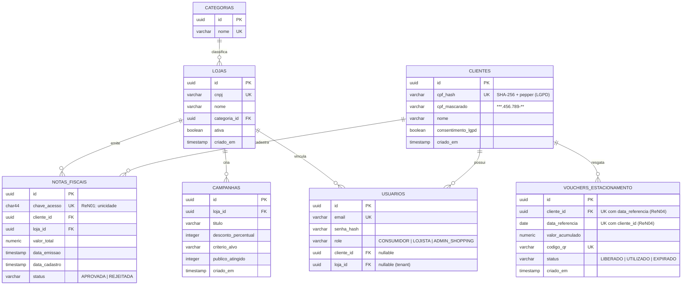

# 🏗️ Arquitetura, Modelagem de Domínio e ADRs — Shopping Analytics & Loyalty Hub

> **Objetivo:** Consolidar as decisões de arquitetura, modelo de dados (DER), contratos iniciais de API REST e *Architecture Decision Records (ADRs)* definidos na fase de planejamento e validação do MVP.

---

## 1. Arquitetura Lógica: Monólito Modular

O backend em **Java 21 LTS + Spring Boot 3.x** será estruturado como um **Monólito Modular** organizado por contextos de negócio (*Bounded Contexts*), aplicando **Clean Architecture** e **SOLID**:

* **`fiscal`**: Ingestão de NFC-e, validação de unicidade (ReN01), prazo de 72h (ReN02), consulta ao gateway fiscal (`ConsultaNotaFiscalGateway`) e publicação de eventos de domínio (`NotaFiscalValidadaEvent`).
* **`beneficios`**: Escuta eventos de notas aprovadas, calcula o acúmulo diário do consumidor (ReN03) e emite o `VoucherEstacionamento` garantindo a trava de 1 resgate/dia (ReN04).
* **`analytics`**: Consolida métricas de Ticket Médio, horários de pico, afinidade entre categorias (*Cross-Shopping*), gestão de campanhas e aplica a trava de privacidade *K-Anonymity* ($k \ge 3$ lojistas ativos por categoria — ReN05).
* **`auth` / `shared`**: Autenticação stateless com **Spring Security + JWT**, controle de acesso por perfil (`CONSUMIDOR`, `LOJISTA`, `ADMIN_SHOPPING`) e isolamento lógico *multi-tenant* por `loja_id`.

### Inversão de Dependência no Gateway Fiscal (DIP — SOLID)
A camada de domínio/aplicação do módulo `fiscal` depende exclusivamente da abstração `ConsultaNotaFiscalGateway`.
* **No MVP:** A implementação `MockSefazGateway` interpreta chaves de 44 dígitos determinísticas/simuladas para demonstrar tanto cenários válidos (acúmulo até R$ 150,00) quanto cenários de rejeição (nota duplicada, emissão > 72h, CNPJ não credenciado).
* **Na v2:** Uma implementação `SefazRealGateway` substitui o mock sem alterar nenhuma regra de negócio.

---

## 2. Modelagem de Dados (DER — PostgreSQL)

### Garantias de Integridade no Banco (Flyway)
1. **Unicidade Fiscal (ReN01):** `notas_fiscais.chave_acesso` possui restrição `UNIQUE` (`CHAR(44)`).
2. **Limite Diário Atômico (ReN04):** `vouchers_estacionamento` possui chave única composta `UNIQUE (cliente_id, data_referencia)`, impedindo emissão duplicada mesmo sob requisições concorrentes (*Virtual Threads* / cliques duplos).
3. **LGPD por Design:** `clientes` nunca armazena o CPF em texto claro — apenas `cpf_hash` (para busca e deduplicação) e `cpf_mascarado` (para exibição na UI).

---

## 3. Contratos Iniciais da API REST (MVP — 3 Telas)

| Módulo | Método & Endpoint | Perfil | Finalidade no MVP |
| :--- | :--- | :--- | :--- |
| **Auth** | `POST /api/v1/auth/login` | Público | Autentica usuário seedado e retorna JWT com `role` e `lojaId`/`clienteId`. |
| **Fiscal** | `POST /api/v1/notas` | `CONSUMIDOR` | Recebe chave de 44 dígitos (ou payload do simulador QR), valida ReN01–ReN03 e dispara evento. |
| **Benefícios** | `GET /api/v1/beneficios/estacionamento/hoje` | `CONSUMIDOR` | Retorna valor acumulado hoje, percentual da meta (R$ 150) e voucher/QR Code se liberado. |
| **Analytics** | `GET /api/v1/analytics/lojista/dashboard` | `LOJISTA` | Retorna Ticket Médio da loja, média da categoria (se $k \ge 3$), horários de pico e cross-shopping. |
| **Campanhas** | `POST /api/v1/campanhas` | `LOJISTA` | Registra campanha direcionada (botão 1 clique da Tela 2) e retorna público estimado atingido. |
| **Analytics** | `GET /api/v1/analytics/shopping/dashboard` | `ADMIN_SHOPPING` | Retorna faturamento total capturado, distribuição por setor, mapa horário e total de vouchers/campanhas. |

---

## 4. Architecture Decision Records (ADRs)

### ADR-01: Monólito Modular em vez de Microsserviços
* **Contexto:** Prazo de 2 dias para MVP funcional com 3 telas, equipe enxuta e necessidade de manter código limpo e escalável.
* **Decisão:** Adotar Monólito Modular em Java 21 / Spring Boot 3 com separação lógica por pacotes e eventos internos (`ApplicationEventPublisher`).
* **Consequência:** Zero overhead de rede/orquestração agora, preservando fronteiras claras caso algum módulo precise virar microsserviço no futuro.

### ADR-02: Armazenamento de `cpf_hash` + `cpf_mascarado` (LGPD)
* **Contexto:** RNF04 exige proteção rigorosa de dados pessoais (CPF), mas o domínio exige agrupar compras do cliente e limitar 1 voucher/dia por CPF.
* **Decisão:** Armazenar hash determinístico SHA-256 com *pepper* configurado via variável de ambiente (`cpf_hash`) e máscara para exibição (`cpf_mascarado`).
* **Consequência:** Conformidade imediata com LGPD e *Privacy by Design* sem comprometer chaves únicas e consultas rápidas no PostgreSQL.

### ADR-03: Adiamento da tabela `itens_nota` para a v2 (YAGNI)
* **Contexto:** A NFC-e real contém lista granular de produtos (SKU/NCM), mas nenhuma das 3 telas do MVP exibe detalhamento por produto — todas operam sobre loja, categoria e valor total da nota.
* **Decisão:** Manter apenas `notas_fiscais` na Fase 1 e introduzir `itens_nota` na v2 junto à integração real da SEFAZ.
* **Consequência:** Entrega mais rápida e banco enxuto sem impactar o valor demonstrado na demo.

### ADR-04: `MockSefazGateway` atrás de Interface (DIP) + Cenários de Erro
* **Contexto:** Integração real com SEFAZ exige certificado digital e está fora do prazo de 2 dias.
* **Decisão:** Implementar `MockSefazGateway` sob `ConsultaNotaFiscalGateway` aceitando chaves de teste determinísticas (válidas, > 72h, loja não credenciada).
* **Consequência:** Demonstração ao vivo 100% confiável de todos os fluxos (sucesso e validações ReN01–ReN03) sem acoplar o código de domínio.

### ADR-05: JWT com Usuários Seedados e Acesso Rápido na UI
* **Contexto:** Construir fluxo completo de cadastro, verificação de e-mail e recuperação de senha consumiria tempo crítico do MVP.
* **Decisão:** Manter autenticação JWT real com Spring Security + RBAC, populando usuários de demonstração via *seed* do Flyway e oferecendo botões de acesso rápido na tela de login do React.
* **Consequência:** Segurança real garantida no backend e navegação fluida entre os 3 perfis durante a apresentação.

