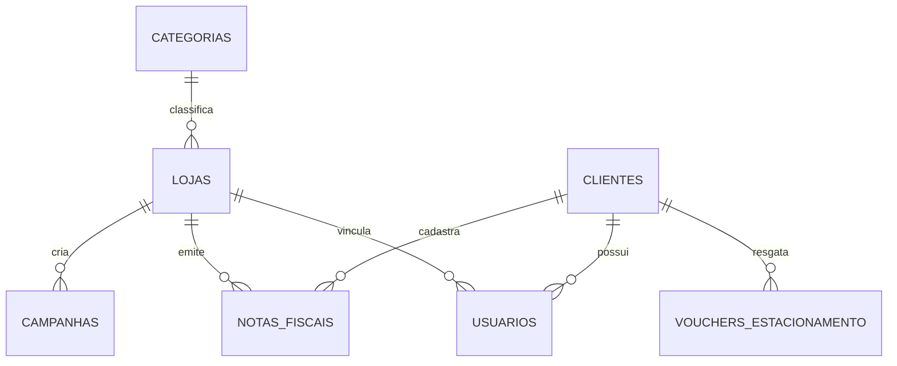

# Domain Migrations and Demo Seeds (ORD-01)

## Problem

The database currently contains no business tables or initial demo data, so the backend modules (`auth`, `fiscal`, `beneficios`, `analytics`) cannot persist entities, test business rules against real PostgreSQL instances, or provide data to frontend developers. Setting up tables manually or allowing Hibernate to auto-generate DDL creates environment drift, makes reproducible CI builds impossible, and loses auditability of database constraints.

When this ships, the database automatically initializes all 7 core tables with strict relational constraints and loads complete demo seed data on application startup via versioned Flyway migrations.

## Flow

1. Spring Boot application startup -> `FlywayAutoConfiguration` executes before JPA `EntityManagerFactory`
2. `Flyway` discovers migration scripts in `classpath:db/migration`
3. `V1__create_domain_tables.sql` executes DDL creating the 7 core domain tables and constraints in topological order
4. `V2__seed_demo_data.sql` inserts deterministic seed data (categories, stores with $k \ge 3$, demo users with BCrypt hashes, and historical receipts)
5. `schema_version` table records both migration checksums; Hibernate validates entities against the live schema on startup

## Impact

| Front | What changes |
| --- | --- |
| domain | new terms: `Categoria`, `Loja`, `Cliente`, `Usuario`, `NotaFiscal`, `VoucherEstacionamento`, `Campanha` mapped to domain entities |
| stored data | 7 new relational tables created in PostgreSQL; 4 categories, 5 stores, 3 users and 15 historical receipts seeded deterministically |

## Relations

One-way constraints:
- `notas_fiscais.chave_acesso` must be unique (`CHAR(44)`).
- `vouchers_estacionamento` must enforce atomic composite uniqueness on `(cliente_id, data_referencia)` preventing duplicate redemptions per day.
- `clientes.cpf_hash` must be unique (`VARCHAR(64)`).
- `lojas.cnpj` must be unique (`VARCHAR(14)`).
- `usuarios.email` must be unique (`VARCHAR(150)`).

## Surface

None - database schema and initial seed only, no HTTP surface consumed outside

## Landing

| One-way door | Literal shape | Alternative rejected |
| --- | --- | --- |
| Flyway versioned SQL migrations | `V1__create_domain_tables.sql` and `V2__seed_demo_data.sql` in `db/migration` | Hibernate `ddl-auto: update` - loses constraint auditability and causes drift between environments |
| NFC-e key uniqueness constraint | `chave_acesso CHAR(44) NOT NULL UNIQUE` on `notas_fiscais` table | Application-level validation only - concurrent requests could insert duplicate fiscal receipts |
| Daily parking voucher uniqueness | `CONSTRAINT uk_voucher_cliente_data UNIQUE (cliente_id, data_referencia)` on `vouchers_estacionamento` | In-memory locks or query-before-insert - vulnerable to race conditions under Virtual Threads |
| LGPD storage of customer CPF | `cpf_hash VARCHAR(64) NOT NULL UNIQUE` and `cpf_mascarado VARCHAR(14) NOT NULL` on `clientes` | Storing plaintext CPF - violates LGPD and security standards |

- Nothing else in this change is hard to reverse

## Criteria

### S1: Domain Schema & Relational Constraints

All 7 domain tables exist with proper foreign keys, check constraints, and unique indexes upon application startup.

**Acceptance Criteria**

1. WHEN the application starts with a clean database THEN the system SHALL execute `V1__create_domain_tables.sql` and create the 7 domain tables: `categorias`, `lojas`, `clientes`, `usuarios`, `notas_fiscais`, `vouchers_estacionamento`, and `campanhas`
2. WHEN an insertion into `notas_fiscais` contains a duplicate `chave_acesso` of 44 characters THEN the system SHALL reject the operation with a unique constraint violation
3. WHEN an insertion into `vouchers_estacionamento` contains the same `cliente_id` and `data_referencia` as an existing record THEN the system SHALL reject the operation with a composite unique constraint violation
4. WHEN an insertion into `campanhas` specifies a `desconto_percentual` outside the range of 1 to 100 THEN the system SHALL reject the operation with a check constraint violation
5. WHEN an insertion into `notas_fiscais` specifies a `valor_total` less than or equal to 0.00 THEN the system SHALL reject the operation with a check constraint violation

**Independent test:** run Testcontainers integration tests asserting schema presence and constraint violation exceptions on duplicate access key and duplicate voucher date.

### S2: Demo Seed Data Insertion

Deterministic data is loaded on startup, satisfying K-Anonymity requirements and enabling quick-access demo flows.

**Acceptance Criteria**

6. WHEN `V2__seed_demo_data.sql` executes THEN the system SHALL insert exactly 4 categories (`Vestuário`, `Alimentação`, `Eletrônicos`, `Farmácia & Beleza`)
7. WHEN `V2__seed_demo_data.sql` executes THEN the system SHALL insert at least 3 active stores belonging to the same category (`Vestuário`) to satisfy K-Anonymity ($k \ge 3$)
8. WHEN `V2__seed_demo_data.sql` executes THEN the system SHALL insert 3 demo users with BCrypt password hashes representing roles `CONSUMIDOR`, `LOJISTA`, and `ADMIN_SHOPPING`
9. WHEN `V2__seed_demo_data.sql` executes THEN the system SHALL insert 15 historical receipts distributed across stores and recent timestamps to populate initial analytics charts

**Independent test:** query counts on `categorias`, `lojas`, `usuarios`, and `notas_fiscais` via integration test and verify category group count for Vestuário $\ge 3$.

## Out of scope

| Excluded | Why |
| --- | --- |
| Granular item-level receipt table (`itens_nota`) | Deferred to v2 via ADR-03 (YAGNI); MVP screens operate exclusively on store, category, and total receipt values |
| User registration and password reset HTTP endpoints | Demo uses seeded accounts with quick access buttons via ADR-05 |
| Production environment profile disabling seeds | MVP demo runs with seeded data; environment-specific profile separation is planned for post-MVP |

## Assumptions

| Assumption | Chosen default | Rationale | Confirmed? |
| --- | --- | --- | --- |
| Primary key strategy for all domain entities | UUID using PostgreSQL `gen_random_uuid()` | Prevents sequential ID enumeration and aligns with distributed enterprise architecture | y |
| Password hashing algorithm for seeded users | BCrypt with strength 10 | Standard Spring Security `PasswordEncoder` compatibility | y |
| Timezone storage for dates and timestamps | `TIMESTAMP WITH TIME ZONE` (`TIMESTAMPTZ`) | Avoids ambiguity in fiscal emission and daily voucher calculation | y |

**Open questions:** none - all resolved or logged above.

## Observable

| Surface | Decisions it always has | Landing |
| --- | --- | --- |
| Database schema execution | migration logging, checksum failure behavior, error reporting on invalid DDL | `Flyway` automatically logs executed scripts to stdout; checksum mismatch aborts Spring application context |
| Seed execution idempotency | execution ordering, duplicate insertion prevention | Managed by Flyway `schema_version` history; scripts execute strictly once per database instance |

## Sources

- GitHub Issue [#1](https://github.com/victoraugusto2008df-blip/Ho-ho-project/issues/1): `[ORD-01] BACK — Migrations de Domínio (Flyway) & Seeds da Demo`
- Architecture & ADRs: `.docs/architecture/architecture-and-domain.md` (ADR-01, ADR-02, ADR-03, ADR-07)
- Requirements: `.docs/markdown/requirements.md` (ReN01, ReN04, ReN05)
- Planning Kanban: `.docs/planning/mvp-sabado-kanban.md` (Card ORD-01)
