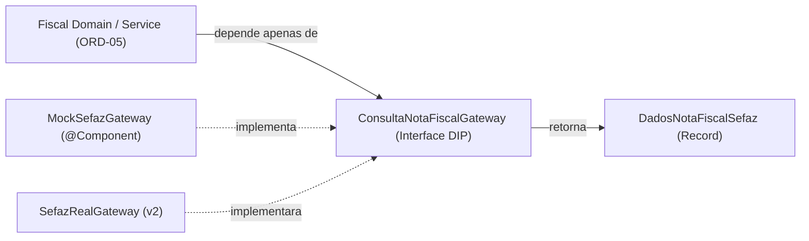

# ConsultaNotaFiscalGateway and MockSefazGateway (DIP) - Plan

## Problem

O módulo `fiscal` precisa consultar os dados de uma NFC-e (CNPJ emitente, valor total e data/hora de emissão) a partir da chave de acesso de 44 dígitos sem acoplar as regras de negócio do shopping (ReN01, ReN02, RF03) a uma implementação concreta de comunicação com a SEFAZ. Sem essa abstração (`ConsultaNotaFiscalGateway`) e um adaptador determinístico (`MockSefazGateway`), a equipe não consegue desenvolver e testar o fluxo do consumidor (`ORD-05`) nem demonstrar cenários de sucesso e rejeição na demo de sábado.

## Flow

1. O domínio fiscal (consumidor da interface, ex.: `ORD-05`) recebe ou valida uma chave de acesso de 44 dígitos e chama `ConsultaNotaFiscalGateway.consultarPorChave(chaveAcesso)`.
2. O container Spring injeta `MockSefazGateway` (em `fiscal.gateway`) como implementação ativa de `ConsultaNotaFiscalGateway` (em `fiscal.domain`).
3. `MockSefazGateway` valida se a chave tem exatamente 44 dígitos numéricos e consulta um catálogo determinístico indexado pela chave de acesso, calculando `dataEmissao` a partir de `Clock`:
   - Chaves válidas de lojas credenciadas retornam `Optional.of(DadosNotaFiscalSefaz)` com CNPJ credenciado (presente em `V2__seed_demo_data.sql`), `valorTotal` positivo e `dataEmissao` recente (< 72h), incluindo pares que somam exatamente `R$ 150,00` (ex.: `65,00 + 85,00` e `55,00 + 95,00`).
   - Chave de nota expirada retorna `Optional.of(DadosNotaFiscalSefaz)` com `dataEmissao` superior a 72 horas atrás (ex.: 96 horas) para permitir que o domínio rejeite por **ReN02**.
   - Chave de loja externa retorna `Optional.of(DadosNotaFiscalSefaz)` com CNPJ não cadastrado no shopping (`99999999000199`) para permitir que o domínio rejeite por **RF03**.
   - Chave não mapeada no catálogo determinístico retorna `Optional.empty()`.
4. Caso a chave informada seja nula ou não possua formato válido de 44 dígitos numéricos, o gateway lança `IllegalArgumentException` antes da consulta.

## Impact

- **Direct:**
  - `backend/src/main/java/com/hoho/shoppinghub/fiscal/domain/ConsultaNotaFiscalGateway.java` (nova interface de domínio — porta DIP)
  - `backend/src/main/java/com/hoho/shoppinghub/fiscal/domain/DadosNotaFiscalSefaz.java` (novo `record` imutável de domínio com `chaveAcesso`, `cnpjEmitente`, `valorTotal`, `dataEmissao`)
  - `backend/src/main/java/com/hoho/shoppinghub/fiscal/gateway/MockSefazGateway.java` (nova implementação `@Component` determinística)
  - `backend/src/test/java/com/hoho/shoppinghub/fiscal/MockSefazGatewayTest.java` (novos testes unitários/de contrato sem dependência de banco ou HTTP)
- **Indirect:**
  - Destrava a implementação da issue `ORD-05` (`fiscal.service` / ingestão de notas fiscais), que dependerá exclusivamente de `ConsultaNotaFiscalGateway` e `DadosNotaFiscalSefaz`.
  - Documentação das chaves determinísticas de teste para uso em `ORD-07` (Frontend Consumidor) e `ORD-14` (Ensaio da Demo).

## Relations

## Surface

None - contrato interno de domínio Java (`ConsultaNotaFiscalGateway`) e adaptador Spring (`MockSefazGateway`) no módulo `fiscal`, sem endpoints HTTP próprios (será consumido pela camada de serviço em `ORD-05`).

## Landing

| One-way door | Literal shape | Alternative rejected |
| --- | --- | --- |
| Inversão de Dependência (DIP) no módulo fiscal | Interface `ConsultaNotaFiscalGateway` e `record DadosNotaFiscalSefaz` em `fiscal.domain`; `MockSefazGateway` em `fiscal.gateway` | Injetar `MockSefazGateway` diretamente no service — acoplaria regra de negócio ao mock e exigiria refatoração na v2 |
| Assinatura de retorno sem acoplamento HTTP | `Optional<DadosNotaFiscalSefaz> consultarPorChave(String chaveAcesso)` com `BigDecimal` e `Instant` | Retornar `ResponseEntity` ou DTO específico de SEFAZ XML — vazaria detalhes de infraestrutura para o domínio |
| Chaves determinísticas alinhadas aos CNPJs seedados | Chaves de 44 dígitos embutindo os CNPJs da `V2__seed_demo_data.sql` (`11111111000101`, `22222222000102`, etc.) | Chaves aleatórias ou CNPJs fictícios incompatíveis com o banco — impediria a `ORD-05` de encontrar a loja no PostgreSQL |

- Nothing else in this change is hard to reverse

## Criteria

### S1: Abstração de Domínio (DIP) e Contrato de Retorno

O domínio fiscal define a porta `ConsultaNotaFiscalGateway` e o modelo imutável `DadosNotaFiscalSefaz` sem qualquer dependência de framework web ou detalhes do mock.

**Acceptance Criteria**

1. WHEN a interface `ConsultaNotaFiscalGateway` e o record `DadosNotaFiscalSefaz` são compilados no pacote `fiscal.domain` THEN the system SHALL expor o método `consultarPorChave(String chaveAcesso)` retornando `Optional<DadosNotaFiscalSefaz>` sem importar classes de `fiscal.gateway` ou da camada web.
2. WHEN uma chave de acesso nula ou fora do padrão de 44 dígitos numéricos é enviada ao gateway THEN the system SHALL rejeitar a entrada lançando `IllegalArgumentException`.

**Independent test:** compilar e validar assinatura/isolamento de pacote e comportamento com chaves inválidas via JUnit 5 sem subir contexto web ou banco.

### S2: Adaptador Determinístico `MockSefazGateway` para Demo e Regras Fiscais

`MockSefazGateway` interpreta chaves de 44 dígitos reproduzíveis cobrindo sucesso, acúmulo exato de R$ 150,00, emissão acima de 72h (ReN02), CNPJ fora do shopping (RF03) e chave inexistente.

**Acceptance Criteria**

3. WHEN `MockSefazGateway` é consultado com uma chave válida de loja credenciada THEN the system SHALL retornar `DadosNotaFiscalSefaz` com CNPJ pertencente às lojas credenciadas do seed, `valorTotal` positivo e `dataEmissao` dentro da janela de 72 horas em relação ao `Clock`.
4. WHEN duas chaves válidas de teste designadas para o fluxo de voucher são consultadas THEN the system SHALL retornar valores cuja soma seja exatamente `150.00` (ex.: `65.00` + `85.00` e `55.00` + `95.00`).
5. WHEN `MockSefazGateway` é consultado com a chave de cenário expirado THEN the system SHALL retornar `DadosNotaFiscalSefaz` com `dataEmissao` superior a 72 horas antes do instante atual do `Clock` (permitindo validação da ReN02).
6. WHEN `MockSefazGateway` é consultado com a chave de loja não credenciada THEN the system SHALL retornar `DadosNotaFiscalSefaz` com CNPJ externo não presente nas lojas do shopping (permitindo validação da RF03).
7. WHEN `MockSefazGateway` é consultado com uma chave de 44 dígitos numéricos não cadastrada no catálogo determinístico THEN the system SHALL retornar `Optional.empty()`.

**Independent test:** executar testes unitários em `MockSefazGatewayTest` usando `Clock.fixed(...)` verificando todos os cenários determinísticos, a soma exata de `150.00` e ausência de side effects.

## Out of scope

| Excluded | Why |
| --- | --- |
| Persistência em `notas_fiscais`, endpoints REST e validação transacional de ReN01/ReN02/RF03 no service | Pertence à issue `ORD-05`, que consumirá esta interface |
| Integração HTTP/SOAP real com a SEFAZ e certificado digital A1 | Escopo da v2 (`SefazRealGateway`); MVP utiliza mock determinístico (AD-004) |
| Geração de voucher de estacionamento | Pertence à issue `ORD-06` |

## Assumptions

- Os CNPJs das lojas credenciadas retornados pelas chaves válidas do mock correspondem aos já semeados em `V2__seed_demo_data.sql` (`11111111000101`, `22222222000102`, `44444444000104`, `55555555000105`).
- O domínio fiscal (`ORD-05`) será responsável por consultar o repositório de lojas e aplicar a regra de bloqueio de 72h sobre o `DadosNotaFiscalSefaz` retornado pelo gateway.

## Observable

- Execução limpa de `./mvnw test` (incluindo `MockSefazGatewayTest`) passando sem depender de Docker quando executada isoladamente, e tabela determinística `chave -> cenário` disponível para uso na demo (`ORD-07` e `ORD-14`).

## Sources

- `.local-tasks/ORD-04.md` (Issue `#4` — critérios de aceite e DoD)
- `.docs/architecture/architecture-and-domain.md` (Módulo `fiscal` e `ADR-04`)
- `backend/src/main/resources/db/migration/V2__seed_demo_data.sql` (CNPJs das lojas credenciadas)
