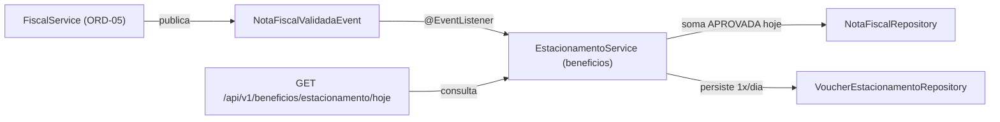

# Motor de Estacionamento Grátis (módulo beneficios) - Plan

## Problem

O consumidor já consegue enviar NFC-e em `POST /api/v1/notas` (`ORD-05`), mas a publicação de `NotaFiscalValidadaEvent` ainda não possui consumidor no módulo `beneficios`. Sem o motor de acúmulo diário, o sistema não soma as compras `APROVADA` do dia (ReN03), não gera o `VoucherEstacionamento` ao atingir R$ 150,00 com trava de 1 resgate por cliente por dia (ReN04), e não expõe `GET /api/v1/beneficios/estacionamento/hoje` para a Tela 1 (`ORD-07`) mostrar progresso e QR Code.

## Flow

1. Quando uma NFC-e é validada em `ORD-05`, `FiscalService` publica `NotaFiscalValidadaEvent(notaFiscalId, chaveAcesso, clienteId, lojaId, valorTotal, dataEmissao)`.
2. `EstacionamentoService` (em `beneficios.service`) escuta `NotaFiscalValidadaEvent` via `@EventListener` e consulta a soma de `valor_total` das notas do `clienteId` com `status = 'APROVADA'` e `data_emissao` dentro da janela do dia atual (`[inicioDoDia, fimDoDia)` conforme `Clock`).
3. Se o acumulado do dia atingir ou ultrapassar `R$ 150,00` e ainda não existir registro em `vouchers_estacionamento` para `(cliente_id, data_referencia)`, o motor persiste um `VoucherEstacionamento` com `status = 'LIBERADO'` e `codigo_qr` único; a constraint `uk_voucher_cliente_data` no PostgreSQL garante atomicamente no máximo 1 voucher por cliente por dia mesmo sob concorrência.
4. Quando o consumidor autenticado (`ROLE_CONSUMIDOR`) chama `GET /api/v1/beneficios/estacionamento/hoje`, `EstacionamentoController` obtém o `clienteId` do `AuthenticatedUser` e retorna `EstacionamentoHojeResponse` contendo `valorAcumulado`, `meta` (`150.00`), `percentual` (`0` a `100`), `valorFaltante` (`>= 0.00`), `voucherLiberado` (`true`/`false`) e `voucher` (`id`, `codigoQr`, `status`, `dataReferencia` quando liberado, ou `null`).
5. Usuários não autenticados recebem `401 Unauthorized`; usuários autenticados sem role `CONSUMIDOR` (`LOJISTA`, `ADMIN_SHOPPING`) recebem `403 Forbidden`.

## Impact

- **Direct:**
  - `backend/src/main/java/com/hoho/shoppinghub/beneficios/domain/VoucherEstacionamento.java` (nova entidade JPA mapeando `vouchers_estacionamento` da `V1`)
  - `backend/src/main/java/com/hoho/shoppinghub/beneficios/domain/VoucherEstacionamentoRepository.java` (novo `JpaRepository` com `findByClienteIdAndDataReferencia` e `existsByClienteIdAndDataReferencia`)
  - `backend/src/main/java/com/hoho/shoppinghub/beneficios/dto/EstacionamentoHojeResponse.java` (novo DTO de resposta para `GET /api/v1/beneficios/estacionamento/hoje`)
  - `backend/src/main/java/com/hoho/shoppinghub/beneficios/service/EstacionamentoService.java` (listener de `NotaFiscalValidadaEvent`, cálculo de acúmulo diário ReN03 e emissão idempotente de voucher ReN04)
  - `backend/src/main/java/com/hoho/shoppinghub/beneficios/controller/EstacionamentoController.java` (endpoint `GET /api/v1/beneficios/estacionamento/hoje` restrito a `ROLE_CONSUMIDOR`)
  - `backend/src/main/java/com/hoho/shoppinghub/fiscal/domain/NotaFiscalRepository.java` (adição de query de soma diária `APROVADA` por `clienteId` e intervalo `[inicio, fim)`)
  - `backend/src/test/java/com/hoho/shoppinghub/beneficios/EstacionamentoIntegrationTest.java` (testes de integração Testcontainers provando acúmulo, 1 voucher/dia, filtro de status/data e contrato HTTP)
- **Indirect:**
  - Desbloqueia `ORD-07` (Tela 1 — Frontend Consumidor), que consome `GET /api/v1/beneficios/estacionamento/hoje` logo após `POST /api/v1/notas`.

## Relations



## Surface

- **HTTP Endpoint:** `GET /api/v1/beneficios/estacionamento/hoje`
  - **Auth:** `Bearer <JWT>` com `ROLE_CONSUMIDOR` (`@PreAuthorize("hasRole('CONSUMIDOR')")`)
  - **200 OK Response (`EstacionamentoHojeResponse`):**
    ```json
    {
      "valorAcumulado": 160.00,
      "meta": 150.00,
      "percentual": 100,
      "valorFaltante": 0.00,
      "voucherLiberado": true,
      "voucher": {
        "id": "uuid",
        "codigoQr": "HOHO-PARK-2026-11-14-ABCD1234",
        "status": "LIBERADO",
        "dataReferencia": "2026-11-14"
      }
    }
    ```
  - **401 Unauthorized:** sem token válido
  - **403 Forbidden:** token de `LOJISTA` ou `ADMIN_SHOPPING`

## Landing

| One-way door | Literal shape | Alternative rejected |
| --- | --- | --- |
| Trava atômica de 1 voucher/CPF/dia no banco | `VoucherEstacionamento` mapeia `vouchers_estacionamento` com `CONSTRAINT uk_voucher_cliente_data UNIQUE (cliente_id, data_referencia)` da `V1` | Checar apenas em memória ou lock distribuído — vulnerável a corrida entre Virtual Threads |
| Cálculo de progresso em memória sobre soma diária real | Soma via SQL `SUM(valor_total)` de `notas_fiscais` (`status = 'APROVADA'` e `data_emissao` no dia corrente) | Campo incremental `saldo_hoje` na tabela `clientes` — dessincroniza em retries ou notas antigas |
| Contrato JSON de `/api/v1/beneficios/estacionamento/hoje` | `valorAcumulado`, `meta`, `percentual` (0–100), `valorFaltante`, `voucherLiberado`, `voucher` (`null` se não liberado) | Retornar 404 quando não há voucher — impede a UI de exibir barra de progresso antes dos R$ 150,00 |

- Nothing else in this change is hard to reverse

## Criteria

### S1: Motor de Acúmulo Diário e Emissão Idempotente de Voucher

Ao receber `NotaFiscalValidadaEvent`, o motor soma apenas notas `APROVADA` emitidas hoje (ReN03) e gera no máximo 1 voucher por cliente por dia ao atingir R$ 150,00 (ReN04).

**Acceptance Criteria**

1. WHEN duas notas `APROVADA` de R$ 80,00 são processadas para o mesmo cliente no mesmo dia THEN the system SHALL acumular R$ 160,00 e gerar exatamente 1 `VoucherEstacionamento` com status `LIBERADO`.
2. WHEN uma terceira nota `APROVADA` é processada para o mesmo cliente no mesmo dia após o voucher já ter sido gerado THEN the system SHALL somar o valor no acumulado diário e NOT gerar um segundo voucher (mantendo exatamente 1 registro em `vouchers_estacionamento` para `(cliente_id, data_referencia)`).
3. WHEN existem notas do cliente emitidas em dias anteriores (como as 15 notas históricas do seed) ou notas com status diferente de `APROVADA` THEN the system SHALL ignorá-las na soma do dia corrente (ReN03).
4. WHEN ocorre tentativa de inserção duplicada em `vouchers_estacionamento` para o mesmo `(cliente_id, data_referencia)` THEN the system SHALL respeitar a constraint `uk_voucher_cliente_data` do PostgreSQL sem permitir duplicidade.

**Independent test:** executar testes de integração com Testcontainers disparando fluxo completo (`POST /api/v1/notas` ou publicação de evento + persistência) e verificando contagem exata de vouchers e soma diária isolada.

### S2: Endpoint `GET /api/v1/beneficios/estacionamento/hoje` e Segurança

O endpoint autenticado para `CONSUMIDOR` expõe o progresso diário (0–100%, valor acumulado, valor faltante) e o QR Code do voucher quando liberado.

**Acceptance Criteria**

5. WHEN um usuário `CONSUMIDOR` autenticado sem compras hoje chama `GET /api/v1/beneficios/estacionamento/hoje` THEN the system SHALL retornar HTTP `200` com `valorAcumulado: 0.00`, `percentual: 0`, `valorFaltante: 150.00`, `voucherLiberado: false` e `voucher: null`.
6. WHEN um usuário `CONSUMIDOR` autenticado possui R$ 65,00 acumulados hoje THEN the system SHALL retornar HTTP `200` com `valorAcumulado: 65.00`, `percentual: 43`, `valorFaltante: 85.00`, `voucherLiberado: false` e `voucher: null`.
7. WHEN um usuário `CONSUMIDOR` autenticado atinge R$ 160,00 hoje THEN the system SHALL retornar HTTP `200` com `valorAcumulado: 160.00`, `percentual: 100`, `valorFaltante: 0.00`, `voucherLiberado: true` e `voucher` preenchido com `codigoQr` e `status: "LIBERADO"`.
8. WHEN uma requisição a `GET /api/v1/beneficios/estacionamento/hoje` é feita sem token ou com perfil `LOJISTA` / `ADMIN_SHOPPING` THEN the system SHALL retornar `401` (sem token) ou `403` (perfil não autorizado).

**Independent test:** executar `MockMvc` / integração contra PostgreSQL real validando respostas HTTP `200`, `401` e `403` e os cálculos exatos para 0%, parcial e 100%.

## Out of scope

| Excluded | Why |
| --- | --- |
| Validação de QR Code na catraca / transição para status `UTILIZADO` ou `EXPIRADO` | Fora do escopo do MVP de sábado (basta gerar voucher `LIBERADO` com `codigoQr`) |
| Regras de campanha ou descontos de lojistas | Pertence aos módulos de lojista/analytics (`ORD-08`–`ORD-10`) |
| Interface React da barra de progresso e exibição do QR Code | Pertence à issue `ORD-07` (Frontend Consumidor) |

## Assumptions

- O `AuthenticatedUser` do perfil `CONSUMIDOR` possui `clienteId` não nulo no banco e no contexto de segurança (`ORD-03`).
- A definição de "hoje" utiliza a data corrente (`LocalDate`) no fuso horário padrão configurado pelo `Clock` (`America/Sao_Paulo` ou `Clock.systemDefaultZone()`).

## Observable

- `./mvnw test` executa e passa integralmente com todos os cenários da `ORD-06` (incluindo tentativa de 2º voucher no mesmo dia), e o contrato JSON de `GET /api/v1/beneficios/estacionamento/hoje` fica documentado para `ORD-07`.

## Sources

- `.local-tasks/ORD-06.md` (Issue `#6` — critérios de aceite e DoD)
- `backend/src/main/resources/db/migration/V1__create_domain_tables.sql` (`vouchers_estacionamento` e `uk_voucher_cliente_data`)
- `backend/src/main/java/com/hoho/shoppinghub/fiscal/domain/NotaFiscalValidadaEvent.java` (contrato do evento publicado em `ORD-05`)
- `backend/src/main/java/com/hoho/shoppinghub/auth/security/AuthenticatedUser.java` (`clienteId` e `ROLE_CONSUMIDOR`)
