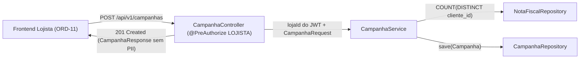

# Disparo de Campanha em 1 Clique (POST /api/v1/campanhas) - Plan

## Problem

O lojista ainda não possui endpoint para disparar campanhas promocionais segmentadas a partir da Tela 2/3 (`ORD-11`). Sem `POST /api/v1/campanhas`, não é possível persistir campanhas vinculadas à loja autenticada nem calcular e registrar a contagem anônima de público atingido (`publico_atingido`) preservando a LGPD (sem expor CPFs, nomes ou IDs de clientes).

## Flow

1. O lojista autenticado (`ROLE_LOJISTA`) envia `POST /api/v1/campanhas` com JSON `{ "titulo", "descontoPercentual", "criterioAlvo" }`.
2. Bean Validation valida presença de `titulo` (`@NotBlank`, máx. 150), `criterioAlvo` (`@NotBlank`, máx. 100) e `descontoPercentual` entre `1` e `100` (`@Min(1)`, `@Max(100)`), retornando `400 Bad Request` via `GlobalExceptionHandler` em caso de violação.
3. `CampanhaController` extrai o `lojaId` exclusivamente do principal JWT (`AuthenticatedUser.getLojaId()`), ignorando qualquer tentativa externa de informar outra loja.
4. `CampanhaService` calcula `publicoAtingido` via consulta agregada (`COUNT(DISTINCT cliente_id)`) sobre notas `APROVADA` da `lojaId` (com segmentação por `criterioAlvo`, como `TICKET_ALTO` ou `RECORRENTES`, e fallback para clientes distintos da loja), sem carregar entidades `Cliente` nem dados pessoais.
5. `CampanhaService` persiste a entidade `Campanha` na tabela `campanhas` com `lojaId`, `titulo`, `descontoPercentual`, `criterioAlvo` e `publicoAtingido`, retornando HTTP `201 Created` com `CampanhaResponse` contendo apenas metadados da campanha e a contagem inteira `publicoAtingido` (zero PII).
6. Usuários não autenticados recebem `401 Unauthorized`; usuários com perfil `CONSUMIDOR` ou `ADMIN_SHOPPING` recebem `403 Forbidden`.

## Impact

- **Direct:**
  - `backend/src/main/java/com/hoho/shoppinghub/campanhas/package-info.java` (documentação do módulo `campanhas`)
  - `backend/src/main/java/com/hoho/shoppinghub/campanhas/domain/Campanha.java` (entidade JPA mapeando a tabela `campanhas` da `V1`)
  - `backend/src/main/java/com/hoho/shoppinghub/campanhas/domain/CampanhaRepository.java` (`JpaRepository<Campanha, UUID>`)
  - `backend/src/main/java/com/hoho/shoppinghub/campanhas/dto/CampanhaRequest.java` (DTO de entrada com Bean Validation)
  - `backend/src/main/java/com/hoho/shoppinghub/campanhas/dto/CampanhaResponse.java` (DTO de saída anônimo sem PII)
  - `backend/src/main/java/com/hoho/shoppinghub/campanhas/service/CampanhaService.java` (cálculo anônimo de audiência e persistência vinculada ao `lojaId` do JWT)
  - `backend/src/main/java/com/hoho/shoppinghub/campanhas/controller/CampanhaController.java` (endpoint `POST /api/v1/campanhas` com `@PreAuthorize("hasRole('LOJISTA')")`)
  - `backend/src/main/java/com/hoho/shoppinghub/fiscal/domain/NotaFiscalRepository.java` (queries de contagem agregada anônima de clientes distintos por `lojaId`)
  - `backend/src/test/java/com/hoho/shoppinghub/CampanhaIntegrationTest.java` (testes de integração Testcontainers provando persistência, vínculo ao `lojaId` do JWT, contagem anônima LGPD, validação `1..100` e RBAC)
- **Indirect:**
  - Alimenta a tabela `campanhas` consumida pelos indicadores da Tela 3 (`ORD-10`/`ORD-12`) e desbloqueia a UI de disparo em 1 clique (`ORD-11`).

## Relations



## Surface

- **HTTP Endpoint:** `POST /api/v1/campanhas`
  - **Auth:** `Bearer <JWT>` com `ROLE_LOJISTA` (`@PreAuthorize("hasRole('LOJISTA')")`)
  - **Request Body (`CampanhaRequest`):**
    ```json
    {
      "titulo": "Semana VIP Vestuario",
      "descontoPercentual": 15,
      "criterioAlvo": "CLIENTES_LOJA"
    }
    ```
  - **201 Created Response (`CampanhaResponse`):**
    ```json
    {
      "id": "uuid",
      "lojaId": "uuid-da-loja-do-jwt",
      "titulo": "Semana VIP Vestuario",
      "descontoPercentual": 15,
      "criterioAlvo": "CLIENTES_LOJA",
      "publicoAtingido": 3,
      "criadoEm": "2026-11-14T13:30:00Z"
    }
    ```
  - **400 Bad Request:** `titulo`/`criterioAlvo` em branco ou `descontoPercentual` fora de `1..100`
  - **401 Unauthorized:** sem token válido
  - **403 Forbidden:** token de `CONSUMIDOR` ou `ADMIN_SHOPPING`

## Landing

| One-way door | Literal shape | Alternative rejected |
| --- | --- | --- |
| `lojaId` derivado exclusivamente do JWT | `CampanhaRequest` não aceita `lojaId`; `CampanhaController` lê `user.getLojaId()` de `AuthenticatedUser` | Aceitar `lojaId` no payload — permitiria um lojista criar campanhas em nome de concorrentes (IDOR) |
| Agregação anônima no banco (LGPD) | `NotaFiscalRepository` retorna apenas `long` (`COUNT(DISTINCT clienteId)`) sem trazer `Cliente`, `cpfHash` ou `nome` | Buscar lista de `Cliente` na memória e chamar `.size()` — trafega dados pessoais desnecessários |
| Resposta sem lista de destinatários | `CampanhaResponse` expõe apenas `publicoAtingido` (int) e metadados da campanha | Retornar array de clientes ou CPFs mascarados — viola critério LGPD da ORD-09 |

- Nothing else in this change is hard to reverse

## Criteria

### S1: Persistência de Campanha, Vínculo ao Tenant e Agregação Anônima (LGPD)

`CampanhaService` calcula o público elegível agregado para a loja do JWT e persiste a campanha na tabela `campanhas` sem expor dados pessoais.

**Acceptance Criteria**

1. WHEN um lojista autenticado envia `POST /api/v1/campanhas` com título, `descontoPercentual` válido (`1..100`) e `criterioAlvo` THEN the system SHALL persistir a campanha na tabela `campanhas` vinculada ao `lojaId` do JWT e retornar HTTP `201` com `id`, `lojaId`, `titulo`, `descontoPercentual`, `criterioAlvo`, `publicoAtingido` e `criadoEm`.
2. WHEN a resposta de `POST /api/v1/campanhas` é serializada THEN the system SHALL retornar apenas a contagem inteira `publicoAtingido` e NOT expor lista de clientes, `clienteId`, CPF ou nome (LGPD).
3. WHEN existem notas `APROVADA` da loja autenticada no banco THEN the system SHALL calcular `publicoAtingido` como contagem anônima de clientes elegíveis daquela loja (suportando critérios como `TICKET_ALTO`, `RECORRENTES` e padrão de clientes distintos da loja).

**Independent test:** executar teste de integração com Testcontainers verificando registro salvo no PostgreSQL, `lojaId` igual ao do JWT e ausência de campos pessoais no JSON retornado.

### S2: Validação de Entrada e Autorização por Perfil (`ROLE_LOJISTA`)

O endpoint valida limites de negócio na entrada (`1..100`) e bloqueia acessos não autenticados ou de outros perfis.

**Acceptance Criteria**

4. WHEN `POST /api/v1/campanhas` recebe `descontoPercentual` menor que `1`, maior que `100`, ou `titulo`/`criterioAlvo` em branco THEN the system SHALL rejeitar com HTTP `400 Bad Request` (`validation_error`).
5. WHEN `POST /api/v1/campanhas` é chamado sem token ou com perfil `CONSUMIDOR` / `ADMIN_SHOPPING` THEN the system SHALL retornar `401` (sem token) ou `403` (perfil não autorizado).

**Independent test:** executar `MockMvc` contra PostgreSQL real validando HTTP `400`, `401` e `403`.

## Out of scope

| Excluded | Why |
| --- | --- |
| Envio real de e-mail, SMS, push ou WhatsApp aos clientes | Disparo é simulado no MVP (`ORD-09`) |
| Listagem ou dashboard gerencial de campanhas | Pertence às issues de analytics/dashboard (`ORD-10`/`ORD-12`) |
| Interface React do modal/botão de disparo em 1 clique | Pertence à issue `ORD-11` (Frontend Lojista) |

## Assumptions

- O usuário `LOJISTA` autenticado via JWT possui `lojaId` não nulo no `AuthenticatedUser` (`V2__seed_demo_data.sql` vincula `lojista@shopping.com` à Zara `22222222-2222-2222-2222-222222222201`).
- As 15 notas históricas semeadas na `V2` já fornecem clientes distintos na loja do lojista demo para que `publicoAtingido` seja `> 0` na demonstração.

## Observable

- `./mvnw test` executa e passa integralmente incluindo `CampanhaIntegrationTest`, e o contrato JSON de `POST /api/v1/campanhas` fica documentado para `ORD-11`.

## Sources

- `.local-tasks/ORD-09.md` (Issue `#9` — critérios de aceite e DoD)
- `backend/src/main/resources/db/migration/V1__create_domain_tables.sql` (tabela `campanhas` e `ck_campanhas_desconto`)
- `backend/src/main/java/com/hoho/shoppinghub/auth/web/GlobalExceptionHandler.java` (contrato `validation_error` 400)
- `backend/src/main/java/com/hoho/shoppinghub/auth/security/AuthenticatedUser.java` (`lojaId` e `ROLE_LOJISTA`)
