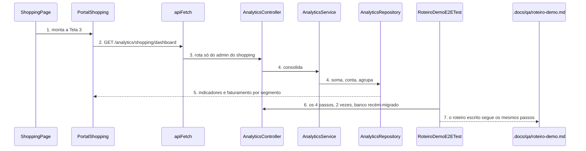
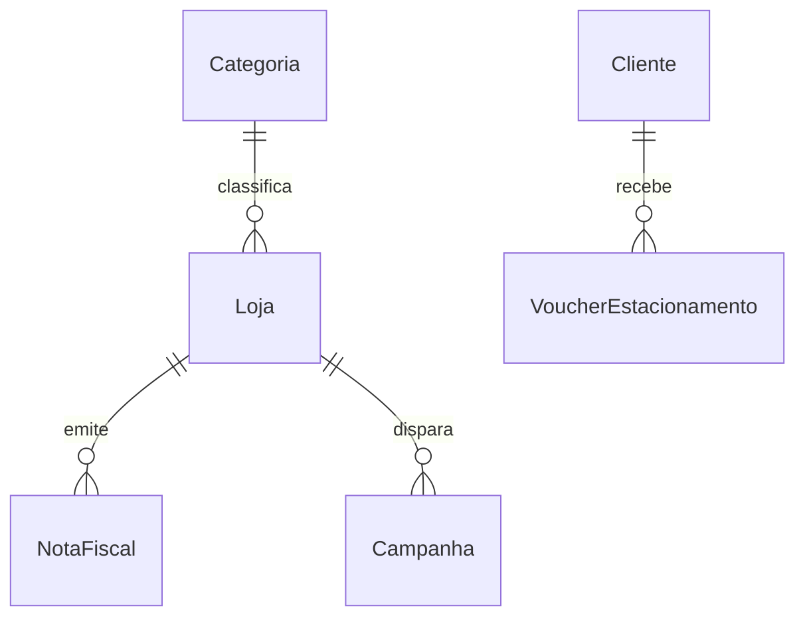
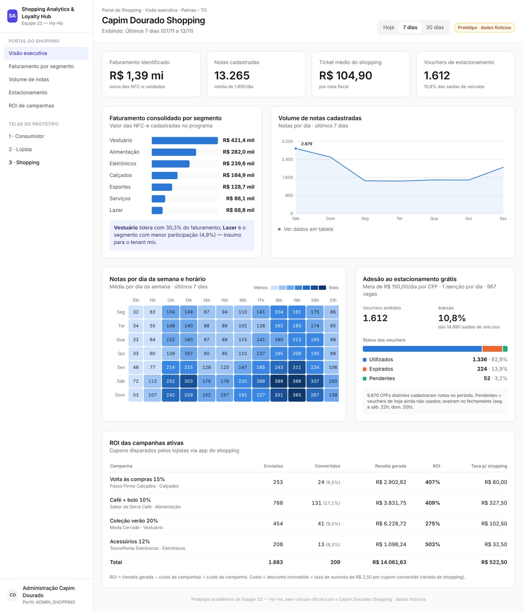

# ORD-14 - Ensaio ponta a ponta da demonstração

**Approved**: 2026-11-14 - user: "pode e faça o build e o push"

## Problem

O roteiro da banca tem quatro passos e o último não existe: ao trocar para Admin Shopping, a rota
`/shopping` mostra um placeholder "Conteúdo em construção." e o backend não tem
`GET /api/v1/analytics/shopping/dashboard` (ORD-10), então não há onde ver o faturamento
atualizado nem o voucher contabilizado. Os três primeiros passos só fecham depois do plano
`integracao-front-back`. Ninguém ensaiou o roteiro inteiro: não há lista das chaves de cada passo,
não há plano B, e nada garante que o roteiro roda duas vezes seguidas a partir de um banco limpo.
Quem paga é a equipe diante da banca. A issue não traz evidência além da lista de critérios.

Quando isto entra: o Admin Shopping abre `/shopping` e vê o faturamento, os vouchers e as campanhas
somando o que o consumidor e o lojista acabaram de fazer; a equipe tem um teste que roda o roteiro
inteiro pela API duas vezes a partir de banco limpo, e um roteiro escrito com as chaves, a subida
do zero, o plano B e as limitações.

## Shape

Reusa o `B2BShell`, o `apiFetch`, os cards e os estados de carregamento e erro da Tela 2, e o
padrão `AnalyticsController` -> `AnalyticsService` -> `AnalyticsRepository` do ORD-08. As somas e
contagens rodam em `AnalyticsService`/`AnalyticsRepository`, ao alcance dos testes JUnit; a
formatação em reais roda no front, ao alcance do Vitest.

1. Admin Shopping abre `/shopping` -> `ShoppingPage` (exists) - monta `PortalShopping` (new) no lugar do placeholder
2. `PortalShopping` (new) -> `apiFetch` (exists) - `GET /analytics/shopping/dashboard` com o Bearer
3. `AnalyticsController` (exists) - rota nova, só para o perfil de administração do shopping (door 1)
4. `AnalyticsService` (exists) -> `AnalyticsRepository` (exists) - soma as notas `APROVADA`, conta vouchers e campanhas, agrupa por categoria
5. out: `PortalShopping` mostra os 3 indicadores e o faturamento por segmento
6. `RoteiroDemoE2ETest` (new) - roda os 4 passos pela API sobre banco recém-migrado, 2 vezes, com o relógio da aplicação fixado (door 2)
7. out: `.docs/qa/roteiro-demo.md` (new) - o roteiro que a equipe segue na banca

**Changes underneath**

| Front | What changes |
| --- | --- |
| domain | o relógio de `FiscalService`, `EstacionamentoService` e `MockSefazGateway` passa a vir de um bean `Clock` único; quem ramifica nele hoje: os construtores com `Clock` que os testes já usam, que continuam existindo |
| stored data | nada a migrar - só leitura |
| readers | `ShoppingPage` deixa de mostrar o placeholder "ORD-12"; os testes do shell que afirmam o placeholder mudam com a afirmação |

New: nothing - read only.

## Surface

| Route | In | Out | Status | Who |
| --- | --- | --- | --- | --- |
| `GET /api/v1/analytics/shopping/dashboard` | - | `faturamentoTotal`, `vouchersLiberados`, `campanhasAtivas`, `faturamentoPorCategoria[]` de `categoria`, `valor` | `200`, `401`, `403` | ADMIN_SHOPPING; sem token 401, outro perfil 403 |

## Landing

| One-way door | Literal shape | Alternative rejected |
| --- | --- | --- |
| 1. contrato do dashboard do shopping | `200 {"faturamentoTotal":3150.40,"vouchersLiberados":1,"campanhasAtivas":1,"faturamentoPorCategoria":[{"categoria":"Vestuário","valor":1880.40}]}` | devolver percentuais prontos: o front teria dois números que podem não bater com os valores |
| 2. relógio único da aplicação | `@Bean Clock clock() { return Clock.systemDefaultZone(); }`, injetado nos serviços que hoje criam o seu | cada teste de ponta a ponta trocar os três relógios: `EstacionamentoService` duplicado como bean ouviria o evento duas vezes |

- Nothing else in this change is hard to reverse

## Criteria

### S1: dashboard do shopping (P1)

O Admin Shopping obtém os números consolidados do banco.

**Acceptance Criteria**

1. WHEN um ADMIN_SHOPPING chama `GET /api/v1/analytics/shopping/dashboard` THEN o sistema SHALL responder `200` com `faturamentoTotal` igual à soma de `valor_total` das notas `APROVADA`, com 2 casas
   - sem notas → `0.00`; nota `REJEITADA` de R$ 500,00 → não soma; notas de R$ 65,00 e R$ 85,00 a mais → total anterior + 150,00
2. The resposta SHALL trazer `vouchersLiberados` igual ao número de linhas de `vouchers_estacionamento` e `campanhasAtivas` igual ao número de linhas de `campanhas`
   - banco recém-migrado → 0 e 0; depois de 1 voucher e 1 campanha → 1 e 1
3. The resposta SHALL trazer em `faturamentoPorCategoria` uma linha por categoria que tem nota `APROVADA`, com `categoria` igual ao nome e `valor` igual à soma, da maior para a menor
   - a soma dos `valor` é igual a `faturamentoTotal`; categoria sem nota aprovada ("Farmácia & Beleza" no seed) → ausente
4. IF quem chama `GET /api/v1/analytics/shopping/dashboard` é CONSUMIDOR ou LOJISTA THEN o sistema SHALL responder `403`, e `401` sem token

### S2: Tela 3 (P1)

O Admin Shopping vê os indicadores na tela.

**Acceptance Criteria**

5. WHEN o Admin Shopping abre `/shopping` THEN o sistema SHALL mostrar a Tela 3 de `.specs/features/ORD-14-ensaio-demo/captures/figura4-portal-shopping.png`, menos o que `Differences from the source` lista
6. WHEN o dashboard responde THEN a Tela 3 SHALL mostrar os indicadores "Faturamento identificado" com `faturamentoTotal` em reais e a legenda "soma das NFC-e validadas", "Vouchers de estacionamento" com `vouchersLiberados` e "Campanhas ativas" com `campanhasAtivas`
   - `faturamentoTotal` 3150.4 → "R$ 3.150,40"; 0 → "R$ 0,00"
7. WHEN o dashboard responde THEN a Tela 3 SHALL mostrar o card "Faturamento consolidado por segmento", com a legenda "Valor das NFC-e cadastradas no programa" e, para cada item de `faturamentoPorCategoria`, o nome, uma barra proporcional ao maior valor e o valor em reais, na ordem recebida
8. IF `faturamentoPorCategoria` vem vazio THEN o card SHALL mostrar "Nenhuma nota cadastrada ainda." no lugar das barras
9. WHILE o dashboard carrega THE Tela 3 SHALL mostrar o estado "Carregando…" nos indicadores e no card
10. IF o dashboard falha THEN a Tela 3 SHALL mostrar um alerta de erro e o botão "Tentar novamente"; WHEN o Admin Shopping usa "Tentar novamente" THEN a Tela 3 SHALL refazer a chamada e mostrar os dados quando ela responde

### S3: o roteiro (P1)

O roteiro da banca roda inteiro, duas vezes, a partir de banco limpo.

**Acceptance Criteria**

11. WHEN o consumidor de demonstração envia a chave `35261111111111000101650010000001050000000105` sobre um banco recém-migrado THEN o sistema SHALL responder `422` com `code` `NOTA_EXPIRADA_72H` e `message` "Nota emitida há mais de 72 horas.", sem gravar nota
12. WHEN o mesmo consumidor envia `35261111111111000101650010000001010000000101` (R$ 65,00) e `35261122222222000102650010000001020000000102` (R$ 85,00) THEN o sistema SHALL responder `201` às duas e `GET /api/v1/beneficios/estacionamento/hoje` SHALL trazer `valorAcumulado` `150.00`, `percentual` `100`, `valorFaltante` `0.00`, `voucherLiberado` `true` e `voucher.codigoQr` começando por `HOHO-PARK-`
13. WHEN o lojista de demonstração consulta o painel depois do passo anterior THEN `ticketMedio` SHALL ser (soma anterior das notas da loja + 65,00) dividido por (quantidade anterior + 1), com 2 casas, e `POST /api/v1/campanhas` com `descontoPercentual` `15` SHALL responder `201` com `publicoAtingido` `2`
14. WHEN o Admin Shopping consulta o dashboard depois dos passos anteriores THEN `faturamentoTotal` SHALL ser o valor do banco recém-migrado + 150,00, `vouchersLiberados` SHALL ser `1` e `campanhasAtivas` SHALL ser `1`
15. The roteiro dos critérios 11 a 14 SHALL passar 2 vezes seguidas, cada uma sobre um banco recriado do zero pelas migrations, sem intervenção no banco entre os passos, com login real (`POST /api/v1/auth/login`) dos 3 usuários de demonstração
16. The arquivo `.docs/qa/roteiro-demo.md` SHALL conter: os comandos da subida do zero (`docker compose down -v`, `docker compose up -d postgres`, backend e frontend); os 4 passos com o perfil, o controle usado e a chave de cada um (`35261111111111000101650010000001050000000105`, `35261111111111000101650010000001010000000101`, `35261122222222000102650010000001020000000102`); o resultado esperado de cada passo; um plano B por passo; as limitações conhecidas; e o campo do responsável pela condução, a preencher pela equipe

## Out of scope

| Excluded | Why |
| --- | --- |
| Ensaio humano, 2 vezes, e a escolha de quem conduz a demo | AD-028: ficam com a equipe; o roteiro escrito traz o campo |
| Abrir uma issue no GitHub por falha encontrada | o `gh` não está autenticado nesta máquina; as falhas entram em "limitações conhecidas" do roteiro |
| Heatmap, volume de notas, adesão ao estacionamento, ROI das campanhas e filtro de período | AD-027: a Tela 3 é mínima |
| Ensaio no navegador com capturas de cada passo | AD-028: opção não escolhida |

## Assumptions

| Assumption | Chosen default | Rationale | Confirmed? |
| --- | --- | --- | --- |
| Escopo do passo 4 | ORD-10 e Tela 3 mínimos | AD-027 | y |
| Entrega da ORD-14 | teste E2E pela API + roteiro escrito | AD-028 | y |
| "Campanhas ativas" | todas as campanhas gravadas | a tabela `campanhas` não tem status nem validade | n |
| "Vouchers liberados" | todos os vouchers emitidos, em qualquer status | o card pede o total liberado; hoje nenhum fluxo muda o status | n |
| Período do dashboard | todo o histórico, sem filtro | AD-027 tira o filtro Hoje/7 dias/30 dias | n |
| Depende de | plano `integracao-front-back` construído antes (campanhas, V3, login real) | os passos 1 a 3 do roteiro passam por ele | n |
| Larguras da Tela 3 | 1373px da figura 4 e 390px, empilhando em uma coluna como a Tela 2 | a figura 4 só desenha o desktop; a Tela 2 já empilha abaixo de 1024px | n |

**Open questions:** none - all resolved or logged above.

## Differences from the source

| Source shows | Product shows | Confirmed |
| --- | --- | --- |
| cabeçalho "Capim Dourado Shopping", trilha "Portal do Shopping · Visão executiva · Palmas – TO" e "Exibindo: Últimos 7 dias" | título "Portal do Shopping"; o selo "Protótipo · dados fictícios" é o do shell | y - AD-027 |
| abas "Hoje", "7 dias", "30 dias" | nada | y - AD-027 |
| indicadores "Notas cadastradas" e "Ticket médio do shopping" | indicador "Campanhas ativas" | y - AD-027 |
| legenda "10,8% das saídas de veículos" no indicador de vouchers | nada | y - AD-027 |
| destaque "Vestuário lidera com 30,3% do faturamento…" | nada | y - AD-027 |
| cards "Volume de notas cadastradas", "Notas por dia da semana e horário", "Adesão ao estacionamento grátis" e "ROI das campanhas ativas" | nada | y - AD-027 |
| itens "Faturamento por segmento", "Volume de notas", "Estacionamento" e "ROI de campanhas" no menu lateral | o menu lateral do ORD-03, sem mudança | y - AD-027 |

## Sources

- `.private/issue2.md` (colado pelo usuário na conversa) - binding - os 4 passos e os critérios de aceite
- `.docs/planning/mvp-sabado-kanban.md`, cards ORD-10 e ORD-12 - binding - o que o dashboard consolida
-  - binding - a Tela 3, menos o que `Differences from the source` lista
