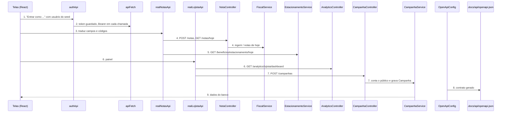
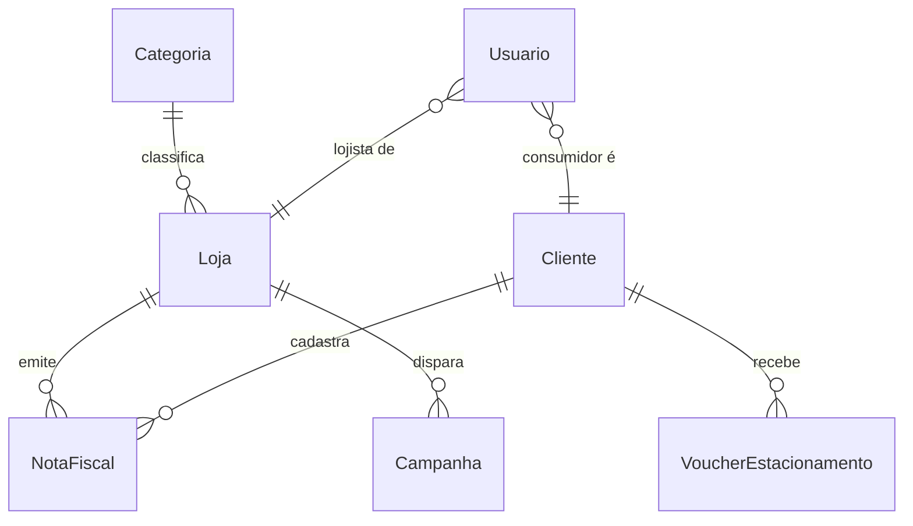
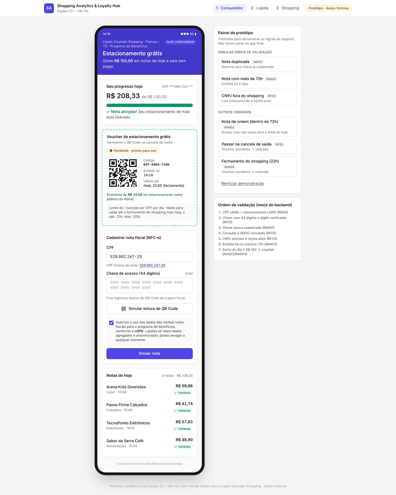

# Integração front-back, campanhas e Swagger

**Approved**: 2026-11-14 - user: "pode e faça o build e o push"

## Problem

O frontend não fala com o backend. O login gera um JWT local (`VITE_AUTH_MOCK`), a Tela 1 e a
Tela 2 leem dados de mocks em memória (`mockNotasApi`, `mockLojistaApi`) e o contrato que o front
propôs não é o que o backend devolve: o back responde `chaveAcesso`/`valorTotal` e erros
`{ code, message }`, o front espera `chave`/`valor`/`estabelecimento`/`categoria` e `{ codigo }`;
o código da nota vencida é `NOTA_EXPIRADA_72H` no back e `NOTA_ANTIGA` no front; os usuários de
demonstração do front (`consumidor@hoho.demo`) não existem no seed (`consumidor@shopping.com`);
`GET /api/v1/notas/hoje` e `POST /api/v1/campanhas` não existem; as chaves de demonstração do
front não estão no catálogo do `MockSefazGateway`. Quem paga é a equipe na banca: uma nota
cadastrada na Tela 1 não chega ao banco, então o ticket do lojista e o faturamento do shopping
nunca mudam, e o roteiro da ORD-14 não fecha. O Swagger UI já é servido, mas sem título, sem o
esquema Bearer e sem descrição das rotas, então não dá para testar uma rota protegida por ele.

Quando isto entra: quem clica em "Entrar como Consumidor" recebe um token do backend, a nota que
cadastra é gravada no Postgres e aparece na lista e na barra de progresso, o lojista vê o painel
calculado sobre o banco e dispara uma campanha que fica gravada, e qualquer pessoa da equipe abre
`/swagger-ui.html`, autoriza com o token e chama as rotas.

## Shape

Reusa o `apiFetch` do ORD-03 como único cliente HTTP e as interfaces `NotasApi`/`LojistaApi` que as
telas já consomem; só a implementação atrás delas muda. As regras que mudam um resultado rodam no
backend, em `FiscalService`, `EstacionamentoService` e `CampanhaService`, ao alcance dos testes
JUnit; a tradução de campos e códigos roda em `realNotasApi`, ao alcance do Vitest.

1. clique em "Entrar como …" -> `authApi` (exists) - envia e-mail e senha do usuário do seed a `POST /api/v1/auth/login`, guarda o token
2. `apiFetch` (exists) - põe o Bearer em toda chamada das telas
3. `realNotasApi` (exists) - traduz a resposta do backend para `NotaHoje`/`BeneficioHoje` e o `code` do erro para `NegocioError`
4. `NotaController` (exists) -> `FiscalService` (exists) - checa duplicidade, consulta a SEFAZ simulada, valida 72h e loja, persiste `NotaFiscal`; a resposta ganha `estabelecimento` e `categoria` (door 1); `GET /notas/hoje` lista as notas do dia (door 1)
5. `EstacionamentoService` (exists) - a resposta ganha `cpfMascarado` e `voucher.criadoEm` (door 1)
6. `realLojistaApi` (exists) -> `AnalyticsController` (exists) - painel da loja do token
7. `realLojistaApi` (exists) -> `CampanhaController` (new) -> `CampanhaService` (new) - conta o público, persiste `Campanha` (door 2)
8. `OpenApiConfig` (new) - título e esquema Bearer; o contrato gerado é gravado em `.docs/api/openapi.json` (door 4)
9. out: as telas mostram o que o banco tem; `mockNotasApi`, `mockLojistaApi`, `createNotasApi`, `createLojistaApi` e o token simulado deixam de existir

**Changes underneath**

| Front | What changes |
| --- | --- |
| domain | `FiscalService.ingerir` checa duplicidade antes de consultar a SEFAZ (AD-029); quem ramifica nisso hoje: `FiscalExceptionHandler` (mesmo 409) |
| domain | código de erro lido pelo front: `NOTA_ANTIGA` passa a `NOTA_EXPIRADA_72H`; entra `CHAVE_NAO_ENCONTRADA`; o corpo lido é `code`, não `codigo` - `realNotasApi` e `hooks` ramificam nisso |
| stored data | V3 acrescenta 2 clientes e 2 notas com mais de 60 dias na loja do lojista de demonstração; nada a migrar no que existe |
| readers | `DatabaseMigrationTests` conta as notas do seed (15 passa a 17); painel do lojista e o dashboard do shopping somam as 2 notas novas |
| readers | `mock-and-routes.test.tsx`, `acesso.test.tsx`, `shell.test.tsx`, `api.test.ts`, `PortalConsumidor.test.tsx`, `PortalLojista.test.tsx`, `consumidor.test.ts`, `lojista.test.ts` afirmam o modo simulado, os placeholders ou o `App.tsx`; mudam com a afirmação |
| readers | GitHub Pages (`gh-pages`) publica o build só com mock; sem mock ele deixa de funcionar sem backend - fora do escopo |

New: nenhuma entidade; `Campanha` passa a ser gravada (a tabela existe desde a V1); V3 só insere
linhas (door 3). One-way constraints: nenhuma nova.

## Surface

| Route | In | Out | Status | Who |
| --- | --- | --- | --- | --- |
| `POST /api/v1/notas` | `chaveAcesso` | o que já devolve + `estabelecimento`, `categoria` | `201`, `400`, `404`, `409`, `422`, `401`, `403` | CONSUMIDOR; sem token 401, outro perfil 403 |
| `GET /api/v1/notas/hoje` | - | lista de `chaveAcesso`, `valorTotal`, `dataEmissao`, `status`, `estabelecimento`, `categoria` | `200`, `401`, `403` | CONSUMIDOR; sem token 401, outro perfil 403 |
| `GET /api/v1/beneficios/estacionamento/hoje` | - | o que já devolve + `cpfMascarado`, `voucher.criadoEm` | `200`, `401`, `403` | CONSUMIDOR; sem token 401, outro perfil 403 |
| `POST /api/v1/campanhas` | `titulo`, `descontoPercentual`, `criterioAlvo` | `id`, `titulo`, `descontoPercentual`, `criterioAlvo`, `publicoAtingido`, `criadoEm` | `201`, `400`, `401`, `403` | LOJISTA; sem token 401, outro perfil 403 |
| `GET /v3/api-docs` | - | documento OpenAPI 3 | `200` | anyone |

## Landing

| One-way door | Literal shape | Alternative rejected |
| --- | --- | --- |
| 1. campos aditivos nas respostas da Tela 1 | nota: `{"chaveAcesso","valorTotal","dataEmissao","status","clienteId","lojaId","estabelecimento":"Zara Shopping Hub","categoria":"Vestuário"}`; benefício: `{"valorAcumulado","meta","percentual","valorFaltante","voucherLiberado","cpfMascarado":"***.456.789-**","voucher":{"id","codigoQr","status","dataReferencia","criadoEm"}}` | renomear para o contrato do front (`chave`, `valor`, `faltante`): quebra os testes de integração existentes (AD-025) |
| 2. contrato de `POST /api/v1/campanhas` | in `{"titulo":"Cupom 15% OFF","descontoPercentual":15,"criterioAlvo":"INATIVOS_60_DIAS"}`; out `201 {"id","titulo","descontoPercentual","criterioAlvo","publicoAtingido":2,"criadoEm"}`; a loja vem do token, nunca do corpo | `lojaId` no corpo: um lojista dispararia campanha em nome de outra loja |
| 3. `V3__seed_clientes_inativos.sql` | 2 clientes novos e 2 notas `APROVADA` na loja `22222222-2222-2222-2222-222222222201`, emitidas há 75 e 90 dias | editar a V2: o Flyway rejeita migration já aplicada com checksum diferente (AD-007) |
| 4. contrato versionado | `.docs/api/openapi.json`, gerado de `GET /v3/api-docs` | escrever o arquivo à mão: diverge do código na primeira rota nova |
| 5. corpo de erro que o front lê | `{"code":"NOTA_DUPLICADA","message":"..."}` com `code` em `NOTA_DUPLICADA`, `NOTA_EXPIRADA_72H`, `LOJA_NAO_CREDENCIADA`, `CHAVE_INVALIDA`, `CHAVE_NAO_ENCONTRADA` | o front manter `codigo`/`NOTA_ANTIGA`: exigiria mudar o `FiscalError` e seu teste de contrato (AD-025) |

- Nothing else in this change is hard to reverse

## Criteria

### S1: login real e fim dos mocks (P1)

Os três perfis entram com o usuário do seed e nada no front simula o backend.

**Acceptance Criteria**

1. WHEN alguém usa "Entrar como Consumidor", "Entrar como Lojista" ou "Entrar como Admin Shopping" THEN o front SHALL enviar `POST /api/v1/auth/login` com `consumidor@shopping.com`, `lojista@shopping.com` ou `admin@shopping.com` e a senha `demo123`, e abrir `/consumidor`, `/lojista` ou `/shopping` com o token devolvido
2. The frontend SHALL não conter implementação simulada do backend nem as flags `VITE_AUTH_MOCK`, `VITE_BACKEND_CONSUMIDOR` e `VITE_BACKEND_LOJISTA`: os arquivos `mockNotasApi.ts`, `mockLojistaApi.ts`, `createNotasApi.ts` e `createLojistaApi.ts` não existem e nenhum arquivo de `frontend/src`, `frontend/vite.config.ts`, `frontend/.env.example`, `frontend/package.json` ou `docker-compose.yml` cita essas flags
3. WHEN a Tela 1 ou a Tela 2 chama o backend THEN a requisição SHALL levar `Authorization: Bearer <token da sessão>`
4. WHERE o frontend roda pelo `docker compose --profile front` THEN o proxy de `/api` SHALL apontar para o host `host.docker.internal` na porta `8080`; fora do compose o destino continua `localhost` na porta `8080`

### S2: Tela 1 sobre o backend (P1)

A nota cadastrada na Tela 1 é gravada e volta na lista, no progresso e no voucher.

**Acceptance Criteria**

5. WHEN um CONSUMIDOR envia uma chave válida THEN `POST /api/v1/notas` SHALL responder `201` com `estabelecimento` igual ao nome da loja e `categoria` igual ao nome da categoria da loja, além dos campos que já devolve
   - chave Zara R$ 65,00 → `estabelecimento` "Zara Shopping Hub", `categoria` "Vestuário"; chave Burger King R$ 95,00 → "Burger King", "Alimentação"
6. WHEN um CONSUMIDOR chama `GET /api/v1/notas/hoje` THEN o sistema SHALL responder `200` com as notas `APROVADA` do cliente do token emitidas hoje, a cadastrada por último primeiro
   - nenhuma nota hoje → `[]`; nota do mesmo cliente emitida ontem → fora; nota de outro cliente emitida hoje → fora; duas notas de hoje → a segunda cadastrada vem primeiro
7. IF a chave enviada já está cadastrada THEN `POST /api/v1/notas` SHALL responder `409` `NOTA_DUPLICADA` sem consultar a SEFAZ simulada
   - chave de nota do seed, ausente do catálogo da SEFAZ simulada (`35261111111111000101650010000000010000000001`) → 409; chave do catálogo enviada duas vezes → 201 e depois 409; chave nunca cadastrada e ausente do catálogo → 404 `CHAVE_NAO_ENCONTRADA`
8. WHEN o backend rejeita uma nota THEN a Tela 1 SHALL mostrar a mensagem do `code` recebido: `NOTA_DUPLICADA` (409) "Esta nota já foi cadastrada. Cada nota vale apenas uma vez."; `NOTA_EXPIRADA_72H` (422) "Esta nota foi emitida há mais de 72 horas e não pode ser usada."; `LOJA_NAO_CREDENCIADA` (422) "A loja emissora não participa do programa do shopping."; `CHAVE_INVALIDA` (400) "A chave precisa ter 44 dígitos numéricos."; `CHAVE_NAO_ENCONTRADA` (404) "Chave não localizada na SEFAZ."
   - 500 sem corpo → a mensagem genérica de falha de envio que a tela já tem; 409 com `code` desconhecido → a mesma mensagem genérica
9. WHEN a Tela 1 recebe uma nota do backend THEN ela SHALL mostrar `valorTotal` como valor, `estabelecimento` e `categoria` na lista "notas de hoje", e a mensagem "Nota de R$ 65,00 validada." para uma nota de R$ 65,00
10. WHEN um CONSUMIDOR chama `GET /api/v1/beneficios/estacionamento/hoje` THEN a resposta SHALL trazer `cpfMascarado` igual ao `cpf_mascarado` do cliente do token e, quando há voucher, `voucher.criadoEm` com o instante em que foi gravado
    - cliente `33333333-3333-3333-3333-333333333301` → `***.456.789-**`; sem voucher → `voucher` nulo e `cpfMascarado` presente
11. WHEN a Tela 1 recebe o benefício THEN ela SHALL mostrar `valorFaltante` como o que falta, `voucher.codigoQr` como código e conteúdo do QR Code, `voucher.criadoEm` como hora de emissão, e a validade no fechamento do shopping do dia (22h de segunda a sábado, 20h no domingo)
12. WHEN o consumidor usa "Simular leitura de QR Code" THEN o campo SHALL receber, em ciclo, `35261111111111000101650010000001010000000101` (Zara R$ 65,00), `35261122222222000102650010000001020000000102` (Renner R$ 85,00) e `35261155555555000105650010000001030000000103` (R$ 55,00 na loja de CNPJ `55555555000105`)
13. WHEN o consumidor usa os botões "Nota duplicada", "Nota com mais de 72h" e "CNPJ fora do shopping" do Painel do protótipo THEN a Tela 1 SHALL enviar `35261111111111000101650010000000010000000001`, `35261111111111000101650010000001050000000105` e `35261199999999000199650010000001060000000106`, nessa ordem
14. The Tela 1 SHALL não mostrar "Reiniciar demonstração"
15. The Tela 1 SHALL mostrar o card "Ordem de validação" com os itens, nesta ordem: "CPF válido + consentimento LGPD (RN04)", "Chave com 44 dígitos (RF01)", "Chave nunca cadastrada (ReN01)", "Consulta à SEFAZ simulada (RF02)", "Emitida há no máximo 72h (ReN02)", "CNPJ emissor é lojista ativo (RF03)", "Soma do dia ≥ R$ 150 → voucher (ReN03/ReN04)"

### S3: Tela 2 e campanhas (P1)

O lojista vê o painel calculado no banco e a campanha que dispara fica gravada.

**Acceptance Criteria**

16. WHEN um LOJISTA envia `POST /api/v1/campanhas` com `titulo`, `descontoPercentual` e `criterioAlvo` `INATIVOS_60_DIAS` THEN o sistema SHALL gravar a campanha na loja do token e responder `201` com `id`, `titulo`, `descontoPercentual`, `criterioAlvo`, `publicoAtingido` e `criadoEm`
    - um `lojaId` no corpo é ignorado: a campanha fica na loja do token
17. The `publicoAtingido` SHALL ser o número de clientes distintos cuja nota `APROVADA` mais recente na loja do token foi emitida há mais de 60 dias
    - última compra há 61 dias → conta; há 59 dias → não conta; comprou há 90 dias e de novo há 5 dias → não conta; inativo há 90 dias só em outra loja → não conta; loja sem notas → 0
18. IF o corpo de `POST /api/v1/campanhas` é inválido THEN o sistema SHALL responder `400` e não gravar nada
    - `titulo` vazio → 400; `descontoPercentual` 0 → 400; 101 → 400; 1 → 201; 100 → 201; `criterioAlvo` diferente de `INATIVOS_60_DIAS` → 400
19. IF quem chama `POST /api/v1/campanhas` não é LOJISTA THEN o sistema SHALL responder `403`, e `401` sem token
20. WHEN o banco acaba de ser migrado THEN o lojista de demonstração (`lojista@shopping.com`) SHALL obter `publicoAtingido` 2 ao disparar a campanha, e `notas_fiscais` SHALL ter 17 linhas, todas emitidas antes de hoje
21. WHEN o lojista usa "Disparar Cupom 15% OFF" THEN a Tela 2 SHALL enviar `{"titulo":"Cupom 15% OFF","descontoPercentual":15,"criterioAlvo":"INATIVOS_60_DIAS"}` a `POST /api/v1/campanhas` e mostrar a mensagem de sucesso com o `publicoAtingido` devolvido
22. WHEN o lojista abre `/lojista` THEN a Tela 2 SHALL carregar `GET /api/v1/analytics/lojista/dashboard` e o consumidor em `/consumidor` SHALL ver a Tela 1, dentro do shell do ORD-03, no lugar dos placeholders "ORD-07" e "ORD-11"

### S4: Swagger (P2)

A equipe abre o Swagger UI, autoriza com o token e chama as rotas; o contrato fica no repositório.

**Acceptance Criteria**

23. WHEN alguém sem token chama `GET /v3/api-docs` THEN o sistema SHALL responder `200` com `info.title` "Shopping Analytics & Loyalty Hub API", o esquema de segurança `bearerAuth` (`type` `http`, `scheme` `bearer`, `bearerFormat` `JWT`) e os caminhos `/api/v1/auth/login`, `/api/v1/notas`, `/api/v1/notas/hoje`, `/api/v1/beneficios/estacionamento/hoje`, `/api/v1/analytics/lojista/dashboard` e `/api/v1/campanhas`
24. The documento OpenAPI SHALL marcar `/api/v1/auth/login` sem exigência de segurança e as demais rotas de `/api/v1` com `bearerAuth`
25. WHEN alguém sem token abre `/swagger-ui.html` THEN o sistema SHALL servir o Swagger UI (redirecionamento para `/swagger-ui/index.html`, que responde `200`)
26. The arquivo `.docs/api/openapi.json` SHALL ser igual ao documento que `GET /v3/api-docs` gera

## Out of scope

| Excluded | Why |
| --- | --- |
| Build de demonstração sem backend (GitHub Pages) | AD-026: os mocks saem; a página publicada em `gh-pages` deixa de funcionar sem backend |
| "Reiniciar demonstração" pelo backend | AD-026: não há como zerar o banco pela UI; o ensaio recomeça com `docker compose down -v` |
| Backend no `docker-compose.yml` | não há Dockerfile do backend; ele continua rodando com `./mvnw spring-boot:run` |
| Remover `ProbeController` | rotas de sondagem do ORD-02 com testes próprios; não fazem parte deste pedido |
| Campanhas com outros critérios, listagem ou edição | o card da Tela 2 só dispara a campanha fixa (AD-017) |
| Nome do usuário no token | o JWT do backend não traz `nome`; o shell já trata o campo como opcional |
| Dashboard e Tela 3 do shopping | plano `ORD-14-ensaio-demo` |

## Assumptions

| Assumption | Chosen default | Rationale | Confirmed? |
| --- | --- | --- | --- |
| Base da integração | branch a partir da `develop` com ORD-03 e ORD-11 mesclados | AD-024 | y |
| Quem se adapta ao contrato | o front; o back só soma campos e rotas | AD-025 | y |
| Destino dos mocks | removidos, com `POST /api/v1/campanhas` novo | AD-026 | y |
| Ordem da checagem de duplicidade | antes da SEFAZ simulada | AD-029 | y |
| Regra do público da campanha | literal (60 dias) com seed V3 | AD-030 | y |
| Card "Ordem de validação" | renomeado, na ordem real | AD-031 | y |
| Entrega do Swagger | UI configurada e `.docs/api/openapi.json` | AD-032 | y |
| Mensagem de `CHAVE_NAO_ENCONTRADA` na Tela 1 | "Chave não localizada na SEFAZ.", a mesma do backend, sem pílula de regra | o mockup não desenha esse caso; reusa o texto que o backend já devolve | n |
| Notas antigas da V3 | 2 clientes novos, notas de R$ 120,00 e R$ 80,00 na Zara há 75 e 90 dias | menor seed que dá um público maior que zero sem tocar nos clientes existentes | n |
| JDK local | os testes com Mockito rodam com `-DargLine=-Dnet.bytebuddy.experimental=true` nesta máquina (só há JDK 26; o projeto e o CI usam 21) | sem a flag o Byte Buddy do Spring Boot 3.4.5 recusa o Java 26; o `pom.xml` não muda | n |

**Open questions:** none - all resolved or logged above.

## Differences from the source

| Source shows | Product shows | Confirmed |
| --- | --- | --- |
| "Reiniciar demonstração" no Painel do protótipo (figura 1) | nada | y - AD-026 |
| card "Ordem de validação (mock do backend)" (figura 1) | card "Ordem de validação" com a ordem real do backend | y - AD-031 |

## Sources

- `.private/issue1.md`, `.private/issue2.md` e o pedido do usuário ("faça a conexão do front com back tirando os mocks e gere o swagger do projeto") - binding - o escopo
- `.specs/features/ord-07-portal-consumidor/plan.md` e `.specs/features/ord-11-portal-lojista/plan.md` - binding - as telas que já existem e seus textos
-  - binding - a Tela 1, que este plano só altera no que `Differences from the source` lista
