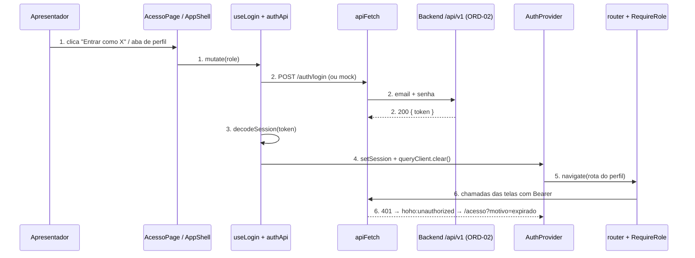
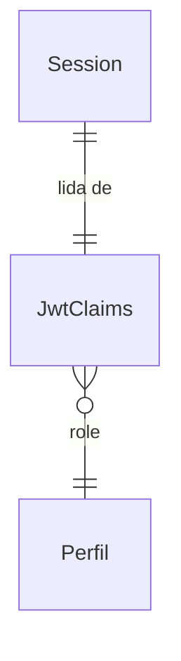
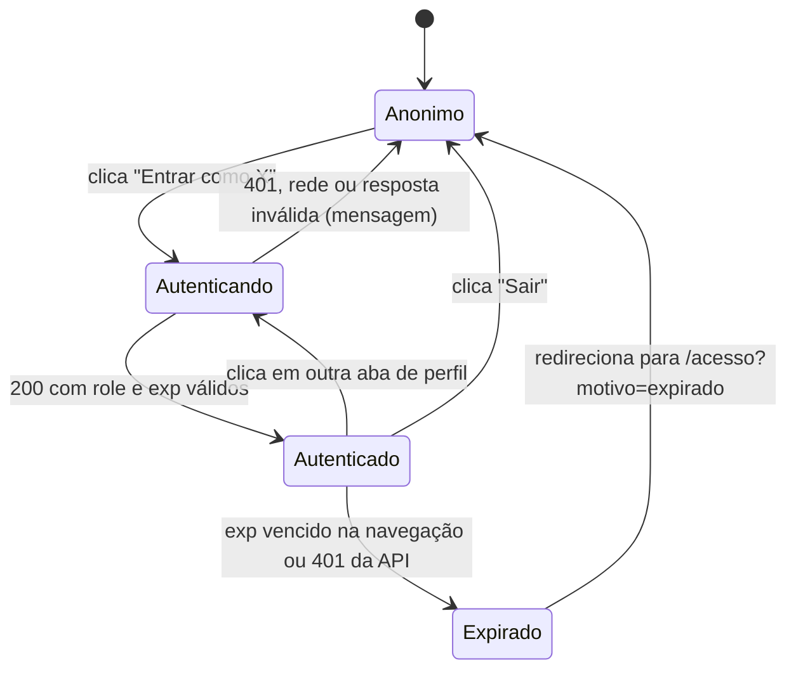
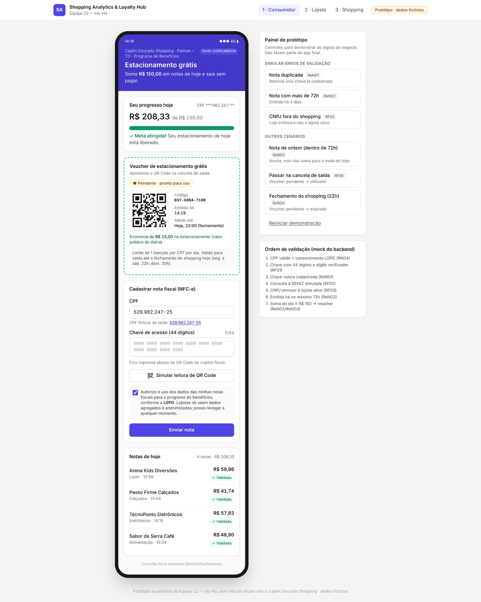
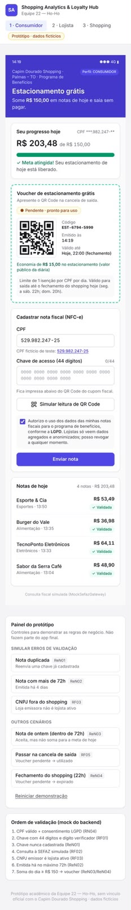
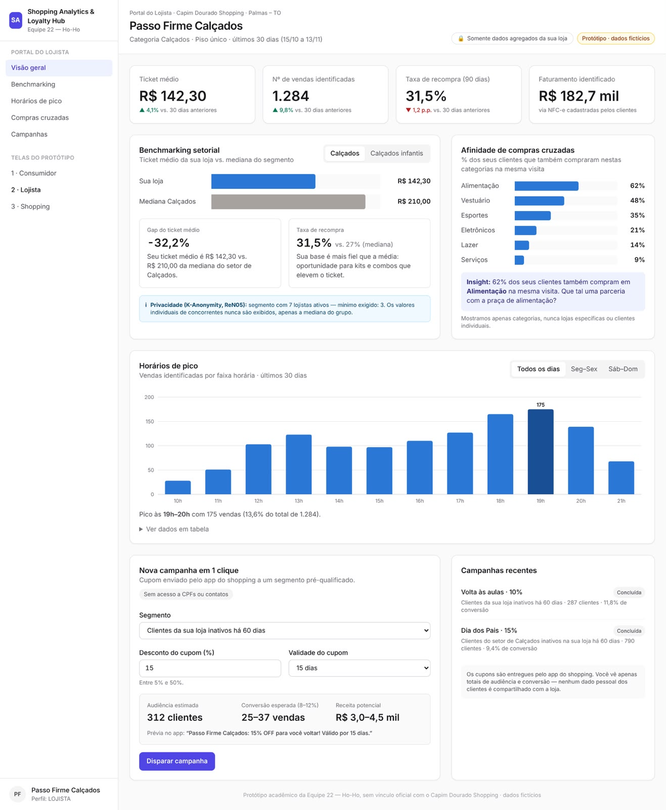
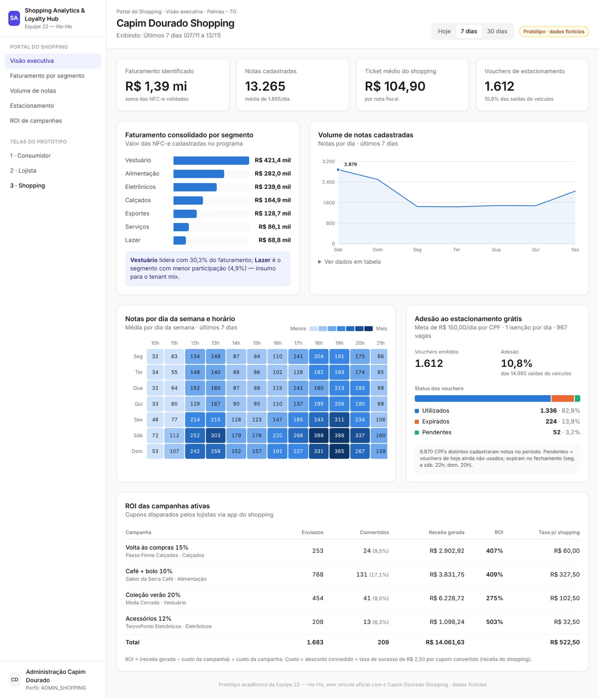

# ORD-03 - Shell da Aplicação, Rotas & Login "Acesso Rápido"

**Approved**: 2026-11-14 - user: "Pode aplicar e Inicie o Checks depois de validar"

## Problem

Hoje o frontend abre numa página-vitrine do design system (`frontend/src/App.tsx`): não há tela de acesso, rotas por perfil, sessão nem cliente HTTP autenticado. Quem paga é o apresentador da banca, que precisa alternar entre Consumidor, Lojista e Admin Shopping em 1 clique (o "eixo do roteiro da banca", ORD-14), e os donos do ORD-07, ORD-11 e ORD-12, que não têm onde montar as telas nem como chamar a API protegida. Evidência: a issue #3 lista #7, #11 e #12 como bloqueados por este card, e o `App.tsx` mostra os 4 slots como "Aguardando implementação".

Quando entregar, o apresentador entra em qualquer perfil e troca entre eles em 1 clique, com o token emitido pelo backend; um token vencido o devolve à tela de acesso; e cada dono de tela só preenche o seu slot, chamando a API sem tocar no token.

## Shape

Reusa o proxy `/api` → `:8080` do `vite.config.ts`, o `queryClient` de `src/lib/queryClient.ts`, os primitivos `Button`/`Card`/`Badge` e os tokens de `tokens.css`; não cria um segundo cliente nem um segundo tema. As regras que mudam um resultado (role → rota, decisão do guard, expiração, injeção do header, reação ao 401) ficam em funções puras de `src/lib/` e `src/features/auth/`, alcançáveis pelo Vitest (door 6).

1. o apresentador clica em "Entrar como X" em `AcessoPage` (new) ou numa aba de perfil do `AppShell` (new) → `useLogin` (new) dispara a mutation do TanStack Query
2. `authApi.postLogin` (new) - com `VITE_AUTH_MOCK=true` gera um token local (door 3); senão chama `apiFetch` (door 1) `POST /api/v1/auth/login` pelo proxy do Vite (exists), com as credenciais de demonstração do perfil, de um único arquivo de constantes (new)
3. `jwt.decodeSession` (new) - valida `role` e `exp` do token (door 4) e devolve a `Session`, ou um erro de resposta inválida
4. `AuthProvider` (new) - guarda o token em `sessionStorage` `hoho.session` (door 2) e limpa o `queryClient` (exists)
5. `router` (new) navega para a rota do perfil (door 7); `RequireRole` (new) aceita, ou redireciona por falta de sessão, expiração ou perfil errado
6. out: as chamadas seguintes do ORD-07/11/12 passam por `apiFetch` com `Authorization: Bearer`; um `401` dispara `hoho:unauthorized`, e o `AuthProvider` limpa a sessão e navega para `/acesso?motivo=expirado`

**Changes underneath**

| Front | What changes |
| --- | --- |
| domain | novo termo: `Perfil` - o `role` do token (`CONSUMIDOR`, `LOJISTA`, `ADMIN_SHOPPING`), mapeado para rota, rótulo e shell em `PERFIS`; nada no front ramifica sobre ele hoje |
| stored data | nada a migrar: a única coisa persistida é a sessão no `sessionStorage` do navegador (door 2), nova |
| readers | `frontend/src/main.tsx` passa a renderizar `RouterProvider`; a vitrine `App.tsx` sai, e ninguém mais a importa. Os cards ORD-07/11/12 leem `useAuth()` e chamam `apiFetch` |
| docs | `.docs/architecture/architecture-and-domain.md` §5 descreve `src/App.tsx` como o placeholder dos slots do Kanban; passa a descrever o shell, as rotas e `apiFetch` (critério 31) |

New: `Session` (só no navegador) e o mapa `Perfil` → rota. One-way constraints: chave `hoho.session` com `{ "token": "<jwt>" }` (door 2); claims `role` e `exp` obrigatórios (door 4).

## Surface

| Route | In | Out | Status | Who |
| --- | --- | --- | --- | --- |
| `GET /acesso` | `?motivo=expirado` opcional | tela com os 3 botões de acesso rápido | `200` (SPA); com sessão válida, redirect para a rota do perfil | anyone |
| `GET /consumidor` | sessão | shell do Consumidor + área do ORD-07 | `200` (SPA); sem sessão → `302` no cliente para `/acesso`; outro perfil → `302` no cliente para a rota do próprio perfil | `CONSUMIDOR` |
| `GET /lojista` | sessão | shell B2B + área do ORD-11 | `200` (SPA); sem sessão → `302` no cliente para `/acesso`; outro perfil → `302` no cliente para a rota do próprio perfil | `LOJISTA` |
| `GET /shopping` | sessão | shell B2B + área do ORD-12 | `200` (SPA); sem sessão → `302` no cliente para `/acesso`; outro perfil → `302` no cliente para a rota do próprio perfil | `ADMIN_SHOPPING` |
| `GET /` e qualquer outra rota | sessão opcional | redirecionamento | `200` (SPA) com redirect para a rota do perfil, ou `/acesso` | anyone |

## Landing

| One-way door | Literal shape | Alternative rejected |
| --- | --- | --- |
| 1. cliente HTTP do projeto (AD-002) | `apiFetch<T>(path: string, init?: RequestInit): Promise<T>` em `src/lib/api.ts`; `path` relativo a `/api/v1`; erro = `class ApiError { status: number; body: unknown }`; 401 dispara `window` event `hoho:unauthorized` | Axios + interceptors - dependência nova para o que um wrapper de 40 linhas resolve; o usuário escolheu fetch |
| 2. armazenamento da sessão (AD-003) | `sessionStorage['hoho.session'] = '{"token":"<jwt>"}'`; claims sempre derivados do token | `localStorage` - sobrevive ao fechamento do navegador e vaza entre abas; só em memória - um F5 derruba a demo |
| 3. modo mock (AD-004) | `VITE_AUTH_MOCK=true` → token `header.payload.mock` com `alg: none`, claims do perfil e `exp = agora + 8h`, sem rede; documentado em `frontend/.env.example` | MSW - dependência nova + service worker para um único endpoint |
| 4. contrato consumido do ORD-02 | `POST /api/v1/auth/login` `{"email","senha"}` → `200 {"token"}`; claims lidos: `sub`, `role`, `exp`, opcional `nome`; `lojaId`/`clienteId` nunca lidos nem enviados pelo front | `role` no corpo da resposta - duas fontes de verdade para o mesmo dado |
| 5. contrato do slot de navegação (AD-001) | rota do portal declara `handle: { nav: Array<{ label: string; to: string }> }`; o shell B2B renderiza `handle.nav` na seção do portal | cada tela monta a própria sidebar - duplica o shell e quebra a troca de perfil uniforme |
| 6. runner de testes (AD-007) | devDeps `vitest@^3` (compatível com Vite 6), `@testing-library/react@^16` + `@testing-library/dom` (compatível com React 18, fixado pelo ADR-07), `@testing-library/user-event@^14`, `jsdom`; script `"test": "vitest run"`; o React continua em `^18.3.1` | sem runner - redirecionamento, header e 401 seriam provados só à mão |
| 7. URLs dos portais | `/acesso`, `/consumidor`, `/lojista`, `/shopping` - os cards ORD-07/11/12 e o roteiro ORD-14 apontam para elas | `/login` e `/app/<perfil>` - o card fala em "tela de acesso" e o prefixo não protege nada |
| 8. rotas públicas do `apiFetch` (achada no build) | todo `path` que começa com `/auth/` sai sem `Authorization` e o seu `401` não encerra a sessão nem dispara `hoho:unauthorized` | exceção por opção em cada chamada - quem esquecesse de passá-la derrubaria a sessão ao trocar de perfil com credencial recusada |

- Nothing else in this change is hard to reverse

## Criteria

### S1: Acesso rápido (P1)

Na tela de acesso, 1 clique autentica no perfil escolhido e abre a sua tela.

**Acceptance Criteria**

1. WHEN o apresentador abre `/acesso` sem sessão THEN o sistema SHALL mostrar 3 botões: "Entrar como Consumidor", "Entrar como Lojista" e "Entrar como Admin Shopping"
2. WHEN o apresentador clica em "Entrar como Lojista" THEN o sistema SHALL enviar `POST /api/v1/auth/login` com o `email` e a `senha` de `DEMO_USERS.LOJISTA` e, na resposta `200`, abrir `/lojista` com sessão de `role` `LOJISTA`
   - "Entrar como Consumidor" → `/consumidor` com `CONSUMIDOR`; "Entrar como Admin Shopping" → `/shopping` com `ADMIN_SHOPPING`
3. WHILE o login está pendente o sistema SHALL desabilitar os 3 botões e mostrar "Entrando…" no botão clicado
4. IF o login responde `401` THEN o sistema SHALL mostrar "Credenciais de demonstração inválidas.", reabilitar os 3 botões e não criar sessão
   - falha de rede → "Não foi possível conectar ao servidor."; `500` → "Erro no servidor. Tente novamente."
5. IF o token recebido não tem `role` entre os 3 perfis ou não tem `exp` THEN o sistema SHALL mostrar "Resposta de login inválida." e não criar sessão
   - `role: "ADMIN"` → rejeitado; sem `exp` → rejeitado; `role: "LOJISTA"` com `exp` futuro → aceito
6. WHEN alguém abre `/acesso` com sessão válida THEN o sistema SHALL redirecionar para a rota do perfil da sessão
7. WHEN alguém abre `/acesso?motivo=expirado` THEN o sistema SHALL mostrar o aviso "Sua sessão expirou. Entre novamente." acima dos botões

### S2: Rotas por perfil (P1)

Cada tela só abre para o seu perfil; quem não tem sessão válida volta para o acesso.

**Acceptance Criteria**

8. IF não há sessão WHEN alguém abre `/consumidor`, `/lojista` ou `/shopping` THEN o sistema SHALL redirecionar para `/acesso`
9. WHILE a sessão é de um perfil, WHEN ele abre a rota de outro perfil THEN o sistema SHALL redirecionar para a rota do próprio perfil
   - `CONSUMIDOR` abre `/lojista` → `/consumidor`; `LOJISTA` abre `/shopping` → `/lojista`; `ADMIN_SHOPPING` abre `/consumidor` → `/shopping`
10. WHEN alguém abre `/` ou uma rota inexistente THEN o sistema SHALL redirecionar para a rota do perfil da sessão, ou para `/acesso` sem sessão
11. IF o token guardado tem `exp` no passado ou não pode ser decodificado THEN, na próxima navegação, o sistema SHALL apagar `hoho.session` e redirecionar para `/acesso?motivo=expirado`
    - `exp` = agora − 1s → expirado; `exp` = agora + 60s → aceito; `"lixo"` → expirado
12. WHEN o apresentador recarrega a página (F5) com sessão válida em `/lojista` THEN o sistema SHALL continuar em `/lojista` com a mesma sessão

### S3: Cliente HTTP autenticado (P1)

As telas chamam a API por `apiFetch` e o token entra sozinho.

**Acceptance Criteria**

13. WHILE há sessão, `apiFetch` SHALL enviar o header `Authorization: Bearer <token da sessão>` em toda requisição; sem sessão, SHALL não enviar `Authorization`
14. The system SHALL prefixar `/api/v1` ao `path` recebido por `apiFetch`
    - `apiFetch('/notas')` → `/api/v1/notas`
15. IF uma chamada de `apiFetch` com sessão recebe `401` THEN o sistema SHALL apagar `hoho.session`, redirecionar para `/acesso?motivo=expirado` e rejeitar com `ApiError` de `status` `401`
    - `401` em `GET /beneficios/estacionamento/hoje` → redireciona; `401` no próprio `POST /auth/login` → sem redirecionamento, vale o critério 4
16. IF uma chamada de `apiFetch` recebe `403` THEN o sistema SHALL rejeitar com `ApiError` de `status` `403` e manter a sessão e a rota atual

### S4: Shell e troca de perfil (P1)

As 3 telas ficam dentro do shell dos mockups, e a troca de perfil funciona de qualquer uma delas.

**Acceptance Criteria**

17. WHEN o `CONSUMIDOR` abre `/consumidor` THEN o sistema SHALL mostrar a barra do topo de `.specs/features/ord-03-shell-login/captures/figura1-consumidor-desktop.png` em 1280px e de `.specs/features/ord-03-shell-login/captures/figura2-consumidor-mobile.png` em largura de celular, com a área abaixo dela entregue ao ORD-07
18. WHEN o `LOJISTA` abre `/lojista` THEN o sistema SHALL mostrar a sidebar de `.specs/features/ord-03-shell-login/captures/figura3-portal-lojista.png`, e WHEN o `ADMIN_SHOPPING` abre `/shopping` THEN a de `.specs/features/ord-03-shell-login/captures/figura4-portal-shopping.png`, com a área à direita entregue ao ORD-11 e ao ORD-12
19. WHEN o apresentador clica em "2 · Lojista" na barra do Consumidor ou na seção "TELAS DO PROTÓTIPO" da sidebar THEN o sistema SHALL fazer o login como `LOJISTA` e abrir `/lojista`, em 1 clique, com o item do perfil ativo destacado
    - "1 · Consumidor" → `/consumidor`; "3 · Shopping" → `/shopping`; clicar no item do perfil ativo → nenhuma requisição e nenhuma navegação
20. WHEN o perfil muda, ou o apresentador sai THEN o sistema SHALL esvaziar o cache do `queryClient`, para que nenhuma query do perfil anterior apareça no novo
21. The system SHALL mostrar, no rodapé da sidebar B2B, o claim `nome` do token (ou `sub` sem `nome`) e "Perfil: <role>"
    - `LOJISTA` → "Perfil: LOJISTA"; `ADMIN_SHOPPING` → "Perfil: ADMIN_SHOPPING"
22. WHILE a largura é menor que 768px, o shell B2B SHALL mostrar uma barra no topo com o logo e um botão "Abrir menu"; WHEN o apresentador toca nele THEN a sidebar SHALL abrir como gaveta sobre o conteúdo; WHEN ele escolhe um item, toca fora ou pressiona Esc THEN a gaveta SHALL fechar
23. WHEN o apresentador clica em "Sair" THEN o sistema SHALL apagar `hoho.session`, esvaziar o cache do `queryClient` e abrir `/acesso` sem o aviso de expiração
24. The system SHALL mostrar na área de conteúdo de cada portal um placeholder com o código do card dono (`ORD-07`, `ORD-11` ou `ORD-12`) até esse card substituí-lo
25. WHERE uma rota de portal declara `handle.nav` o shell B2B SHALL renderizar cada item como link na seção do portal da sidebar, e sem `handle.nav` SHALL omitir a seção
26. The system SHALL não registrar erro nem warning no console do navegador ao percorrer S1 a S4
27. The system SHALL, nos arquivos que este card cria em `frontend/src/`, não ter cor hexadecimal literal (`#rgb`/`#rrggbb`) nem emoji, e importar ícones só de `lucide-react` (regras de ouro do `guia-design-system.md` §1)
    - `text-[#4F46E5]` → violação; `text-[var(--color-brand)]` → aceito; `<LogOut />` de `lucide-react` → aceito
28. The system SHALL renderizar os botões de acesso, "Sair" e "Abrir menu" com o primitivo `Button` de `src/components/ui/Button.tsx`

### S5: Modo mock até o ORD-02 (P2)

O fluxo inteiro roda sem backend enquanto o ORD-02 não fica pronto.

**Acceptance Criteria**

29. WHERE `VITE_AUTH_MOCK=true` o sistema SHALL, ao clicar num botão de perfil, criar a sessão daquele perfil sem nenhuma requisição de rede, com `exp` = agora + 8h
30. WHERE `VITE_AUTH_MOCK` está ausente ou diferente de `true` o sistema SHALL autenticar só via `POST /api/v1/auth/login`
    - ausente → rede; `"false"` → rede; `"TRUE"` → rede

### S6: Documentação de arquitetura (P2)

A arquitetura documentada descreve o frontend que existe depois do merge.

**Acceptance Criteria**

31. WHEN o ORD-03 é mergeado THEN `.docs/architecture/architecture-and-domain.md` §5 SHALL citar `src/lib/api.ts` (`apiFetch`), `src/features/auth/` e `src/app/router.tsx`, e SHALL não descrever mais `src/App.tsx` como placeholder dos slots do Kanban

## Out of scope

| Excluded | Why |
| --- | --- |
| Conteúdo dos 3 portais (cards, gráficos, formulário de NFC-e, "Painel do protótipo") | é do ORD-07, ORD-11 e ORD-12 (AD-001) |
| Itens de menu de cada portal ("Visão geral", "Benchmarking", "Faturamento por segmento"…) | o ORD-11/12 os declaram via `handle.nav` (door 5) |
| Cabeçalho da área do portal (breadcrumb, nome da loja/shopping, filtros de período, selo "Somente dados agregados da sua loja") | é conteúdo do ORD-11/12, desenhado dentro da área de conteúdo; o selo "Protótipo · dados fictícios" fica numa faixa do shell acima dele (AD-008) |
| Cadastro, recuperação de senha e formulário de login livre | ADR-05: acesso só por usuários seedados |
| Refresh token e renovação silenciosa | o ORD-02 não emite refresh token; a expiração devolve ao acesso |
| Validar a assinatura do JWT no front | quem autoriza é o backend; o front só lê `role` e `exp` |
| Cookie httpOnly | exige mudar o contrato do ORD-02; fica para a v2 (AD-003) |
| Implementar o `POST /api/v1/auth/login` | é o ORD-02 |

## Assumptions

| Assumption | Chosen default | Rationale | Confirmed? |
| --- | --- | --- | --- |
| Credenciais dos usuários seedados | `consumidor@hoho.demo`, `lojista@hoho.demo` e `admin@hoho.demo`, senha `demo123`, num único arquivo `DEMO_USERS` | o ORD-01 ainda não as definiu; trocá-las é editar uma linha | n |
| Onde a sessão fica e o que acontece no F5 | `sessionStorage`, sobrevivendo ao F5 e morrendo com a aba | user delegated: "siga os padrões do mercado e as melhores boas práticas" | y |
| `403` vindo da API | mantém a sessão e a rota; a tela trata o erro | `403` é perfil sem permissão para aquele recurso, não sessão inválida | n |
| Textos de erro e aviso | os literais dos critérios 3, 4, 5 e 7 | nenhuma captura desenha a tela de acesso | n |
| Nome no rodapé da sidebar | claim `nome`; sem ele, `sub` | as capturas mostram "Passo Firme Calçados" e "Administração Capim Dourado", que não estão no contrato | n |
| Duração do token no mock | 8 horas | cobre o ensaio e a banca sem expirar no meio | n |
| Selo "Protótipo · dados fictícios" | presente nos 3 shells, como nas capturas | as 4 capturas o desenham | y |
| Tela `/acesso` | layout livre, só com o design system; sem captura | nenhuma das 4 figuras a desenha | n |

**Open questions:**

- Credenciais exatas dos 3 usuários seedados no ORD-01 (Lucas) - blocks go-live
- O token do ORD-02 traz o claim `nome`? (Lucas) - open

## Differences from the source

| Source shows | Product shows | Confirmed |
| --- | --- | --- |
| conteúdo completo de cada portal nas figuras 1 a 4 | placeholder com o código do card dono, até o ORD-07/11/12 entregar | y - AD-001 |
| itens de menu do portal na sidebar (figuras 3 e 4) | seção vazia até a rota declarar `handle.nav` | y - AD-001 |
| nenhum botão de sair | botão "Sair" discreto no fim da barra (Consumidor) e ao lado do rodapé do usuário (B2B) | y - AD-006 |
| avatar com "CD" para "Administração Capim Dourado" (figura 4) | "AC", das 2 primeiras palavras do nome | y - AD-009 |

## Sources

- Issue #3 / `.docs/planning/mvp-sabado-kanban.md` `[ORD-03]` - binding - escopo, critérios de aceite e DoD
- `.docs/architecture/architecture-and-domain.md` §3 e ADR-05 - binding - endpoint `POST /api/v1/auth/login`, os 3 `role` e o acesso rápido com usuários seedados
- `.docs/architecture/architecture-and-domain.md` ADR-07 - binding - proxy `/api`, React 18 fixo (`^18.3.1`) e TanStack Query; restringe as versões da door 6
- `.docs/architecture/architecture-and-domain.md` §5 - binding - descrição do frontend que este card atualiza (critério 31)
-  `captures/figura1-consumidor-desktop.png` (1280×1600) - binding - barra do topo com as abas `1 · Consumidor`, `2 · Lojista`, `3 · Shopping` e o selo
-  `captures/figura2-consumidor-mobile.png` (232×1600, página inteira reduzida) - binding - barra empilhada no celular
-  `captures/figura3-portal-lojista.png` (1317×1600) - binding - sidebar com "TELAS DO PROTÓTIPO" e rodapé "Perfil: LOJISTA"
-  `captures/figura4-portal-shopping.png` (1373×1600) - binding - sidebar com "TELAS DO PROTÓTIPO" e rodapé "Perfil: ADMIN_SHOPPING"
- `.docs/markdown/guia-design-system.md` §1 e §2 - binding - regras de ouro (critérios 27 e 28), tokens e primitivos; §4 atribui as figuras 3 e 4 ao ORD-11/12, cuja sidebar vem deste card (AD-001)
