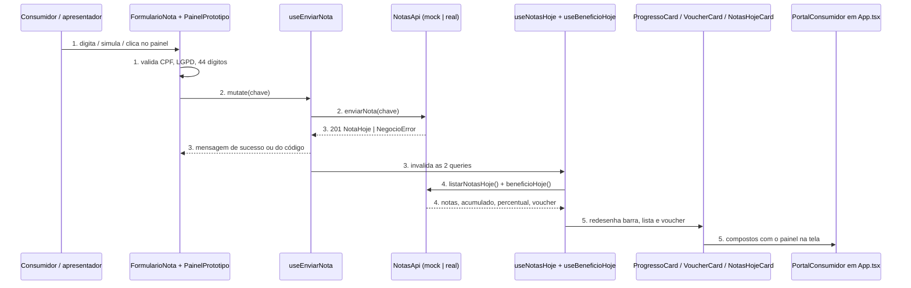
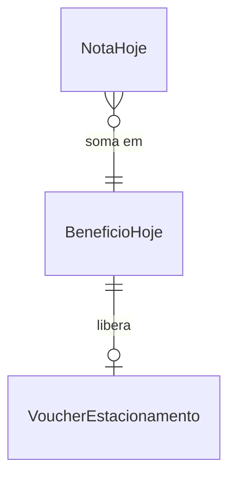
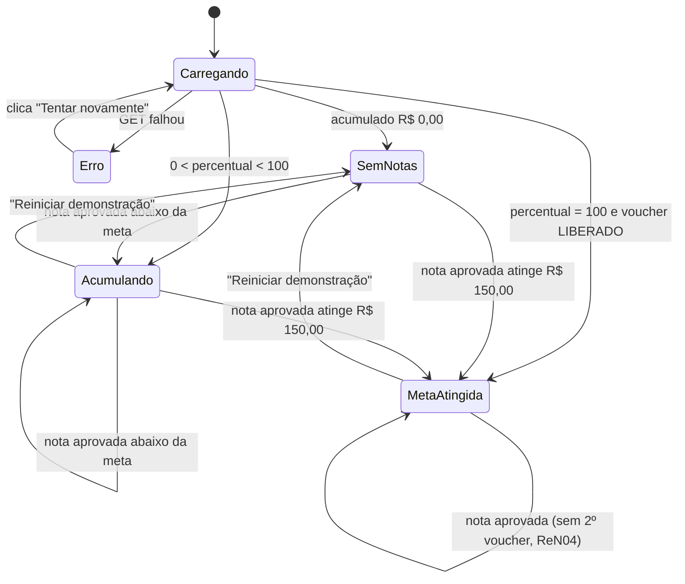
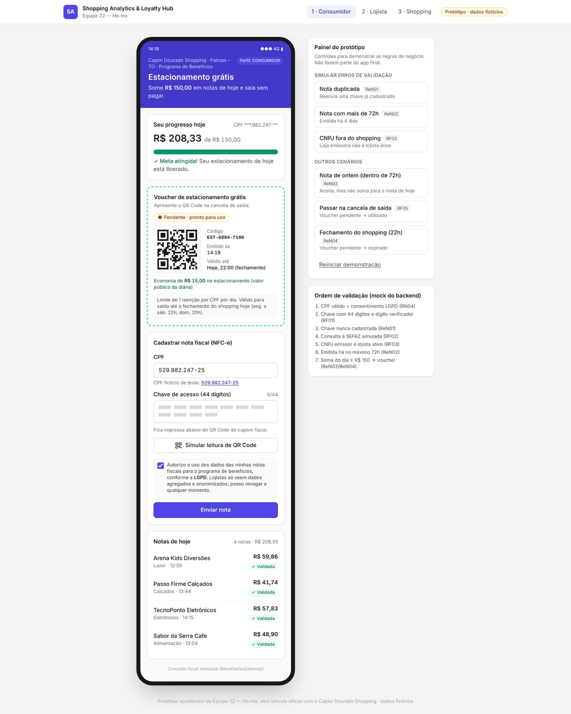

# ORD-07 - Tela 1: Portal do Consumidor

**Approved**: 2026-11-14 - user: "Aprovado, pode seguir para os checks"

## Problem

Hoje o consumidor não tem tela: o slot `ORD-07` do `frontend/src/App.tsx` mostra "Aguardando implementação". Quem paga é o apresentador da banca, que não consegue mostrar os passos 1 e 2 do roteiro do ORD-14 (cadastrar nota, ver o acúmulo até R$ 150,00 e o voucher), nem provar ao vivo as regras ReN01, ReN02 e RF03, que são o diferencial do backend fiscal. Evidência: issue #7 (cópia em `.private/ord-07-card.md`), P0, e o kanban (`.docs/planning/mvp-sabado-kanban.md` `[ORD-07]`). O backend dessas regras (ORD-04/05/06) ainda não existe: `backend/src/main/java/.../fiscal` e `beneficios` só têm `package-info.java`.

Quando entregar, o apresentador digita ou simula a chave de uma NFC-e, vê a nota entrar na lista de hoje e a barra subir até a meta, vê o voucher com QR Code aparecer ao atingir R$ 150,00 e, com um clique no painel, mostra cada erro de negócio com a sua mensagem, tudo sem backend e pronto para trocar pelo backend real com uma flag.

## Shape

Reusa a camada de dados já escrita em `frontend/src/features/consumidor/` (`NotasApi`, `mockNotasApi`, `regras.ts`, ainda não commitada), o `queryClient` de `src/lib/queryClient.ts`, os primitivos `Button`/`Card`/`Badge` e os tokens de `tokens.css`; não cria segundo tema nem segundo cliente de estado. As regras que mudam um resultado (percentual e faltante, validade da chave e do CPF, mapeamento de erro → mensagem, ordenação e soma da lista, ciclo de chaves demo, escolha mock/real) ficam em funções puras e no `NotasApi`, alcançáveis pelo Vitest (door 3).

1. o consumidor digita a chave, clica em "Simular leitura de QR Code" ou num botão do painel → `FormularioNota` (new) valida CPF, consentimento e 44 dígitos no front; inválido para aqui com mensagem, sem requisição
2. `useEnviarNota` (new, mutation do TanStack Query) → `NotasApi.enviarNota` (exists, não commitado), escolhido por `criarNotasApi` (exists, não commitado): `mockNotasApi` (exists, não commitado) ou a implementação real sobre o contrato da door 1, com o `fetcher` injetado (door 2)
3. resposta `201` → a mutation invalida as queries `['consumidor','notas-hoje']` e `['consumidor','beneficio-hoje']`; `NegocioError` → `FormularioNota` mostra a mensagem do código (`MENSAGEM_NEGOCIO`, exists)
4. `useNotasHoje` e `useBeneficioHoje` (new, queries) refazem `GET /notas/hoje` e `GET /beneficios/estacionamento/hoje`
5. out: `ProgressoCard`, `VoucherCard` e `NotasHojeCard` (new) redesenham com o acumulado, o percentual e o voucher que a API devolveu; `PortalConsumidor` (new) os compõe com `PainelPrototipo` (new), e `App.tsx` (exists) o renderiza até o merge do ORD-03 (AD-010)

**Changes underneath**

| Front | What changes |
| --- | --- |
| domain | `NotaHoje.hora` (`HH:mm`) vira `dataEmissao` (ISO 8601) e `VoucherEstacionamento.emitidoEm`/`validoAte` viram ISO, com `status`; `BeneficioHoje` ganha `cpfMascarado`. Só os arquivos não commitados de `features/consumidor/` ramificam sobre eles hoje |
| stored data | nada a migrar: o front não persiste nada; o estado da demonstração vive na memória do mock e some no F5 |
| readers | `App.tsx` deixa de mostrar a vitrine do design system e renderiza `PortalConsumidor` (AD-010); no merge do ORD-03, que apaga `App.tsx`, `PortalConsumidor` substitui o placeholder `pages/ConsumidorPage.tsx` da rota `/consumidor` |
| tests | `consumidor.test.ts` (C43-C59, numeração herdada do ORD-03) é renumerado para os checks deste card e passa a rodar nesta branch (door 3) |

New: `GET /api/v1/notas/hoje` no contrato proposto (door 1); nada persistido no front. One-way constraints: forma dos 3 corpos e dos códigos de erro (door 1).

## Surface

None - nothing consumed outside. A tela não adiciona rota nesta branch (`App.tsx` a renderiza em `/`, AD-010); as 3 rotas de API que ela consome são do ORD-05/06 e o contrato proposto está na door 1.

## Landing

| One-way door | Literal shape | Alternative rejected |
| --- | --- | --- |
| 1. contrato consumido do ORD-05/06 (AD-012) | `POST /api/v1/notas` `{"chaveAcesso":"<44 dígitos>"}` → `201 {"chave","estabelecimento","categoria","dataEmissao","valor","status":"APROVADA"}`; erros `409 {"codigo":"NOTA_DUPLICADA","mensagem"}` e `422 {"codigo":"NOTA_ANTIGA" \| "LOJA_NAO_CREDENCIADA" \| "CHAVE_INVALIDA","mensagem"}`. `GET /api/v1/notas/hoje` → `200 [NotaHoje]`. `GET /api/v1/beneficios/estacionamento/hoje` → `200 {"valorAcumulado","meta","percentual","faltante","cpfMascarado","voucher": null \| {"codigo","status":"LIBERADO" \| "UTILIZADO" \| "EXPIRADO","emitidoEm","validoAte","qrPayload"}}`. Datas em ISO 8601, valores em número com 2 casas | notas de hoje dentro da resposta de `beneficios` - acopla o módulo `beneficios` aos campos de exibição do `fiscal` (estabelecimento, categoria); o front deriva a mensagem do `codigo`, nunca do texto `mensagem`, para que o backend possa mudar a redação |
| 2. ponto de integração com o `apiFetch` do ORD-03 | `criarNotasApi(fetcher?: <T>(path: string, init?: RequestInit) => Promise<T>)`; o `fetcher` recebe `path` relativo a `/api/v1` e rejeita com objeto `{ status: number; body: unknown }` (a forma do `ApiError` do ORD-03); no merge, passa-se `apiFetch` | chamar `fetch` direto - duplicaria o Bearer e o 401 que o `apiFetch` já trata (AD-002 do ORD-03) |
| 3. runner de testes nesta branch (AD-014) | devDeps `vitest@^3.2.7`, `@testing-library/react@^16.3.3`, `@testing-library/dom@^10.4.2`, `@testing-library/user-event@^14.6.10`, `jsdom@^31.0.1`; script `"test": "vitest run"`; React continua `^18.3.1` | versões diferentes das do ORD-03 - conflito no `package-lock.json` no merge e dois runners possíveis |
| 5. modos de build (achada no build, critério 31) | `frontend/package.json` scripts `"build:demo": "tsc -b && vite build --mode demo"` e `"build:integrado": "tsc -b && vite build --mode integrado"`; `vite.config.ts` fixa `import.meta.env.VITE_BACKEND_CONSUMIDOR` só no `vite build`: `"true"` no modo `integrado`, `"false"` em qualquer outro | arquivos `.env.demo`/`.env.integrado` - o `.gitignore` ignora `.env.*`, então o modo não iria para o repositório e cada máquina empacotaria diferente |
| 4. dependência de QR Code | `qrcode.react@^4.2.0` (`<QRCodeSVG value={voucher.qrPayload} />`), peer `react >=16.8` | desenhar um padrão falso em SVG - não é lido pela cancela; gerar à mão - código de codificação QR sem teste |

- Nothing else in this change is hard to reverse

## Criteria

### S1: A tela dos mockups (P1)

A Tela 1 aparece como nos mockups, no desktop e no celular.

**Acceptance Criteria**

1. WHEN o consumidor abre a Tela 1 numa janela de 1280px THEN o sistema SHALL mostrar a tela de `.specs/features/ord-07-portal-consumidor/captures/figura1-consumidor-desktop.png`: o app num quadro de celular à esquerda e, à direita, "Painel do protótipo" e "Ordem de validação (mock do backend)", menos o que `## Differences from the source` lista
2. WHEN o consumidor abre a Tela 1 numa janela de 390px THEN o sistema SHALL mostrar a tela de `.specs/features/ord-07-portal-consumidor/captures/figura2-consumidor-mobile.png` em coluna única, sem rolagem horizontal, na ordem: cabeçalho "Estacionamento grátis", "Seu progresso hoje", voucher (quando houver), "Cadastrar nota fiscal (NFC-e)", "Notas de hoje", "Painel do protótipo", "Ordem de validação (mock do backend)"
3. The system SHALL, nos arquivos que este card cria ou altera em `frontend/src/`, não ter cor hexadecimal literal (`#rgb`/`#rrggbb`) nem emoji, importar ícones só de `lucide-react`, e usar a classe `tabular-nums` em todo valor em reais, percentual e contador (regras de ouro do `guia-design-system.md` §1)
   - `text-[#4F46E5]` → violação; `text-[var(--color-brand)]` → aceito; "✓" como texto → violação; `<Check />` de `lucide-react` → aceito
4. The system SHALL renderizar os botões da tela com o primitivo `Button`, os cards com `Card` e as pílulas ("Validada", "Pendente · pronto para uso", "ReN01"…) com `Badge`, de `src/components/ui/`
5. The system SHALL não registrar erro nem warning no console do navegador ao percorrer S1 a S5

### S2: Progresso e voucher (P1)

A barra e o voucher mostram o que a API devolveu.

**Acceptance Criteria**

6. WHEN a tela abre THEN o sistema SHALL buscar o benefício de hoje e mostrar em "Seu progresso hoje" o `valorAcumulado` em reais, "de R$ 150,00", "CPF <cpfMascarado>" e a barra preenchida no `percentual` da resposta, limitado a 0-100
   - `percentual` 0 → 0%; 48 → 48%; 139 → 100%; -5 → 0%; `valorAcumulado` 208.33 → "R$ 208,33"
7. WHILE o `percentual` é menor que 100 o sistema SHALL mostrar "Faltam R$ <faltante> para liberar seu estacionamento."; WHEN chega a 100 THEN SHALL mostrar "Meta atingida! Seu estacionamento de hoje está liberado." com o ícone `Check`
   - `faltante` 150 → "Faltam R$ 150,00…"; 0,01 → "Faltam R$ 0,01…"; `percentual` 100 → "Meta atingida!…"
8. WHEN a resposta traz `voucher` com `status` `LIBERADO` THEN o sistema SHALL mostrar o card "Voucher de estacionamento grátis" com "Apresente o QR Code na cancela de saída.", a pílula "Pendente · pronto para uso", o QR Code de `qrPayload`, "Código" `<codigo>`, "Emitido às" `<HH:mm de emitidoEm>`, "Válido até" `<validoAte>`, "Economia de R$ 15,00 no estacionamento (valor público da diária)" e "Limite de 1 isenção por CPF por dia. Válido para saída até o fechamento do shopping hoje (seg. a sáb. 22h; dom. 20h)."
   - `validoAte` hoje às 22:00 → "Hoje, 22:00 (fechamento)"; amanhã às 20:00 → "15/11, 20:00 (fechamento)"
9. WHILE `voucher` é `null` o sistema SHALL não mostrar o card do voucher
10. WHILE o benefício está carregando o sistema SHALL mostrar "Carregando seu progresso…" no lugar dos valores; IF a busca falha THEN SHALL mostrar "Não foi possível carregar seu progresso." e um botão "Tentar novamente" que refaz a busca

### S3: Cadastrar nota (P1)

Uma chave válida vira nota aprovada; uma inválida mostra o motivo.

**Acceptance Criteria**

11. The system SHALL aceitar no campo "Chave de acesso (44 dígitos)" só dígitos, no máximo 44, exibidos em grupos de 4, com o contador "<n>/44" e a dica "Fica impressa abaixo do QR Code do cupom fiscal."
    - colar 44 dígitos com espaços → 44 dígitos, "44/44"; digitar "a" → nada muda; 45º dígito → ignorado; campo vazio → "0/44"
12. WHEN o consumidor clica em "Simular leitura de QR Code" THEN o sistema SHALL preencher o campo com a próxima chave válida do ciclo de demonstração (`VALIDA_60` → `VALIDA_90` → `VALIDA_40` → `VALIDA_60`…), sem enviar
13. The system SHALL abrir o campo "CPF" com "529.982.247-25" e a linha "CPF fictício de teste: 529.982.247-25"; WHEN o consumidor clica no CPF da linha THEN SHALL preencher o campo com ele
14. IF o CPF não tem 11 dígitos com dígitos verificadores válidos WHEN o consumidor envia THEN o sistema SHALL mostrar "Informe um CPF válido." e não fazer requisição
    - "529.982.247-25" → aceito; "52998224725" → aceito; "529.982.247-24" → rejeitado; "111.111.111-11" → rejeitado
15. IF a autorização LGPD não está marcada WHEN o consumidor envia THEN o sistema SHALL mostrar "Marque a autorização de uso dos dados (LGPD) para enviar a nota." e não fazer requisição
16. IF a chave não tem 44 dígitos WHEN o consumidor envia THEN o sistema SHALL mostrar "A chave precisa ter 44 dígitos numéricos." e não fazer requisição
17. WHEN o consumidor clica em "Enviar nota" com CPF, autorização e chave válidos THEN o sistema SHALL enviar a chave; WHILE o envio está pendente SHALL desabilitar o botão e mostrar "Enviando…"; WHEN a nota é aprovada THEN SHALL limpar o campo da chave, mostrar "Nota de R$ <valor> validada." e atualizar "Notas de hoje" e "Seu progresso hoje" sem recarregar a página
18. IF o envio é recusado por regra de negócio THEN o sistema SHALL mostrar a mensagem do código com a pílula da regra, manter a chave no campo e não alterar a lista nem o acumulado
    - `NOTA_DUPLICADA` → "ReN01" + "Esta nota já foi cadastrada. Cada nota vale apenas uma vez."; `NOTA_ANTIGA` → "ReN02" + "Esta nota foi emitida há mais de 72 horas e não pode ser usada."; `LOJA_NAO_CREDENCIADA` → "RF03" + "A loja emissora não participa do programa do shopping."
19. IF o envio falha por rede, por `5xx` ou por `codigo` desconhecido THEN o sistema SHALL mostrar "Não foi possível enviar a nota. Tente novamente." e manter a chave no campo
20. WHEN o consumidor altera a chave depois de uma mensagem de erro ou de sucesso THEN o sistema SHALL apagar a mensagem

### S4: Notas de hoje (P1)

A lista mostra as notas aprovadas de hoje e muda a cada envio.

**Acceptance Criteria**

21. The system SHALL listar em "Notas de hoje" as notas devolvidas pela API, da emissão mais recente para a mais antiga, cada uma com estabelecimento, "<categoria> · <HH:mm>", valor e a pílula "Validada", e no cabeçalho "<n> notas · R$ <soma dos valores>"
    - 1 nota de 60 → "1 nota · R$ 60,00"; notas de 60 e 90 → "2 notas · R$ 150,00", a de 14:15 acima da de 12:59
22. WHILE não há notas hoje o sistema SHALL mostrar "Nenhuma nota enviada hoje. Cadastre a primeira acima."
23. WHILE a lista está carregando o sistema SHALL mostrar "Carregando suas notas…"; IF a busca falha THEN SHALL mostrar "Não foi possível carregar suas notas." e um botão "Tentar novamente" que refaz a busca

### S5: Painel do protótipo (P2)

O apresentador mostra cada erro de negócio e recomeça a demo em 1 clique.

**Acceptance Criteria**

24. WHEN o apresentador clica em "Nota duplicada" THEN o sistema SHALL preencher a chave `DUPLICADA` e enviá-la como em 17, mostrando a mensagem de `NOTA_DUPLICADA` (critério 18)
    - "Nota com mais de 72h" → chave `ANTIGA` → mensagem de `NOTA_ANTIGA`; "CNPJ fora do shopping" → chave `LOJA_NAO_CREDENCIADA` → mensagem de `LOJA_NAO_CREDENCIADA`; com a autorização LGPD desmarcada → mensagem do critério 15, sem requisição
25. WHEN o apresentador clica em "Reiniciar demonstração" THEN o sistema SHALL zerar o mock, limpar o campo da chave e a mensagem, voltar o ciclo do critério 12 a `VALIDA_60` e mostrar "R$ 0,00", a lista vazia do critério 22 e nenhum voucher
26. The system SHALL mostrar o card "Ordem de validação (mock do backend)" com os 7 itens da captura, na ordem e com o texto dela
27. WHERE `VITE_BACKEND_CONSUMIDOR=true` o sistema SHALL esconder "Reiniciar demonstração" e o rodapé "Consulta fiscal simulada (MockSefazGateway)"; sem a flag SHALL mostrá-los

### S6: Pronto para o backend real (P2)

Trocar o mock pelo backend do ORD-05/06 é ligar uma flag.

**Acceptance Criteria**

28. WHERE `VITE_BACKEND_CONSUMIDOR=true` o sistema SHALL chamar, pelo `fetcher` injetado, `POST /notas` com `{"chaveAcesso"}`, `GET /notas/hoje` e `GET /beneficios/estacionamento/hoje`, na forma da door 1
29. IF o `fetcher` rejeita com `{ status, body: { codigo } }` THEN a implementação real SHALL lançar `NegocioError` com o `codigo` quando ele é um dos 4 conhecidos, e um erro genérico (critério 19) nos demais casos
    - `409` + `NOTA_DUPLICADA` → `NOTA_DUPLICADA`; `422` + `NOTA_ANTIGA` → `NOTA_ANTIGA`; `422` + `"OUTRO"` → genérico; `500` sem corpo → genérico
30. WHERE `VITE_BACKEND_CONSUMIDOR` está ausente ou diferente de `true` o sistema SHALL usar o mock
    - ausente → mock; `"false"` → mock; `"TRUE"` → mock
31. WHEN o front é empacotado com `npm run build:demo` (ou `npm run build`) THEN o pacote SHALL não conter o código do backend real (nenhum `/api/v1` nem `chaveAcesso`); WHEN com `npm run build:integrado` THEN SHALL conter (pedido no build - user: "Faça uma bilud em que a realações com Backend sejam feitas somente após o backend está pronto")

## Out of scope

| Excluded | Why |
| --- | --- |
| Barra do topo, rota `/consumidor`, `apiFetch` e rodapé "Protótipo acadêmico…" | são do ORD-03; a tela entra na rota no merge dele (AD-010) |
| Seção "OUTROS CENÁRIOS" do painel (nota de ontem ReN03, cancela de saída RF05, fechamento ReN04) | AD-011; dependem de estados do voucher e de datas que o backend ainda não tem |
| Exibir voucher `UTILIZADO` ou `EXPIRADO` | nenhum cenário do escopo leva a esses estados; o contrato já os aceita (door 1) |
| Implementar `POST /notas`, `GET /notas/hoje` e `GET /beneficios/...` | é o ORD-05/06 |
| Ler QR Code pela câmera | o card pede só o botão de simulação |
| Enviar CPF e consentimento ao backend | AD-013: o backend identifica o cliente pelo token |
| Ensaio ponta a ponta com backend real | é o ORD-14 |

## Assumptions

| Assumption | Chosen default | Rationale | Confirmed? |
| --- | --- | --- | --- |
| Base da branch | componentes isolados sobre a `develop`, `App.tsx` renderiza a tela até o merge do ORD-03 | resposta à pergunta de base (AD-010) | y |
| Painel do protótipo | 3 erros + "Reiniciar demonstração" + "Ordem de validação" | resposta à pergunta do painel (AD-011) | y |
| CPF e LGPD | como no mockup, validados no front, fora da requisição | resposta à pergunta do formulário (AD-013) | y |
| Contrato da API | o da door 1, proposto pelo front | resposta à pergunta do contrato (AD-012) | y |
| Autorização LGPD ao abrir | desmarcada | AD-015 - resposta do usuário: "Desmarcada"; a LGPD exige consentimento livre e inequívoco | y |
| O que o botão "Simular leitura de QR Code" preenche | só chaves válidas, em ciclo; as inválidas vêm do painel | a issue pede "chaves de teste válidas e inválidas": o conjunto botão + painel cobre as duas, e cada clique tem resultado previsível na banca | n |
| Botões de erro do painel | preenchem a chave e já enviam | o mockup diz "Reenvia uma chave já cadastrada" | n |
| Ordem da lista de notas | emissão mais recente primeiro | a captura não ordena as amostras | n |
| Textos de estados que a captura não desenha | os literais dos critérios 7, 10, 14-17, 19, 22 e 23 | nenhuma captura desenha carregando, vazio, erro ou sucesso do envio | n |
| Economia exibida no voucher | constante R$ 15,00 | a captura diz "valor público da diária"; o contrato não traz o valor | n |
| Dados das notas no mock | as chaves válidas apontam para lojas do seed do ORD-01, com nome e categoria delas | a captura usa nomes de lojas reais do shopping; os valores das amostras não são transcritos | n |
| Largura do celular | 390px, comparada com a captura na escala 232/390 | mesma convenção do ORD-03 (`screens.md`) | n |

**Open questions:**

- Lucas confirma o contrato da door 1 (corpos, `409`/`422` e `GET /notas/hoje`)? - blocks go-live
- Integração na rota `/consumidor` e troca do `fetcher` pelo `apiFetch` depois do merge do ORD-03 - blocks go-live

## Differences from the source

| Source shows | Product shows | Confirmed |
| --- | --- | --- |
| barra do topo com logo "SA", "Shopping Analytics & Loyalty Hub", abas `1 · Consumidor`/`2 · Lojista`/`3 · Shopping` e selo "Protótipo · dados fictícios" | nada nesta branch; volta com o shell do ORD-03 no merge | y - AD-010 |
| rodapé "Protótipo acadêmico da Equipe 22 — Ho-Ho, sem vínculo oficial com o Capim Dourado Shopping · dados fictícios" | nada nesta branch; volta com o shell do ORD-03 | y - AD-010 |
| autorização LGPD marcada ao abrir a tela | caixa desmarcada até o consumidor marcá-la; sem ela o envio é bloqueado | y - AD-015 |
| seção "OUTROS CENÁRIOS" do painel com "Nota de ontem (dentro de 72h)", "Passar na cancela de saída" e "Fechamento do shopping (22h)" | nada | y - AD-011 |

## Sources

- Issue #7 / `.private/ord-07-card.md` / `.docs/planning/mvp-sabado-kanban.md` `[ORD-07]` - binding - escopo, critérios de aceite e DoD
- `.docs/architecture/architecture-and-domain.md` §1, §2, §3 e ADR-04 - binding - regras ReN01-ReN04 e RF03, campos de `notas_fiscais`/`vouchers_estacionamento`, os endpoints `POST /api/v1/notas` e `GET /api/v1/beneficios/estacionamento/hoje`, chaves determinísticas do `MockSefazGateway`
- `.docs/architecture/architecture-and-domain.md` ADR-06 e ADR-07 - binding - tokens em 3 camadas, `lucide-react`, React 18 e TanStack Query
- `.docs/markdown/guia-design-system.md` §1-§4 - binding - regras de ouro (critérios 3 e 4), tokens, exemplos 2 e 3 (barra e formulário) e o mockup atribuído ao ORD-07; o `variant="outline"` do exemplo 3 não existe no `Button` (usar `secondary`)
- `.specs/STATE.ord-03.md` AD-001, AD-002, AD-007 - binding - o conteúdo do portal é deste card, `apiFetch` é o único cliente HTTP (door 2), Vitest (door 3)
-  `captures/figura1-consumidor-desktop.png` (1280×1600) - binding - quadro de celular com cabeçalho, progresso, voucher, formulário e notas de hoje; painel do protótipo e ordem de validação à direita
-  `captures/figura2-consumidor-mobile.png` (232×1600, página inteira de 390px reduzida) - binding - os mesmos blocos em coluna única, painel no fim
