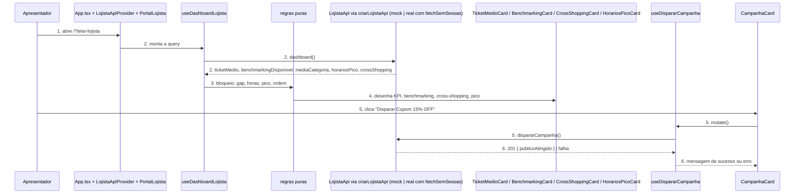
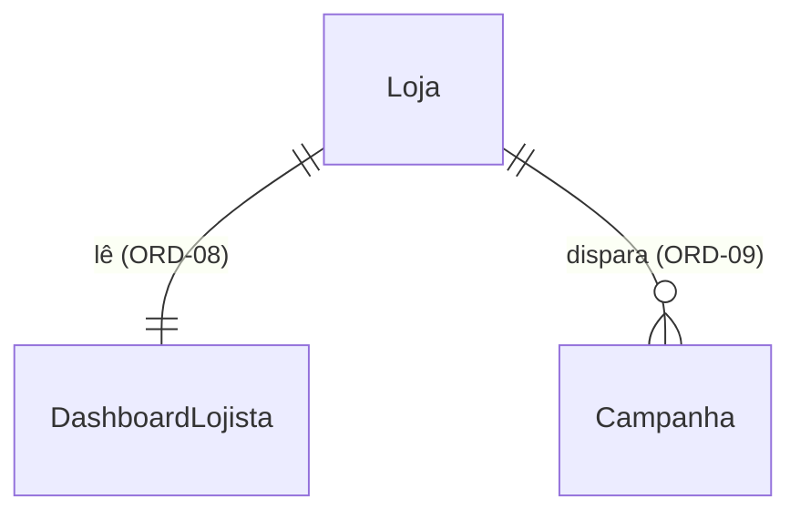
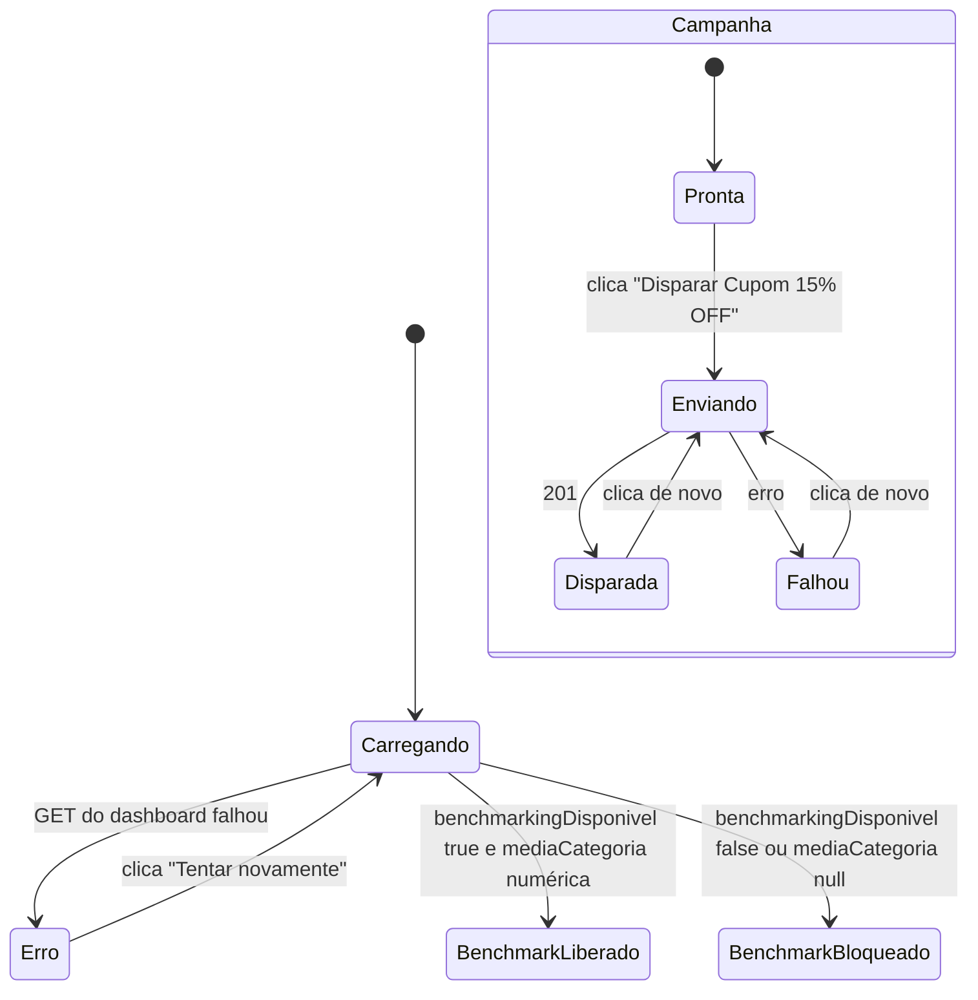
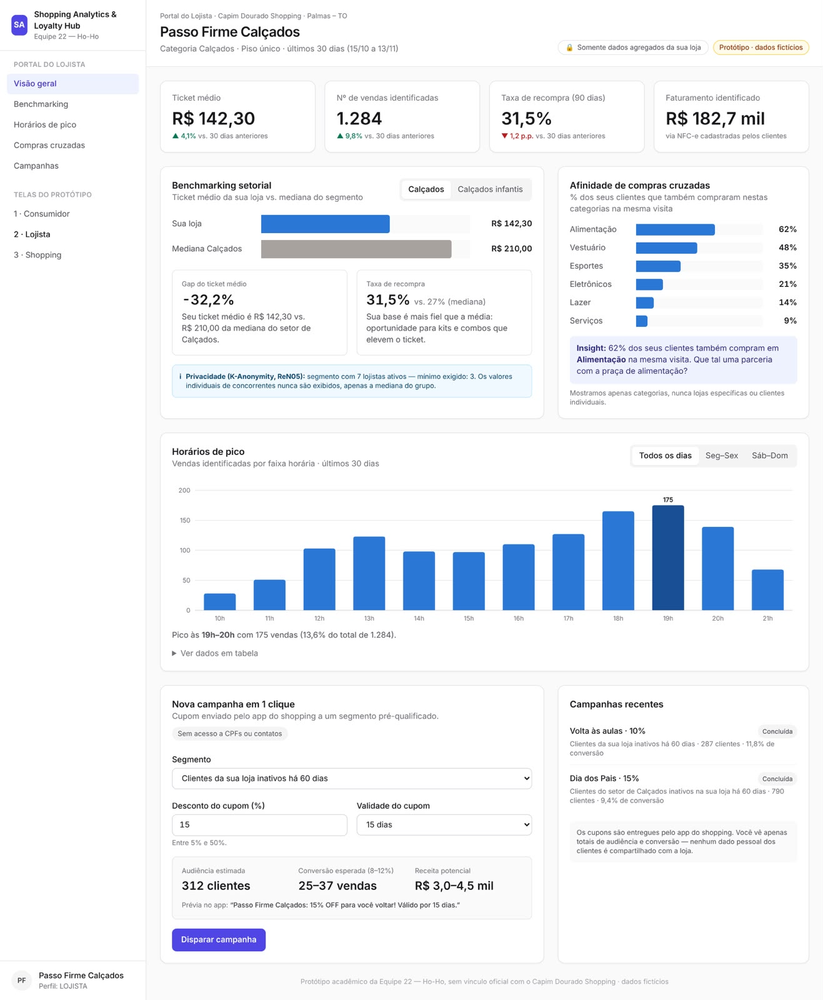

# ORD-11 - Tela 2: Portal do Lojista

**Approved**: 2026-11-14 - user: "Aprovado, pode seguir para os checks"

## Problem

Hoje o lojista não tem tela: o front só abre a Tela 1 (`frontend/src/App.tsx` renderiza `PortalConsumidor`). O backend já calcula o painel da loja (`GET /api/v1/analytics/lojista/dashboard`, ORD-08, mergeado na `develop`), mas ninguém o vê. Quem paga é o apresentador da banca, que não consegue fazer o passo 3 do roteiro do ORD-14 ("Trocar para Lojista, ver ticket atualizado e disparar campanha de 15%") nem mostrar ao vivo a trava de privacidade ReN05 (K-Anonymity), que é o argumento de LGPD do produto. Evidência: issue #11 (cópia em `.private/ord-11-card.md`), P1, e o kanban (`.docs/planning/mvp-sabado-kanban.md` `[ORD-11]`). O `POST /api/v1/campanhas` (ORD-09) ainda não existe no backend, e o shell do ORD-03 (sidebar B2B, rotas, login) não está na `develop`.

Quando entregar, o apresentador abre a Tela 2, vê o ticket médio da loja comparado à média da categoria (ou o card bloqueado com a explicação da K-Anonymity quando a categoria tem menos de 3 lojistas), os horários de pico e as compras cruzadas em gráficos, e dispara o cupom de 15% com um clique, vendo quantos clientes ele alcançou - tudo no mock e pronto para trocar pelo backend real com uma flag.

## Shape

Reusa o padrão da Tela 1: contrato de API trocável por flag (como `NotasApi`/`criarNotasApi`), o `fetchSemSessao` de `features/consumidor/realNotasApi.ts`, o `queryClient` de `src/lib/queryClient.ts`, os primitivos `Button`/`Card`/`Badge`, os tokens de `tokens.css`, a `CHART_PALETTE` do guia de design system e o `recharts` já instalado; não cria segundo tema, segundo cliente HTTP nem segundo cliente de estado. As regras que mudam o que o lojista vê (trava ReN05 a partir de `benchmarkingDisponivel`, gap do ticket, preenchimento e pico das horas, percentual do pico, ordenação e limite do cross-shopping, mensagem da campanha, escolha mock/real) ficam em funções puras e na `LojistaApi`, alcançáveis pelo Vitest (`npm test`).

1. o apresentador abre `/?tela=lojista` -> `App.tsx` (exists) renderiza `PortalLojista` (new) dentro de `LojistaApiProvider` (new); sem o parâmetro, a Tela 1 continua abrindo (AD-018)
2. `useDashboardLojista` (new, query `['lojista','dashboard']`) -> `LojistaApi.dashboard()` (new), escolhida por `criarLojistaApi` (new): o mock (new) ou a implementação real (door 2) que chama `GET /api/v1/analytics/lojista/dashboard` (exists, ORD-08) com `fetchSemSessao` (exists), sem `lojaId` na requisição
3. regras puras (new) - decidem bloqueio do benchmarking, gap, horas preenchidas, hora de pico e percentual, ordem e limite do cross-shopping
4. out: `TicketMedioCard`, `BenchmarkingCard`, `CrossShoppingCard` e `HorariosPicoCard` (new) desenham o resultado, cada um com carregando, vazio e erro
5. o apresentador clica em "Disparar Cupom 15% OFF" -> `useDispararCampanha` (new, mutation) -> `LojistaApi.dispararCampanha()` -> mock ou `POST /api/v1/campanhas` no contrato proposto (door 1)
6. out: `CampanhaCard` (new) mostra o sucesso com `publicoAtingido`, ou o erro

**Changes underneath**

| Front | What changes |
| --- | --- |
| domain | novos termos no front: `DashboardLojista` (espelha o `DashboardResponse` do ORD-08 campo a campo), `Campanha`, `LojistaApi`. Nenhum termo existente muda de sentido |
| stored data | nada a migrar: o front não persiste nada; o mock guarda as campanhas disparadas só na memória |
| readers | `App.tsx` passa a escolher entre a Tela 1 e a Tela 2 pelo parâmetro `tela` (AD-018); a Tela 1 segue sendo o padrão. No merge do ORD-03, `PortalLojista` substitui o placeholder `pages/LojistaPage.tsx` da rota `/lojista` e a escolha por parâmetro sai |
| build | `vite.config.ts` fixa também `VITE_BACKEND_LOJISTA` nos modos `demo` (`false`) e `integrado` (`true`), como já faz com `VITE_BACKEND_CONSUMIDOR` |

New: o corpo de `POST /api/v1/campanhas` proposto ao ORD-09 (door 1); nada persistido no front. One-way constraints: nomes dos campos do corpo e da resposta (door 1).

## Surface

None - nothing consumed outside. A tela não adiciona rota de API; consome a do ORD-08 (já existente) e propõe a do ORD-09 na door 1. O parâmetro `?tela=lojista` é provisório (AD-018).

## Landing

| One-way door | Literal shape | Alternative rejected |
| --- | --- | --- |
| 1. Contrato proposto de `POST /api/v1/campanhas` (o ORD-09 implementa; Lucas confirma antes do go-live) | requisição `{ "titulo": "Cupom 15% OFF", "descontoPercentual": 15, "criterioAlvo": "INATIVOS_60_DIAS" }`, sem `lojaId` (vem do JWT); resposta `201 { "id": <uuid>, "titulo": <string>, "descontoPercentual": <int>, "criterioAlvo": <string>, "publicoAtingido": <int>, "criadoEm": <ISO 8601> }`; erro qualquer não-2xx, corpo `{ "codigo", "mensagem" }` como no ORD-05, que a tela trata como falha genérica | mandar `lojaId` no corpo - abre a porta para um lojista disparar em nome de outra loja (ORD-02: `lojaId` só do token); nomes em snake_case - destoa do `DashboardResponse` do ORD-08 e do `NotaRequest` do ORD-05 |
| 2. Flag e modos de build da Tela 2 | `VITE_BACKEND_LOJISTA === 'true'` (exatamente) liga a implementação real; `vite build --mode integrado` fixa `'true'` e o modo `demo` fixa `'false'`, removendo o código real do pacote | reaproveitar `VITE_BACKEND_CONSUMIDOR` - acoplaria as telas: o ORD-08 já existe e o ORD-09 não, então ligar a Tela 2 no real quebraria a campanha enquanto a Tela 1 ainda depende só do seu backend |

- Nothing else in this change is hard to reverse

## Criteria

### S1: Benchmarking com a trava ReN05 (P1)

O lojista vê o ticket médio da loja ao lado da média da categoria, ou o bloqueio explicado quando a categoria tem menos de 3 lojistas.

**Acceptance Criteria**

1. WHEN o apresentador abre `/?tela=lojista` THEN o sistema SHALL mostrar a Tela 2 como em `.specs/features/ord-11-portal-lojista/captures/figura3-portal-lojista.png`, menos o que `## Differences from the source` lista
2. WHEN a URL não tem `tela=lojista` THEN o sistema SHALL abrir a Tela 1 (`PortalConsumidor`), como hoje
   - `/` → Tela 1; `/?tela=lojista` → Tela 2; `/?tela=shopping` → Tela 1
3. WHEN o dashboard chega THEN o card "Ticket médio" SHALL mostrar `ticketMedio` em reais no formato pt-BR com `tabular-nums`
   - `142.3` → "R$ 142,30"; `1234.5` → "R$ 1.234,50"; `0` → "R$ 0,00"
4. WHILE `benchmarkingDisponivel` é `true` e `mediaCategoria` é numérica, o card "Benchmarking setorial" SHALL mostrar as barras "Sua loja" e "Média da categoria" com os dois valores em reais, e o card "Gap do ticket médio" com `(ticketMedio - mediaCategoria) / mediaCategoria × 100` com uma casa decimal e sinal
   - 142,30 vs 210,00 → "-32,2%"; 227,52 vs 210,00 → "+8,3%"; 210,00 vs 210,00 → "0,0%"
5. IF `benchmarkingDisponivel` é `false` THEN o card "Benchmarking setorial" SHALL trocar a barra da média e o gap por um bloco bloqueado, com ícone de cadeado, borda tracejada no tom de alerta, o título "Benchmarking Temporariamente Indisponível" e o texto "Para proteger o sigilo concorrencial, as médias setoriais só são exibidas quando houver 3 ou mais lojistas ativos no seu segmento (ReN05)."; a barra "Sua loja" com o ticket continua
6. IF `benchmarkingDisponivel` é `false` THEN nenhum valor de `mediaCategoria` SHALL aparecer na tela, nem quando a API o envia numérico por engano
   - `{ benchmarkingDisponivel: false, mediaCategoria: 210 }` → nenhum "R$ 210,00" na página; `{ benchmarkingDisponivel: true, mediaCategoria: null }` → bloco bloqueado
7. WHILE o benchmarking está liberado, o card SHALL mostrar o aviso "Privacidade (K-Anonymity, ReN05): segmento com o mínimo exigido de 3 lojistas ativos. Os valores individuais de concorrentes nunca são exibidos, apenas a média do grupo."

### S2: Horários de pico e compras cruzadas (P1)

O lojista vê quando vende mais e em que outras categorias os seus clientes compram, com os dados que a API devolveu.

**Acceptance Criteria**

8. WHEN o dashboard chega com `horariosPico` não vazio THEN o card "Horários de pico" SHALL desenhar um gráfico de barras Recharts com uma barra por hora, da menor à maior hora devolvida, preenchendo com 0 as horas do meio que faltam, e rótulos "10h", "11h"...
   - `[{hora:10,total:5},{hora:13,total:2}]` → barras 10h=5, 11h=0, 12h=0, 13h=2
9. The sistema SHALL destacar a barra de maior `total` com a cor mais escura e o valor acima dela, e escrever abaixo do gráfico "Pico às <h>h–<h+1>h com <n> vendas (
% do total de <t>)."; empate fica com a hora mais cedo; `p` com uma casa decimal
   - 175 de 1.284 às 19h → "Pico às 19h–20h com 175 vendas (13,6% do total de 1.284)."; pico às 23h → "23h–0h"
10. WHEN o apresentador abre "Ver dados em tabela" THEN o card SHALL mostrar uma tabela com as colunas "Horário" e "Vendas", uma linha por barra do gráfico
11. WHEN o dashboard chega com `crossShopping` não vazio THEN o card "Afinidade de compras cruzadas" SHALL listar no máximo 6 categorias, por `total` decrescente (empate por nome), cada uma com uma barra proporcional à maior e "<n> compras" à direita (AD-020), e o rodapé "Mostramos apenas categorias, nunca lojas específicas ou clientes individuais."
    - 8 categorias → as 6 maiores; `total` 1 → "1 compra"
12. IF `horariosPico` vem vazio THEN o card "Horários de pico" SHALL mostrar "Ainda não há vendas identificadas para calcular os horários de pico." no lugar do gráfico; IF `crossShopping` vem vazio THEN o card de afinidade SHALL mostrar "Ainda não há compras cruzadas dos seus clientes em outras categorias."

### S3: Campanha em 1 clique (P1)

O lojista dispara o cupom de 15% e vê quantos clientes ele alcançou.

**Acceptance Criteria**

13. The card "Nova campanha em 1 clique" SHALL mostrar o subtítulo "Cupom enviado pelo app do shopping a um segmento pré-qualificado.", o selo "Sem acesso a CPFs ou contatos", o segmento fixo "Clientes da sua loja inativos há 60 dias", o desconto "15%" e o botão "Disparar Cupom 15% OFF" (AD-017)
14. WHEN o apresentador clica em "Disparar Cupom 15% OFF" THEN o sistema SHALL chamar `dispararCampanha` com `{ titulo: "Cupom 15% OFF", descontoPercentual: 15, criterioAlvo: "INATIVOS_60_DIAS" }` e, no `201`, mostrar a mensagem de sucesso "Campanha disparada! Cupom de 15% OFF enviado a <publicoAtingido> clientes." no tom de sucesso
    - `publicoAtingido` 312 → "... enviado a 312 clientes."; 1 → "... enviado a 1 cliente."; 0 → "Campanha registrada, mas nenhum cliente está no segmento agora."
15. WHILE o disparo está em andamento, o botão SHALL ficar desabilitado com o texto "Disparando…", de modo que um segundo clique não faz uma segunda chamada
16. IF o disparo falha THEN o card SHALL mostrar "Não foi possível disparar a campanha. Tente novamente." no tom de erro e reabilitar o botão
17. WHERE `VITE_BACKEND_LOJISTA` é `'true'` o sistema SHALL enviar `POST /api/v1/campanhas` com o corpo da door 1 e ler `publicoAtingido` da resposta, e `GET /api/v1/analytics/lojista/dashboard` para o painel; em qualquer outro valor SHALL usar o mock, sem requisição de rede

### S4: Só a loja do token, com estados de carga e erro (P1)

O painel nunca deixa escolher outra loja e nunca fica em branco.

**Acceptance Criteria**

18. The sistema SHALL NOT ter controle para escolher loja, nem enviar `lojaId` em query, caminho ou corpo de qualquer requisição da Tela 2
19. WHILE o dashboard carrega, cada card de dados (ticket, benchmarking, pico, afinidade) SHALL mostrar um esqueleto de carregamento com o rótulo acessível "Carregando…"
20. IF o `GET` do dashboard falha THEN cada card de dados SHALL mostrar "Não foi possível carregar os dados da sua loja." e um botão "Tentar novamente" que refaz o `GET`; o card de campanha continua utilizável
21. The cabeçalho SHALL mostrar o título "Portal do Lojista" e os selos "Somente dados agregados da sua loja" e "Protótipo · dados fictícios" (AD-021)

## Out of scope

| Excluded | Why |
| --- | --- |
| Sidebar B2B, rodapé "Protótipo acadêmico…", login e a rota `/lojista` | shell do ORD-03, fora da `develop` (AD-018) |
| KPIs de nº de vendas, taxa de recompra e faturamento, variação "vs. 30 dias anteriores", abas de categoria, card "Taxa de recompra", insight, abas Seg–Sex/Sáb–Dom, "Campanhas recentes" | sem dado no contrato do ORD-08/09 (AD-016) |
| Formulário de campanha (segmento, desconto, validade, prévia de audiência) | AD-017 |
| Gráfico de `diasPico` | AD-022 |
| Implementar `POST /api/v1/campanhas` no backend | ORD-09 |
| Tratamento de 401/403 com redirecionamento | `apiFetch` e `RequireRole` do ORD-03; nesta branch qualquer falha cai no erro do critério 20 |
| Layout mobile dedicado | não há mockup mobile da Tela 2 nem pedido no card; ver Assumptions |

## Assumptions

| Assumption | Chosen default | Rationale | Confirmed? |
| --- | --- | --- | --- |
| Como mostrar o bloqueio ReN05 na demo, já que o mock devolve a categoria liberada | o mock lê `?benchmarking=bloqueado` na URL e devolve `benchmarkingDisponivel: false`, `mediaCategoria: null`; sem o parâmetro, liberado | o apresentador consegue mostrar os dois estados sem backend; no modo real o parâmetro é ignorado | n |
| Dados do mock | valores no formato e na ordem de grandeza do mockup (ticket ~R$ 142, média ~R$ 210, horas 10h–21h com pico às 19h, 6 categorias), atraso de ~400 ms para o carregamento aparecer, `publicoAtingido` 312 | a tela fica parecida com o mockup na demo | n |
| Larguras | o alvo é a largura do mockup (1317 px); abaixo de 1024 px os cards empilham em uma coluna sem rolagem horizontal da página | sem mockup mobile; o shell do ORD-03 cuida da gaveta | n |
| Cores dos gráficos | barras em `CHART_PALETTE.primary` (`#2563EB`), barra de pico em tom mais escuro do azul analytics, grade em `hairline`, como o guia de design system manda para o Recharts | guia `.docs/markdown/guia-design-system.md` §3 Exemplo 5 | n |
| Onde o `fetchSemSessao` vive | a Tela 2 importa o mesmo cliente da Tela 1 (ou ele sobe para `src/lib/`), sem duplicar | um só cliente HTTP até o `apiFetch` do ORD-03 | n |

**Open questions:**
- `blocks go-live`: o Lucas (ORD-09) confirma o contrato da door 1 antes de ligar `VITE_BACKEND_LOJISTA=true`.

## Differences from the source

| Source shows | Product shows | Confirmed |
| --- | --- | --- |
| Sidebar "Portal do Lojista" / "Telas do protótipo", rodapé do perfil e rodapé "Protótipo acadêmico…" | nada (Tela 2 isolada) | y - AD-018 |
| KPIs "Nº de vendas identificadas", "Taxa de recompra (90 dias)", "Faturamento identificado" e a variação "vs. 30 dias anteriores" no ticket | só o card "Ticket médio", sem variação | y - AD-016 |
| Abas "Calçados" / "Calçados infantis" no benchmarking | nada | y - AD-016 |
| Card "Taxa de recompra" ao lado do gap | nada | y - AD-016 |
| "Mediana Calçados", "mediana do segmento", "mediana do setor", "apenas a mediana do grupo" | "Média da categoria", "média do segmento", "média do setor", "apenas a média do grupo" | y - AD-019 |
| Texto do gap "...da mediana do setor de Calçados." | "...da média do setor.", sem o nome da categoria | y - AD-023 |
| Aviso "segmento com 7 lojistas ativos — mínimo exigido: 3" | "segmento com o mínimo exigido de 3 lojistas ativos" | y - AD-021 |
| Afinidade em "% dos seus clientes" (62%, 48%…) e subtítulo "% dos seus clientes que também compraram nestas categorias na mesma visita" | contagem "<n> compras" e subtítulo "Compras dos seus clientes em outras categorias" | y - AD-020 |
| Caixa "Insight: 62% dos seus clientes…" | nada | y - AD-016 |
| Abas "Todos os dias" / "Seg–Sex" / "Sáb–Dom" e "· últimos 30 dias" no pico | nada | y - AD-016 |
| Formulário (segmento, desconto 5–50%, validade, audiência/conversão/receita, prévia) e botão "Disparar campanha" | segmento e desconto fixos, botão "Disparar Cupom 15% OFF" | y - AD-017 |
| Card "Campanhas recentes" | nada | y - AD-016 |
| Cabeçalho "Passo Firme Calçados", "Categoria Calçados · Piso único · últimos 30 dias (15/10 a 13/11)", "Portal do Lojista · Capim Dourado Shopping · Palmas – TO" | título "Portal do Lojista" com os dois selos | y - AD-021 |

## Sources

- Issue #11 `[ORD-11] FRENTE — Tela 2: Portal do Lojista` (cópia em `.private/ord-11-card.md`) - binding - escopo, critérios de aceite e DoD
-  - binding - layout, textos e composição da Tela 2 (1317×1600, copiado de `.docs/images/figura3-portal-lojista.png` em 2026-11-14)
- `.docs/markdown/guia-design-system.md` - binding - tokens, `lucide-react`, `tabular-nums`, primitivas, card bloqueado da K-Anonymity (Exemplo 4) e `CHART_PALETTE` (Exemplo 5)
- `.specs/features/ORD-08-analytics-lojista-dashboard/plan.md` e `backend/.../analytics/dto/DashboardResponse.java` - binding - contrato do dashboard
- `.docs/architecture/architecture-and-domain.md` (tabela `campanhas`, rota `POST /api/v1/campanhas`) e kanban `[ORD-09]` - binding - base do contrato proposto na door 1
- `.specs/STATE.md` AD-016 a AD-022 - decisões desta feature
