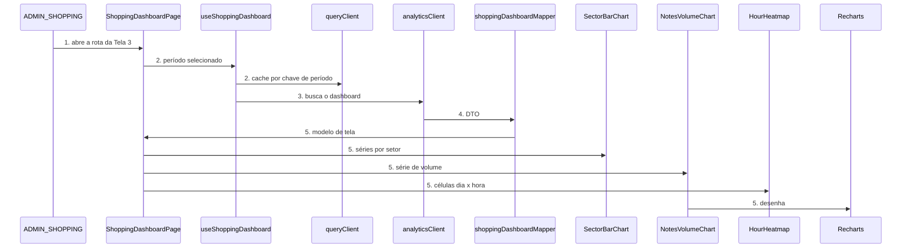
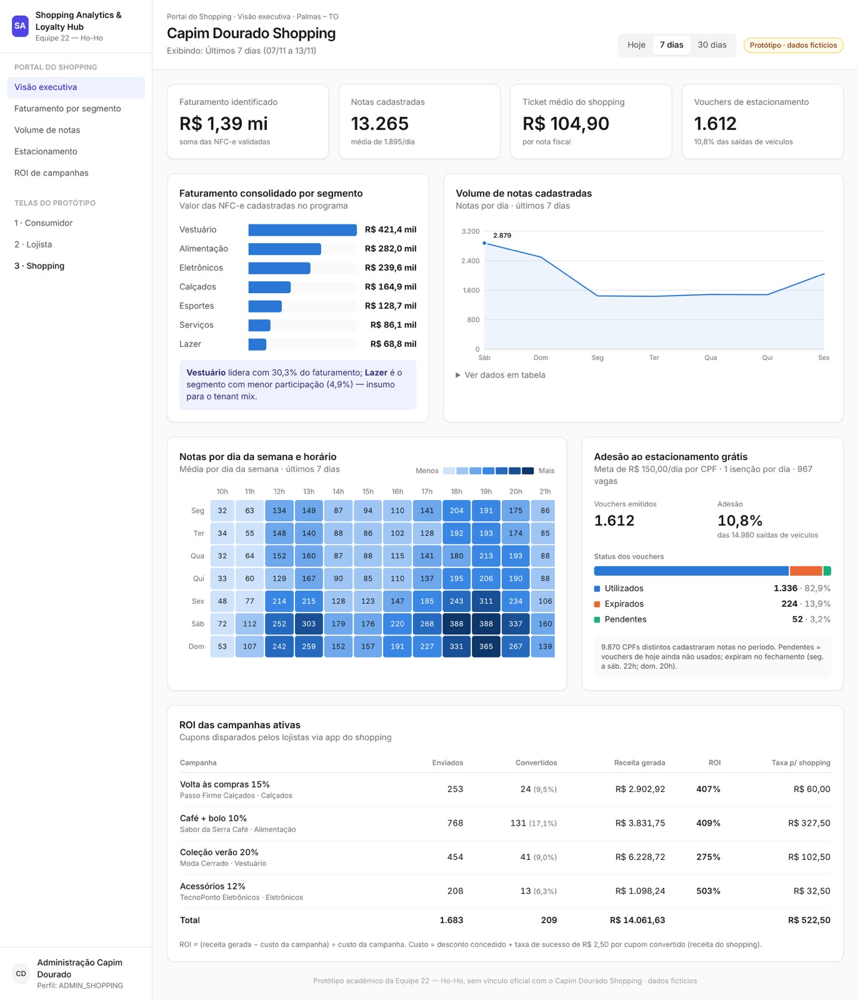

# ORD-12 - Tela 3: Portal da Administração do Shopping

**Approved**: 2026-11-14 - user: "Aprovo a especificação da ORD-12 e autorizo o início do BUILD da Tela 3 do Portal da Administração do Shopping, respeitando o mockup vinculante, o design system, os critérios de aceite e os checks definidos. Autorizo a implementação somente dentro do escopo da minha tarefa. O contrato do ticket médio permanece pendente de alinhamento com Lucas e não deve ser considerado definitivamente acordado. Não autorizo alterações nas tarefas dos colegas, instalação de novas dependências sem minha autorização, push, merge ou deploy."

## Problem

A administração do Capim Dourado Shopping não tem hoje nenhuma leitura consolidada do programa de
fidelidade. O faturamento capturado pelas NFC-e, a liberação de vouchers de estacionamento e o
retorno das campanhas dos lojistas existem apenas como linhas do DER em
`.docs/architecture/architecture-and-domain.md` e como uma linha de contrato de API na linha 115 do
mesmo documento. Quem administra o shopping não consegue responder "qual setor puxa o faturamento"
nem "em que horário o movimento concentra" sem pedir uma extração a alguém.

Quem paga por isso, no prazo imediato, é a entrega de sábado: a Tela 3 é um dos três entregáveis do
MVP (*vertical slice* das 3 telas) e o quarto passo do roteiro da banca (ORD-14, issue #14) depende
dela para fechar a demonstração.

A evidência que a fonte dá é o mockup .docs/images/figura4-portal-shopping.png, que fixa o
recorte, os rótulos, a disposição e os estados da tela. Os números que ele desenha são fictícios e
estão rotulados como tal na própria tela, pelo selo `Protótipo · dados fictícios` no cabeçalho.

Quando isto subir, quem entra com o perfil `ADMIN_SHOPPING` abre uma rota e vê, em uma tela: o
faturamento capturado no período, a distribuição por setor, a concentração de consumo por dia e
hora, a adesão ao estacionamento grátis e o retorno das campanhas ativas.

## Shape

Reutiliza o `queryClient` de `frontend/src/lib/queryClient.ts`, o proxy `/api` do Vite (ADR-07), o
helper `cn()` de `frontend/src/lib/utils.ts`, os tokens de `frontend/src/styles/tokens.css` (ADR-06)
e os primitivos `Card`, `Badge` e `Button` de `frontend/src/components/ui/`, em vez de duplicar
card, selo, botão ou cliente HTTP. As regras que mudam um resultado exibido - percentual por setor,
agregação do mapa horário, adesão de vouchers, totais da tabela de ROI e formatação pt-BR - ficam em
`shoppingDashboardMapper`, um módulo puro sem React e sem dependência externa, que o runner do Node
alcança sem passar pelo build.

1. uma pessoa autenticada como `ADMIN_SHOPPING` abre a rota da Tela 3 -> `ShoppingDashboardPage` (new) - lê o período selecionado e delega a busca
2. `ShoppingDashboardPage` (new) -> `useShoppingDashboard` (new) - hook sobre o `queryClient` (exists), chaveado por período
3. `useShoppingDashboard` (new) -> `analyticsClient` (new) - busca o dashboard pelo proxy `/api` e traduz `401`, `403` e `500` em erro tipado
4. `analyticsClient` (new) -> `shoppingDashboardMapper` (new) - converte o DTO no modelo de tela: percentual por setor, 84 células do mapa horário, adesão de vouchers, totais de campanhas e formatação pt-BR (door 1, door 2)
5. out: `ShoppingDashboardPage` (new) desenha os KPIs e entrega as séries a `SectorBarChart` (new), `NotesVolumeChart` (new) e `HourHeatmap` (new); só `NotesVolumeChart` usa `Recharts` (exists) - `SectorBarChart` e `HourHeatmap` são HTML e CSS, porque o `Recharts` não tem mapa de calor e a captura desenha os setores como lista de rótulo, barra e valor, sem eixo

**Changes underneath**

| Front | What changes |
| --- | --- |
| domain | `ADMIN_SHOPPING` deixa de ser apenas um valor de `role` no JWT (ADR-05) e passa a decidir qual tela a SPA monta - hoje ninguém ramifica nisso no frontend; quem passará a ramificar é o shell do ORD-03 (issue #3), não esta feature |
| stored data | nada a migrar - a tela só lê; não cria, não altera e não apaga nenhuma entidade |
| readers | `frontend/src/App.tsx`, hoje uma página de scaffolding que lista os cards do Kanban, deixa de ser a raiz quando o roteador do ORD-03 entrar; esta feature entrega a Tela 3 como componente autocontido, pronta para ser registrada nesse roteador |

Data: none - a tela não lê nem grava entidade persistida. Todo o estado vem do endpoint do ORD-10 e
vive em cache de memória do TanStack Query.

## Surface

Esta feature **não adiciona** rota HTTP. A linha abaixo é o contrato que ela **consome**, criado
pelo ORD-10 (issue #10, Lucas), registrado aqui porque é a porta de mão única 1 e precisa ser
combinado antes do build.

| Route | In | Out | Status | Who |
| --- | --- | --- | --- | --- |
| `GET /api/v1/analytics/shopping/dashboard` (consumida; criada pelo ORD-10) | `periodo` com valor `hoje`, `7d` ou `30d` na query string | faturamento capturado, notas, ticket médio, setores, mapa horário, vouchers e campanhas | `200`, `401`, `403`, `500` | `ADMIN_SHOPPING`; outro perfil recebe `403` e a SPA o devolve à tela do perfil dele; sem JWT, `401` e volta ao acesso rápido |

## Landing

| One-way door | Literal shape | Alternative rejected |
| --- | --- | --- |
| Contrato de leitura do DTO do dashboard do shopping | `{ "periodo": "7d", "faturamentoCentavos": 139000000, "notasCadastradas": 13265, "ticketMedioCentavos": 10490, "setores": [ { "nome": "Vestuário", "valorCentavos": 42140000 } ], "mapaHorario": [ { "diaSemana": "SEG", "hora": 10, "notas": 32 } ], "vouchers": { "emitidos": 1612, "utilizados": 1336, "expirados": 224, "pendentes": 52, "saidasVeiculos": 14980, "cpfsDistintos": 9870 }, "campanhas": [ { "id": 1, "nome": "Volta às compras 15%", "loja": "Passo Firme Calçados", "segmento": "Calçados", "enviados": 253, "convertidos": 24, "receitaCentavos": 290292, "taxaShoppingCentavos": 6000, "ativa": true } ] }` | cada componente lendo o payload como `any` - a primeira renomeação de campo no ORD-10 quebra em tempo de execução, sem erro de tipo e sem build vermelho |
| Dinheiro em centavos inteiros na borda | `faturamentoCentavos: number` inteiro; a formatação `R$ 1,39 mi` acontece só na camada de exibição | reais com decimal no JSON - a soma dos setores em ponto flutuante diverge do total calculado pelo backend já na terceira casa, e o percentual exibido deixa de fechar `100,0%` |
| Intervalo, série de volume e desconto no DTO (aditivo à porta 1, achado no BUILD; também pendente com o Lucas) | `{ "inicio": "2026-01-05", "fim": "2026-01-11", "serieVolume": [ { "data": "2026-01-05", "hora": null, "notas": 1200 } ], "campanhas": [ { "id": 1, "descontoPercentual": 15, "ativa": true } ] }` - `inicio` e `fim` em `YYYY-MM-DD`; em `serieVolume`, `hora` vale `null` nos períodos `7d` e `30d` (um ponto por dia) e de `10` a `21` no período `hoje` (um ponto por faixa horária); `descontoPercentual` inteiro de 0 a 99; os campos de `campanhas` da porta 1 continuam valendo | a SPA derivar o intervalo do relógio do navegador e a série a partir de `mapaHorario` - o cabeçalho `Exibindo:` divergiria do intervalo que o backend agregou perto da meia-noite, e `mapaHorario` é média por dia da semana, não série por dia; sem `descontoPercentual`, a coluna ROI não tem custo para dividir |
| Identificador de campanha como `uuid` (aditivo à porta 1; decisão do usuário D10, sujeita à confirmação com o Lucas) | `{ "campanhas": [ { "id": "00000000-0000-4000-8000-000000000001", "nome": "C", "ativa": true, "descontoPercentual": 10 } ] }` - `id` é string no formato `uuid`, como `CAMPANHAS.id` no DER, e substitui o `id` numérico do literal da porta 1; a fixture local indexa as métricas fictícias pelo mesmo `uuid` | manter o `id` numérico - o DER define `CAMPANHAS.id` como `uuid`, e uma fixture indexada por número nunca casaria com o id que o ORD-10 devolver, o que deixaria a campanha sem métrica |

- Nada mais nesta mudança é difícil de reverter: componentes, nomes de arquivo, ordem dos painéis,
  estilos e a fixture local saem no diff. A guarda de rota por perfil **não** é porta desta feature:
  ela pertence ao ORD-03 (issue #3) e está em `## Out of scope`.

## Criteria

### S1: A tela contra o mockup (P1)

Quem administra o shopping abre a tela e vê o que o mockup desenha.

**Acceptance Criteria**

1. WHEN uma pessoa com perfil `ADMIN_SHOPPING` abre a Tela 3 e o dashboard responde com dados do período `7 dias` THEN the system SHALL mostrar a visão executiva como em `.specs/features/ord-12-portal-shopping/captures/portal-shopping.png`
2. The system SHALL exibir o selo `Protótipo · dados fictícios` no cabeçalho em todo estado em que a tela mostra números
3. The system SHALL exibir o rodapé `Protótipo acadêmico da Equipe 22 — Ho-Ho, sem vínculo oficial com o Capim Dourado Shopping · dados fictícios`

### S2: Os números que a tela calcula (P1)

Cada valor exibido é derivado do payload por uma regra fixa, nunca copiado do mockup.

**Acceptance Criteria**

4. The system SHALL exibir o KPI de faturamento a partir de `faturamentoCentavos`, formatado em pt-BR com duas casas decimais e sufixo `mi` acima de um milhão de reais
   - `250000000` centavos → `R$ 2,50 mi`; `9990` → `R$ 99,90`; `100000000` → `R$ 1,00 mi`
5. WHEN o payload traz a lista de setores THEN the system SHALL exibir, para cada setor, o percentual de `valorCentavos` sobre `faturamentoCentavos` com uma casa decimal, e os percentuais exibidos SHALL somar `100,0%`
   - três setores de `50000`, `30000` e `20000` centavos sobre um total de `100000` → `50,0 / 30,0 / 20,0` e soma `100,0%`; um único setor → `100,0%`; dois setores de igual valor → `50,0%` cada
6. The system SHALL exibir o mapa horário como 84 células, sendo 7 dias da semana por 12 faixas de hora de `10h` a `21h`, com as linhas ordenadas de `Seg` a `Dom`
7. The system SHALL exibir a adesão ao estacionamento como `emitidos` sobre `saidasVeiculos` em percentual com uma casa decimal
   - `300` emitidos sobre `1200` saídas → `25,0%`
8. The system SHALL exibir a barra de status dos vouchers com `utilizados`, `expirados` e `pendentes`, cada um com o valor absoluto e o percentual sobre `emitidos` com uma casa decimal
9. The system SHALL exibir a linha de total da tabela de campanhas somando `enviados`, `convertidos`, `receitaCentavos` e `taxaShoppingCentavos` de todas as campanhas com `ativa` verdadeiro
10. IF `faturamentoCentavos` é `0` ou a lista de setores vem vazia THEN the system SHALL exibir `0,0%` em cada setor e SHALL NOT dividir por zero
    - total `0` com três setores → `0,0%` em cada; lista vazia → o painel mostra o estado vazio, não uma barra de largura inválida
11. IF `saidasVeiculos` é `0` THEN the system SHALL exibir a adesão como `0,0%`
12. WHERE um valor exibido não tem campo correspondente no payload do ORD-10, the system SHALL exibi-lo a partir da fixture local e SHALL marcá-lo na interface como dado fictício
21. The system SHALL exibir o KPI de ticket médio como `faturamentoCentavos` dividido por `notasCadastradas`, arredondado ao centavo, e SHALL NOT exibir um valor de ticket médio que divirja dessa divisão
    - `100000` centavos em `8` notas → `R$ 125,00`; `100000` em `3` notas → `R$ 333,33`
22. IF `notasCadastradas` é `0` THEN the system SHALL exibir o ticket médio como `R$ 0,00` e SHALL NOT dividir por zero
23. WHILE o período selecionado é `Hoje`, the system SHALL exibir o rodapé do KPI de notas como `até o momento`; WHILE é `7 dias` ou `30 dias`, the system SHALL exibi-lo como `média de <N>/dia`, com `<N>` igual a `notasCadastradas` dividido pelo número de dias do período e arredondado ao inteiro
    - `7000` notas em `7 dias` → `média de 1.000/dia`; `7500` notas em `30 dias` → `média de 250/dia`; qualquer volume em `Hoje` → `até o momento`

### S3: Os estados da tela (P1)

Toda espera, ausência, falha e negativa tem desenho próprio.

**Acceptance Criteria**

13. WHILE a consulta do período selecionado não respondeu, the system SHALL exibir um esqueleto de carregamento no lugar dos KPIs e dos painéis, sem área em branco
14. WHEN o dashboard responde com faturamento `0` e nenhuma nota no período THEN the system SHALL exibir o estado vazio `Sem notas cadastradas no período` e SHALL manter o seletor de período utilizável
15. IF a consulta responde `500` ou expira THEN the system SHALL exibir o estado de erro com o controle `Tentar novamente`, que refaz a mesma consulta
16. IF a consulta responde `401` ou `403` THEN the system SHALL SHOW o estado sem permissão e SHALL NOT desenhar nenhum número do dashboard
17. WHEN a pessoa usa `Hoje`, `7 dias` ou `30 dias` THEN the system SHALL refazer a consulta com aquele período e SHALL atualizar a linha `Exibindo:` do cabeçalho com o intervalo correspondente
18. WHEN a pessoa usa `Ver dados em tabela` THEN the system SHALL abrir, abaixo do gráfico, a tabela com a mesma série que o gráfico desenha
19. WHEN a pessoa usa um item da navegação lateral THEN the system SHALL levar à seção correspondente da tela e SHALL marcar aquele item como o ativo
20. WHILE uma consulta de período está em voo, WHEN a pessoa escolhe outro período, the system SHALL exibir o resultado do último período escolhido, nunca o da resposta que chegar por último

## Out of scope

| Excluded | Why |
| --- | --- |
| Implementar `GET /api/v1/analytics/shopping/dashboard` | é o ORD-10 (issue #10, Lucas); esta tela apenas consome. Decisão do usuário: "sem modificar a issue do Lucas nem assumir a implementação do endpoint" |
| Shell da aplicação, roteador, login, interceptor de JWT e guarda de rota por perfil | é o ORD-03 (issue #3, Breno). Decisão do usuário: "não implementar novamente shell, rotas ou autenticação que pertencem ao Breno" |
| Migrations, seeds e qualquer alteração em `backend/` | é o ORD-01/ORD-02 (Lucas) |
| Rotação de `app.security.jwt.secret` e `app.security.cpf-hash-pepper` | `backend/src/main/resources/application.yml` é do ORD-02 (Lucas). Risco de segurança levantado na auditoria e comunicado ao usuário; não é desta feature |
| Ensaio ponta a ponta da demonstração | é o ORD-14 (issue #14), onda 4, depende de #1 a #12 |
| Exportação de CSV ou PDF dos painéis | nada no mockup desenha esse controle; capacidade nova exige decisão própria |
| Trava de K-Anonymity (ReN05) | é trava da visão do lojista (ORD-11); a visão corporativa agrega o shopping inteiro |
| Rodar os testes do mapper (`node --test src/lib/analytics/`) no CI, com um script `test` em `frontend/package.json` e um passo em `.github/workflows/ci.yml` | o CI é compartilhado pela equipe. Decisão do usuário (D9): "manter testes no CI fora da ORD-12". Até outra feature ligar esse passo, C4 a C13 e C23 a C29 rodam só no `check_proofs.py`, e o CI do frontend continua só com `npm ci` e `npm run build` - uma mudança que quebre esses testes passa com o CI verde |

## Assumptions

| Assumption | Chosen default | Rationale | Confirmed? |
| --- | --- | --- | --- |
| O mockup desenha 4 KPIs (`Faturamento identificado`, `Notas cadastradas`, `Ticket médio do shopping`, `Vouchers de estacionamento`), enquanto o cartão ORD-12 pede 3 e cita "campanhas ativas" | preservar a estrutura do mockup: os 4 KPIs que ele desenha, e as campanhas ativas como a tabela de ROI que o próprio mockup desenha no rodapé | o usuário determinou "preservar a estrutura visual da figura4" e "não ampliar funcionalidades de negócio além do escopo autorizado"; a captura é a medida do escopo | y |
| Painéis cujo dado o DER atual não consegue calcular (quebra de vouchers por status, saídas de veículos, CPFs distintos, colunas de ROI por campanha) | exibir com dado da fixture local, identificado na interface como fictício, preservando a estrutura visual | o usuário determinou "utilizar dados fictícios somente quando necessário, identificando-os claramente" e "não inventar dados reais". **Correção em 2026-11-14 (Verifier, round 1):** o DER sustenta a quebra por status (`VOUCHERS_ESTACIONAMENTO.status`) e os CPFs distintos (`NOTAS_FISCAIS.cliente_id`); não sustenta as saídas de veículos nem as métricas por campanha. Os quatro painéis seguem fictícios até o Lucas confirmar o contrato, por decisão do usuário (D4) | y |
| Origem dos dados enquanto o ORD-10 não existe | um adaptador de fixture local atrás da mesma interface de `analyticsClient`, trocado pela busca real quando o #10 subir; a fixture sai no commit que liga o endpoint | o usuário autorizou "utilizar fixture local para desenvolvimento e validação do mapper" e pediu o contrato provisório documentado | y |
| Valores que a fixture local produz | a fixture reproduz os valores visíveis da captura, recriados com ela aberta, para que a comparação de imagem do C1 possa fechar; esses valores **não** são transcritos para nenhum critério de aceite, que fixam apenas as regras e usam exemplos independentes | o sub-agente de screens marca `copy` como `differs` quando o texto que a captura fixa aparece diferente, e `references/plan.md` proíbe transcrever dado de amostra para os critérios; o usuário determinou "documente que a fixture deve reproduzir os valores visíveis no mockup, sem copiar esses valores para os critérios de aceite" | y |
| Origem do valor do ticket médio | o frontend **deriva** de `faturamentoCentavos` dividido por `notasCadastradas`; o campo `ticketMedioCentavos` do DTO não é a fonte do que a tela exibe | derivar mantém os três KPIs internamente consistentes e torna a regra provável por teste puro; se o backend também enviar o valor e ele divergir da divisão, o divergente é um defeito a reportar, não a exibir. **Decisão não fechada**: depende do Lucas (issue #10) | n |
| Preparação para o ORD-03 | a Tela 3 é entregue como componente autocontido, sem criar roteador, login nem guarda; o registro na rota fica para o shell do Breno | o usuário determinou "preparar a Tela 3 para integração com o trabalho dele" | y |
| Dependências do frontend | `npm ci` executado uma vez sobre o `package-lock.json` versionado, sem adicionar nem atualizar nada | o usuário autorizou explicitamente, restringindo ao lockfile existente | y |
| Período padrão ao abrir a tela | `7 dias`, como o mockup desenha selecionado | a captura é vinculante e desenha a aba `7 dias` ativa | n |
| Faixa horária do mapa | `10h` a `21h`, as 12 colunas que o mockup desenha | a captura fixa as colunas | n |
| Fuso e intervalo de `Hoje` | horário local do navegador, do início do dia até o momento | o mockup escreve `Últimos 7 dias (07/11 a 13/11)`, em datas locais | n |
| Nome da rota da Tela 3 na SPA | a definir com o ORD-03; a tela não depende do nome | o roteador é do Breno | n |

**Open questions:**

| Question | Recommendation | Status |
| --- | --- | --- |
| O contrato da porta 1 precisa ser combinado com o Lucas (issue #10). Os nomes de campo, o parâmetro `periodo` e o dinheiro em centavos são proposta desta feature, não acordo fechado. | enviar o literal da porta 1 ao Lucas antes do build e registrar a resposta como ADR-08 | blocks go-live |
| Quais campos o ORD-10 entrega para os painéis de estacionamento e de campanhas? O DER sustenta a quebra de vouchers por status (`VOUCHERS_ESTACIONAMENTO.status`) e os CPFs distintos (`NOTAS_FISCAIS.cliente_id`), mas não as saídas de veículos nem as métricas por campanha (`CAMPANHAS` não tem `ativa`, `convertidos`, receita nem taxa; tem `publico_atingido` e `desconto_percentual`). Enquanto a quebra por status vier da fixture e `emitidos` vier do ORD-10, os percentuais do critério 8 podem passar de 100%. | confirmar com o Lucas (issue #10). Até lá, os quatro painéis seguem marcados como fictícios (decisão do usuário D4) e, no caso misto, o critério 8 continua sobre `emitidos` (decisão do usuário: "Manter o critério 8") | blocks go-live |
| Os setores do payload somam exatamente `faturamentoCentavos`? Se não somarem, o critério 5 não consegue, ao mesmo tempo, dividir cada setor por `faturamentoCentavos` e fechar `100,0%`. | combinar com o Lucas (issue #10) que a soma dos setores é o faturamento; a tela não cria categoria `Outros` (decisão do usuário D7) | blocks go-live |
| O ticket médio do shopping é **enviado** pelo backend em `ticketMedioCentavos` ou **derivado** pelo frontend como `faturamentoCentavos / notasCadastradas`? O critério 21 e o check C23 estão escritos contra a derivação, que é a recomendação, mas a decisão é do dono do endpoint. | derivar no frontend e o backend parar de enviar o campo, ou mantê-lo apenas informativo; combinar com o Lucas (issue #10) antes do build e registrar como ADR-08 | blocks go-live |
| Uma dependência de teste de componente (Vitest + Testing Library) para os critérios 13 a 20, que hoje são provados por `walk`. | não adicionar antes da banca: seria porta de mão única nova, e o usuário restringiu o `npm ci` ao lockfile existente | open |

## Differences from the source

| Source shows | Product shows | Confirmed |
| --- | --- | --- |
| todo o texto na fonte do sistema (`system-ui`) | título da página e títulos dos painéis em Plus Jakarta Sans; o restante em Inter, as fontes do design system | y - AD-101 |
| azul médio nas barras de setor e na série de volume, rampa azul no mapa horário, fundo cinza neutro e `Expirados` em laranja | as cores dos tokens: `--color-analytics` nas barras e na série, rampa por `color-mix` dos tokens azuis puxando para o índigo, fundo `--bg-canvas` (cinza-azulado) e `Expirados` em `--color-warning` (âmbar), porque o design system não tem token laranja | y - AD-102 |
| ladrilho `SA` achatado, 27 x 34 px | ladrilho `SA` quadrado, 34 x 34 px | y - AD-103 |
| coluna `21h` do mapa horário cortada na borda do conteúdo | coluna `21h` inteira | y - AD-103 |
| `saídas de veiculos`, sem acento, no rodapé do KPI de vouchers e no painel de estacionamento | `saídas de veículos`, com acento - corrige um erro de grafia da própria figura4 | y - AD-104 |

Fora dessas linhas, a estrutura visual da figura4 é preservada: os 4 KPIs, os cinco painéis, a barra
lateral, o seletor de período, o selo de protótipo e o rodapé. Onde o payload não traz um número, o
valor vem da fixture local e é identificado na interface como fictício (critério 12), sem remover,
renomear nem reposicionar nada que a captura desenhe.

## Sources

- `[ORD-12]` em `.docs/planning/mvp-sabado-kanban.md:149-154` - binding - o recorte do cartão e o critério de aceite "Layout alinhado ao mockup"
-  `.specs/features/ord-12-portal-shopping/captures/portal-shopping.png` - binding - cópia byte a byte de .docs/images/figura4-portal-shopping.png (MD5 `29d00489ce726a945f752c48fba36cb8`), 1373 x 1600; desenha a visão executiva: barra lateral, cabeçalho com seletor de período, os 4 KPIs, faturamento por segmento, volume de notas, mapa horário, adesão ao estacionamento e ROI das campanhas
- `.docs/architecture/architecture-and-domain.md:115` - binding - o contrato e o perfil do endpoint consumido
- `.docs/architecture/architecture-and-domain.md:121-165` - binding - ADR-01 a ADR-07, em especial ADR-06 (design tokens em 3 camadas) e ADR-07 (proxy `/api` do Vite, React 18, TanStack Query)
- `.docs/markdown/guia-design-system.md` - binding - regras de ouro da interface, mapa de tokens, "Exemplo 1: Card de KPI" e "Exemplo 5: Cores Oficiais para Gráficos (Recharts)"
- `origin/gh-pages:tela-3-shopping.html` - non-binding - user: "preservar a estrutura visual da figura4" - protótipo de onde a captura foi tirada; serve de referência de rótulos e disposição, nunca de fonte de dados: seus números vêm de ruído determinístico e não reagem a operação alguma

## Notes

- O que a captura **não** desenha fica abaixo da dobra de 1600 px e, pela regra 9 da skill, é provado
  por `walk`, sem imagem e sem juiz.
- Todos os quatro mockups do projeto têm exatamente 1600 px de altura, o que indica recorte na
  captura e não página inteira. Por isso esta feature usa **uma** captura. A figura4 foi tirada a
  escala de cerca de 0,95 (a barra lateral de 256 px CSS mede 243 px na imagem), então a imagem de
  execução é tirada em navegador headless em janela de 1440 x 1678 a escala 0,9535, o que dá
  1373 x 1600 sem recortar nem alterar a fonte original (decisão do usuário durante o BUILD).
- **Duas fontes de número, com papéis distintos.** A fixture recria os valores da captura, para que
  a comparação de imagem feche; os critérios de aceite fixam as regras com exemplos independentes,
  escolhidos justamente para não coincidir com nada que a captura desenhe. Um critério que repetisse
  o número do mockup passaria a provar o dado, e não a regra.
- O JSON da porta 1 em `## Landing` é a **forma literal** do contrato proposto, para o próximo
  leitor copiar; seus valores são ilustrativos e não são dado de aceite.
- Os checks `walk` de `checks.md` são **verificação manual**: o autor executa o gesto e registra o
  que a tela mostrou na linha `**Walked:**`. Não são testes automatizados e não devem ser
  apresentados como tal em nenhum relatório.
