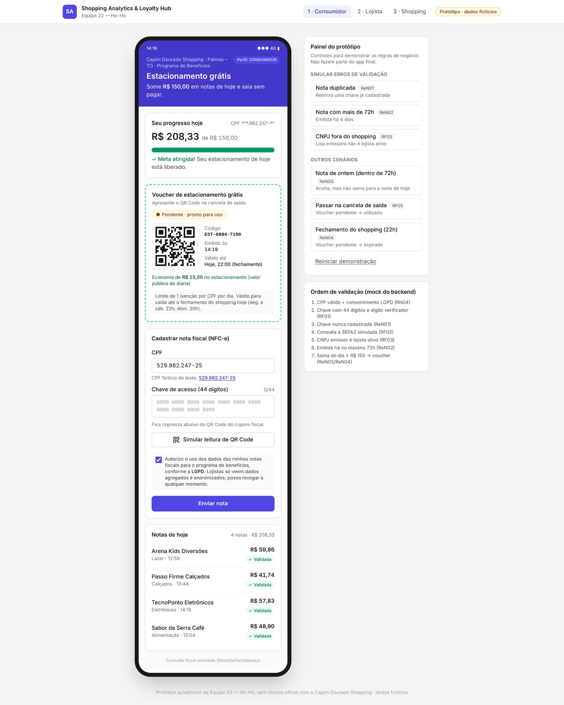
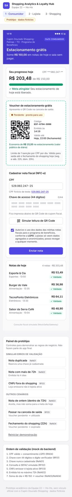
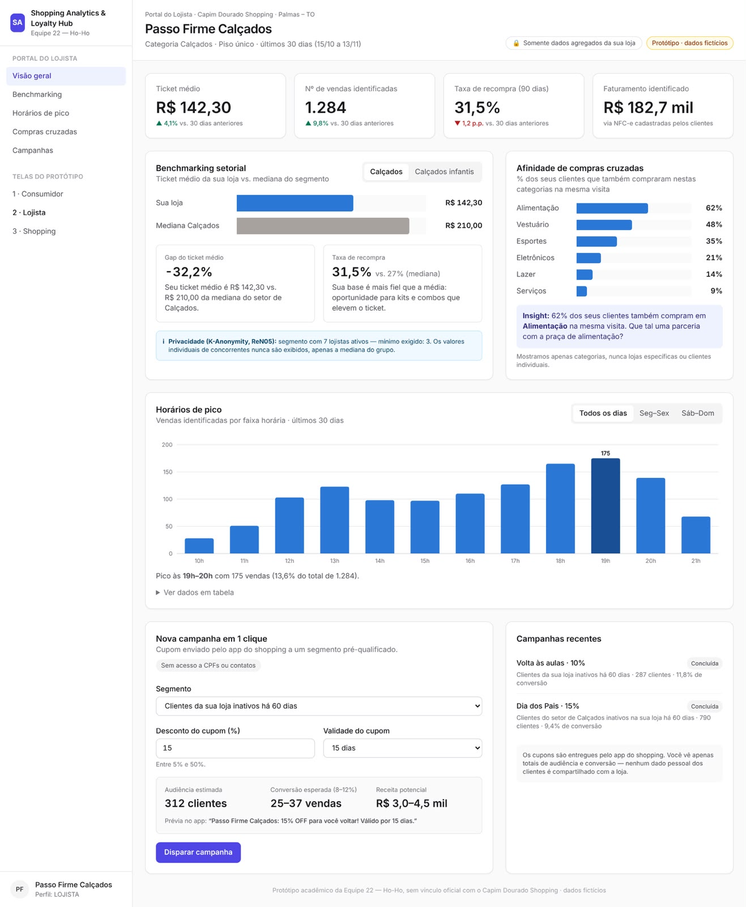
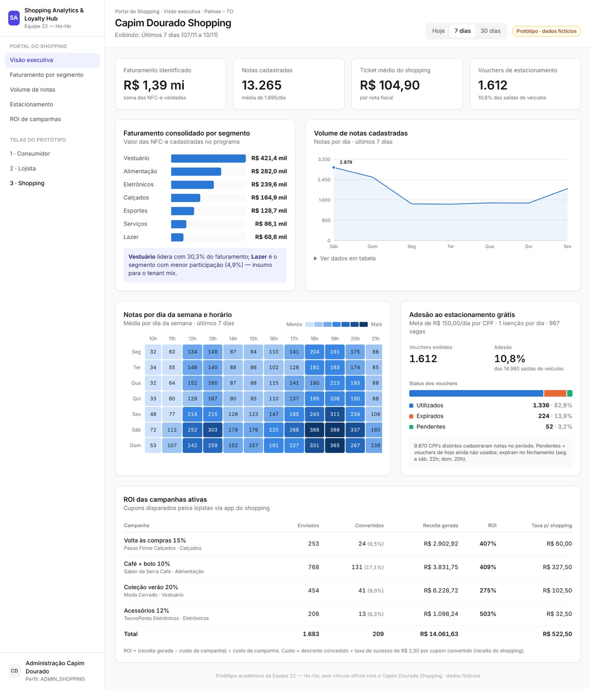

# 🛍️ Shopping Analytics & Loyalty Hub

> **Equipe 22 — Ho-Ho**  
> Plataforma integrada de Inteligência Fiscal, CRM Cooperativo e Gestão de Benefícios para Shopping Centers.

---

## 👥 Equipe e Integrantes

* **Equipe:** Equipe 22 — Ho-Ho
* **Integrantes:**
  * Lucas Anjos
  * Victor Augusto
  * Walisson Kupertino
  * Breno Brito

---

## 📌 Contextualização e Proposta do Projeto

### 1. Contexto
Os shopping centers consolidaram-se como hubs de convivência, lazer e experiência. No entanto, enquanto o comércio eletrônico (e-commerce) possui visibilidade granular de cada clique, busca e carrinho abandonado em tempo real, o varejo físico tradicional opera sob uma histórica **cegueira analítica**: sabe-se quantas pessoas entram pelas portas do empreendimento, mas não quem realmente compra, qual o ticket médio real por categoria ou como o fluxo de clientes transita entre diferentes lojas.

### 2. Problemática
* **Para o Shopping:** Falta de dados transacionais reais para otimizar o mix de lojas (*Tenant Mix*), precificar mídias indoor e antecipar tendências de consumo.
* **Para os Lojistas:** Dificuldade em conhecer o perfil do público do shopping, dependência de campanhas genéricas e ausência de ferramentas acessíveis para ações de atração direcionadas.
* **Para o Consumidor:** Fricção no pagamento de tarifas de estacionamento e excesso de propagandas genéricas sem relevância.

### 3. Justificativa
Tentativas de rastreamento físico (Wi-Fi, Beacons ou câmeras com reconhecimento facial) enfrentam barreiras técnicas severas (*MAC Address Randomization* no iOS/Android), alto custo de hardware e alto risco legal perante a **LGPD**. 
A nossa solução resolve o problema na fonte: adota o princípio de **Privacy by Design**, onde o próprio consumidor fornece voluntariamente seus dados fiscais (**NFC-e / Cupom Fiscal com CPF**) em troca de um benefício imediato e de altíssimo valor percebido: **isenção da tarifa de estacionamento** e participação em clube de vantagens.

### 4. Objetivo Geral
Desenvolver uma plataforma cooperativa e integrada de inteligência de dados transacionais para shopping centers, conectando consumidores, lojistas e administração em um ecossistema ganha-ganha-ganha baseado em ingestão fiscal.

### 5. Objetivos Específicos
* Implementar o cadastro e processamento de notas fiscais eletrônicas (NFC-e) associadas ao CPF do cliente via API REST.
* Automatizar o cálculo diário de consumo do consumidor, concedendo a isenção de estacionamento ao atingir a meta estipulada (ex: R$ 150,00 no dia).
* Disponibilizar aos lojistas um portal web com métricas de *benchmarking* setorial (ticket médio da loja vs. média da categoria) e ferramenta de disparo de campanhas direcionadas sem violação de sigilo concorrencial.
* Prover à administração do shopping um painel executivo com visão macro do faturamento real, horários de pico por setor e conversão do programa de estacionamento.

---

## 🎲 Tecnologia da Roleta: API REST

A prática sorteada para o nosso projeto foi a **API REST**, que atua como o **coração integrador de toda a solução**:

* **Desacoplamento Completo Front ↔ Back:** O backend Java 21 / Spring Boot 3 expõe uma API REST pura e *stateless*, consumida de forma reativa pelo frontend em React + TypeScript.
* **Ingestão Fiscal Padronizada:** A captura de notas opera via endpoints REST sem exigir que lojistas instalem plugins ou alterem seus sistemas de ponto de venda (PDV).
* **Contratos Tipados com OpenAPI/Swagger:** A API é integralmente documentada com a especificação OpenAPI (SpringDoc), permitindo geração automática de contratos de dados e tipagens espelhadas no TypeScript.
* **Segurança e RBAC:** Endpoints protegidos por autenticação **JWT (JSON Web Token)** com controle de acesso granular baseado em perfis (`CONSUMIDOR`, `LOJISTA`, `ADMIN_SHOPPING`) e isolamento lógico *multi-tenant*.

---

## 🛠️ Stack Tecnológica e Arquitetura

O projeto adota a arquitetura de **Monólito Modular** (módulos isolados por domínio: `fiscal`, `beneficios` e `analytics`), aplicando princípios de **Clean Architecture**, **SOLID** (com foco no *Dependency Inversion Principle*) e **Domain-Driven Design (DDD)**.

```
┌───────────────────────────────────────────────────────────────┐
│                      FRONTEND (Vite / React)                  │
│       Portal Consumidor  │  Portal Lojista  │  Portal Admin   │
└───────────────────────────────┬───────────────────────────────┘
                                │ HTTPS / JSON (API REST)
┌───────────────────────────────▼───────────────────────────────┐
│                   BACKEND (Spring Boot 3 / Java 21)           │
│  ┌──────────────────┐ ┌──────────────────┐ ┌───────────────┐  │
│  │  Módulo Fiscal   │ │ Módulo Benefício │ │ Mód. Analytics│  │
│  └─────────┬────────┘ └─────────┬────────┘ └───────┬───────┘  │
└────────────┼────────────────────┼──────────────────┼──────────┘
             ▼                    ▼                  ▼
┌───────────────────────────────────────────────────────────────┐
│              PostgreSQL (Migrations via Flyway)               │
└───────────────────────────────────────────────────────────────┘
```

### Tecnologias do MVP
* **Backend:** Java 21 LTS, Spring Boot 3.x, Spring Data JPA, Spring Security, JWT, SpringDoc OpenAPI.
* **Frontend:** React, TypeScript, Vite, TanStack Query, Tailwind CSS, shadcn/ui, Recharts.
* **Persistência:** PostgreSQL com versionamento de banco via Flyway (*Database as Code*).
* **Infraestrutura e Qualidade:** Docker, Docker Compose, JUnit 5, Mockito, Testcontainers e GitHub Actions (CI).

---

## 📱 Proposta e Estrutura Inicial das Telas (Wireframes e Protótipo)

O MVP inicial é composto por **3 telas essenciais (*Vertical Slice*)**, representadas abaixo através dos mockups do protótipo navegável em conjunto com os esquemas conceituais de wireframe:

> *Nota:* O painel lateral visível nos mockups das telas serve exclusivamente para demonstrar e testar as regras de negócio (ReN01 a ReN05) e a ordem de validação do backend simulado durante as avaliações, não fazendo parte da aplicação final do usuário.

---

### Tela 1 — Portal do Consumidor (Ingestão & Estacionamento Grátis)
* **Desktop:**


* **Mobile (Layout Responsivo):**


* **Esquema de Wireframe:**
```
+-------------------------------------------------------------+
| [🛍️ Shopping Hub]                     Olá, Lucas (Sair)     |
+-------------------------------------------------------------+
|                                                             |
|  🎟️ PROGRAMA ESTACIONAMENTO GRÁTIS                         |
|  Gaste R$ 150,00 hoje e não pague o estacionamento!         |
|                                                             |
|  Progresso de Hoje: R$ 110,00 / R$ 150,00                   |
|  [===========================>            ] 73%             |
|  Faltam apenas R$ 40,00 para liberar seu voucher!           |
|                                                             |
|  +-------------------------------------------------------+  |
|  | Enviar Nota Fiscal:                                   |  |
|  | Chave de Acesso (44 dígitos): [                      ]|  |
|  | [ 📷 Simular Leitura QR Code ]  [ 🚀 Enviar Cupom ]   |  |
|  +-------------------------------------------------------+  |
|                                                             |
|  Notas Cadastradas Hoje:                                    |
|  - 14:15 | Praça Alimentação (Burger King) | R$ 45,00 [OK]   |
|  - 15:40 | Vestuário (Lojas Renner)       | R$ 65,00 [OK]   |
|                                                             |
+-------------------------------------------------------------+
```

---

### Tela 2 — Portal do Lojista (Benchmarking & Campanhas com 1 Clique)
* **Mockup do Protótipo:**


* **Esquema de Wireframe:**
```
+-------------------------------------------------------------+
| [🛍️ Portal Lojista] Loja: Calçados Elegance | Setor: Calçados|
+-------------------------------------------------------------+
|                                                             |
|  📊 BENCHMARKING DO SETOR (Gap Analysis)                    |
|  +----------------------------+ +-------------------------+ |
|  | Ticket Médio da Sua Loja   | | Média Categoria Calçados| |
|  | R$ 145,00                  | | R$ 210,00               | |
|  | (31% abaixo da categoria)  | | (Base: 5 lojas ativas)  | |
|  +----------------------------+ +-------------------------+ |
|                                                             |
|  🕒 Horários de Pico: Quinta e Sexta (18h às 21h)           |
|  🔄 Cestas Cruzadas: 58% dos seus clientes compram em Moda  |
|                                                             |
|  🎯 AÇÃO RÁPIDA DE MARKETING:                               |
|  +-------------------------------------------------------+  |
|  | "380 clientes de calçados do shopping não compram na  |  |
|  | sua loja há mais de 45 dias."                         |  |
|  | [ 🚀 Disparar Cupom 15% OFF no App do Shopping ]      |  |
|  +-------------------------------------------------------+  |
|                                                             |
+-------------------------------------------------------------+
```

---

### Tela 3 — Portal da Administração do Shopping (Visão Consolidada)
* **Mockup do Protótipo:**


* **Esquema de Wireframe:**
```
+-------------------------------------------------------------+
| [🛍️ Shopping Analytics Admin]        Visão: Hoje | Semana    |
+-------------------------------------------------------------+
|                                                             |
|  💰 Total Transacionado Capturado: R$ 142.580,00             |
|  🎟️ Estacionamentos Liberados Hoje: 384 vouchers             |
|                                                             |
|  Distribuição por Setor:                                    |
|  [==== Alimentação (42%) =====][=== Moda (38%) ==][ Outros ]|
|                                                             |
|  Picos de Consumo:                                          |
|  Volume de Compras / Hora:                                  |
|   |         _/\_                                            |
|   |   _/\__/    \                                           |
|   +---------------------                                    |
|     12h    15h   19h   21h                                  |
|                                                             |
+-------------------------------------------------------------+
```

---

## 🚀 Roadmap Futuro (v2 Pós-MVP)

* **Integração Real com SEFAZ / OCR:** Substituição do `MockSefazGateway` pela chamada oficial da SEFAZ via certificado digital, respeitando a interface do domínio (DIP).
* **Fila de Mensageria com RabbitMQ:** Processamento assíncrono de notas com *retry* automático para suportar picos de sábado e datas comerciais.
* **Cache Distribuído com Redis:** Aceleração de consultas analíticas e controle de taxa de requisições (*Rate Limiting*).
* **Observabilidade:** Monitoramento de saúde e latência via Spring Boot Actuator e Micrometer.


## pitch
https://youtube.com/shorts/uFLz5r0V-pM?is=zAXUw2CRUFmwA49E
---

## 📂 Documentação de Apoio
* 📄 **[about.md](.docs/markdown/about.md):** Contexto aprofundado do varejo e modelo de monetização.
* 📋 **[requirements.md](.docs/markdown/requirements.md):** Requisitos de Negócio (RN), Funcionais (RF), Não Funcionais (RNF) e Regras de Negócio (ReN).
* 🏗️ **[architecture-and-domain.md](.docs/architecture/architecture-and-domain.md):** Modelagem de Domínio (DER), ADRs, contratos iniciais de API REST e fluxo do Monólito Modular.
